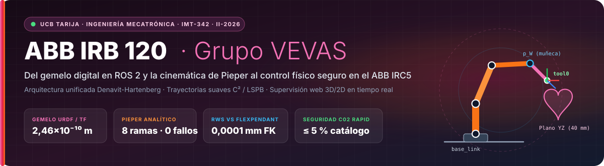

 

  <a href="../README.md"><kbd>← Portada principal</kbd></a>&nbsp;
  <a href="03_FICHA_EJECUTIVA_DEFENSA.md"><kbd>★ Ficha Tribunal</kbd></a>&nbsp;
  <a href="01_CRONOLOGIA.md"><kbd>Cronología y bitácoras</kbd></a>&nbsp;
  <a href="04_LISTA_DE_ENTREGA.md"><kbd>Lista de entrega</kbd></a>&nbsp;
  <a href="../06_videos/README.md"><kbd>06 · Videos</kbd></a>&nbsp;
  <a href="07_CATALOGO_DE_ARCHIVOS.md"><kbd>Catálogo completo</kbd></a>

# 02 · Índice General de VEVAS

| N.º | Área del repositorio | Qué contiene |
| :---: | --- | --- |
| **01** | [Gemelo digital (`02_hito1_gemelo_digital/`)](../02_hito1_gemelo_digital/README.md) | Informe PDF, visor 3D vs RViz, validación TF (`501/1000`) y bitácora H1 |
| **02** | [Cinemática y dinámica (`03_hito2_cinematica_dinamica/`)](../03_hito2_cinematica_dinamica/README.md) | Pose seguida de principio a fin, notebook, animación LSPB, torque 1R y bitácora H2 |
| **03** | [Control del robot (`04_hito3_4_control_real/`)](../04_hito3_4_control_real/README.md) | Informe IEEE, defensa, sesión CSV + animación TCP, bitácora W12 y VEVAS Studio |
| **04** | [Ficha ejecutiva del tribunal](03_FICHA_EJECUTIVA_DEFENSA.md) | Matriz rúbrica → cifra → archivo y respuestas clave para la defensa oral |
| **05** | [Entrega y verificación CI](04_LISTA_DE_ENTREGA.md) | Entregables principales y estado de GitHub Actions (`ci.yml` + `pages.yml`) |
| **06** | [Mapa del repositorio](05_MAPA_DEL_REPOSITORIO.md) | Ubicación de documentación, modelos URDF, código y evidencias |
| **07** | [Paquete ROS 2 (`05_ros2_irb120_description/`)](../05_ros2_irb120_description/README.md) | Modelos URDF manual/generado, RViz, launch y 16 scripts numéricos |
| **08** | [Galería de videos (`06_videos/`)](../06_videos/README.md) | Organización audiovisual por hito, animaciones GIF, guiones y metadatos JSON |
