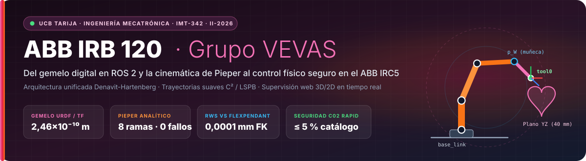

<div align="center">



<br>

<p>
  <a href="../README.md"><kbd>← Portada principal</kbd></a>&nbsp;
  <a href="02_INDICE.md"><kbd>Índice general</kbd></a>&nbsp;
  <a href="04_LISTA_DE_ENTREGA.md"><kbd>Lista de entrega</kbd></a>&nbsp;
  <a href="../04_hito3_4_control_real/01_docs/02_presentacion/02_Defensa_Grupo_VEVAS.pdf"><kbd>Diapositivas PDF</kbd></a>&nbsp;
  <a href="../04_hito3_4_control_real/01_docs/02_presentacion/01_PRESENTACION.md"><kbd>20 Preguntas Q&A</kbd></a>
</p>

</div>


# 03 · Ficha Ejecutiva de Defensa (Mapa Rúbrica → Evidencia)

Documento de consulta rápida pensado para el **tribunal evaluador** y para los cuatro integrantes del **Grupo VEVAS** durante la defensa oral. Relaciona cada exigencia técnica de la materia **IMT-342 Robótica** con la cifra verificada y el archivo exacto donde se demuestra.

---

## 1. Matriz de cumplimiento por hito

| Hito | Exigencia central de la guía oficial | Métrica verificada en el repositorio | Evidencia primaria en 1 clic |
| :---: | --- | --- | --- |
| **Hito 1** | Construcción programática del URDF desde Denavit-Hartenberg sin ajuste visual | Diferencia `0.000e+00` entre URDF manual y generado en las 7 uniones (`IDENTICOS`) | [`compare_urdf.py`](../05_ros2_irb120_description/04_scripts/compare_urdf.py) · [Informe H1]( ../02_hito1_gemelo_digital/01_docs/01_informe/01_Informe_Hito1_VEVAS.pdf) |
| **Hito 1** | Contraste del árbol TF de ROS 2 contra cinemática directa analítica (`< 10⁻⁶ m`) | Error máx. **`2,459 × 10⁻¹⁰ m`** (`4 100×` bajo el umbral) en `501` muestras sincronizadas | [`01_validacion_hito1.txt`](../02_hito1_gemelo_digital/01_docs/04_resultados/01_validacion_hito1.txt) · [Lámina 10](06_figuras/10_comparacion_visor_rviz.png) |
| **Hito 2** | Cinemática inversa analítica completa de 6 GDL por desacoplamiento de Pieper | `8,00` ramas/pose en `2 000` ensayos (`4,98 × 10⁻¹⁶ m`); **`0` rechazos en `1 800` fronteras** | [`resultados.json`](../03_hito2_cinematica_dinamica/01_docs/04_resultados/resultados.json) · [Lámina 11](06_figuras/11_hito2_pose_y_ramas.png) |
| **Hito 2** | Demostración de singularidad ($q_5 = 0$) y leyes de divergencia | $\operatorname{rango}(J) = 5$, $\|\dot{q}\| \sim q_5^{-1}$, $\|\tau\| \sim q_5^{-2}$, residuo `0,442357` | [`01_Hito2_VEVAS.ipynb`](../03_hito2_cinematica_dinamica/02_notebooks/01_Hito2_VEVAS.ipynb) · [`fig_divergencia.pdf`](../03_hito2_cinematica_dinamica/01_docs/04_resultados/01_figuras/fig_divergencia.pdf) |
| **Hito 2** | Planificación LSPB sincronizada y torque del modelo reducido 1R | Llegada simultánea en **`T = 0,7746 s`**; torque en $t=2{,}5\text{ s}$: **`4,4298 N·m`** (ref. `4,429`) | [Lámina 12](06_figuras/12_hito2_trayectoria_pose.png) · [Recuadro 1R](06_figuras/recuadro_torque_1r.svg) |
| **Hito 3/4** | Verificación geométrica frente al controlador real ABB IRC5 (Gate 1) | Coincidencia con FlexPendant: **`0,0001 mm`** en XYZ y **`0,0000°`** angular (`Base`/`wobj0`/`tool0`) | [`06_bitacora.md` (`S1-001`)](../04_hito3_4_control_real/01_docs/05_bitacora/06_bitacora.md) |
| **Hito 3/4** | Control seguro con velocidad acotada en el controlador (Compuerta C02) | `MoveAbsJ \T:=t` al `5 %` ABB: picos medidos **`5,2–5,4`**, **`6,7–6,9`** y **`8,8–8,9 °/s`** | [`VEVAS_RWS.mod`](../04_hito3_4_control_real/02_vevas_studio/05_rapid/VEVAS_RWS.mod) · [Figura C02](06_figuras/05_velocidades_c02.png) |
| **Hito 3/4** | Trazado continuo de figuras, telemetría CSV y pruebas de software | `435` muestras TCP (`50 Hz`), cierre `0,038 mm` + **`329` tests Python y `20` JS** en CI | [Lámina 13](06_figuras/13_evidencia_sesion_tcp.png) · [`CSV sesión`](../04_hito3_4_control_real/01_docs/04_resultados/01_sesion_evidencia/muestras_corazon_yz_40mm.csv) |

---

## 2. Las cinco respuestas clave ante preguntas frecuentes del tribunal

1. **¿Por qué en el Hito 1 se informan 501 muestras válidas de 1.000 intentos?**  
   Porque [`validate_tf.py`](../05_ros2_irb120_description/04_scripts/validate_tf.py) sella cada `JointState` con su marca de tiempo en nanosegundos y descarta cualquier lectura de `/tf` anterior (`timeout = 2,0 s`). Preferimos reportar con transparencia las 499 consultas que agotaron el tiempo del middleware antes que mezclar una `q` nueva con una pose vieja.
2. **¿Cómo garantizan que el URDF no fue acomodado visualmente en RViz?**  
   Porque [`irb120.urdf`](../05_ros2_irb120_description/01_urdf/irb120.urdf) se genera por código desde `DH_TABLE` usando $\text{Origin}_i = B_{i-1}R_z(\text{off}_i)$ y coincide con `0.000e+00` de diferencia contra [`irb120_manual.urdf`](../05_ros2_irb120_description/01_urdf/irb120_manual.urdf).
3. **¿Qué diferencia hay entre singularidad y torque alto?**  
   La singularidad es puramente **cinemática** ($\operatorname{rango}(J) < 6$, existiría aunque el brazo no tuviera masa). El torque es **dinámico**. Contraejemplo directo en el Hito 2: el modelo 1R jamás es singular y aun así exige `4,89 N·m` en velocidad constante ($\ddot{q}=0$) por gravedad.
4. **¿Qué impide que un error en la interfaz web mueva rápido al robot real?**  
   El límite físico vive **adentro del controlador ABB IRC5** en [`VEVAS_RWS.mod`](../04_hito3_4_control_real/02_vevas_studio/05_rapid/VEVAS_RWS.mod): cada `MoveAbsJ` lleva `\T := max(t_piso, 2.5 * |Δq_i| / vLim_i)`, obligando a que ningún eje supere el `5 %` de catálogo aunque la PC pida más.
5. **¿Por qué `GO_VEVAS.json` y `evidencia_c02.json` no están subidos a GitHub?**  
   Por diseño de seguridad: ambos son permisos presenciales atados a la fecha, estado físico de la celda y huella del módulo cargado en el IRC5 ese día. Subirlos al repositorio permitiría clonar una autorización vencida.

---

## 3. Comandos listos para demostración en vivo (menos de 30 segundos)

```bash
# 1. Resolver en vivo cualquier pose que dicte el tribunal (Hito 2)
python 05_ros2_irb120_description/04_scripts/resolver_en_vivo.py

# 2. Abrir VEVAS Studio en simulación interactiva 3D/2D (Hitos 3 y 4)
python 04_hito3_4_control_real/02_vevas_studio/vevas.py --modo sim --puerto 9012 --abrir
```
