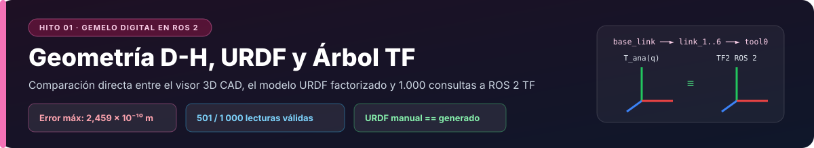

 

  <a href="../../README.md"><kbd>← Volver al Hito 1</kbd></a>&nbsp;
  <a href="../../../01_docs/01_CRONOLOGIA.md"><kbd>Cronología general</kbd></a>&nbsp;
  <a href="../01_informe/01_Informe_Hito1_VEVAS.pdf"><kbd>Informe PDF</kbd></a>&nbsp;
  <a href="../04_resultados/01_validacion_hito1.txt"><kbd>Salida TF oficial</kbd></a>

## Resumen ejecutivo de entradas

Cada entrada documenta una dificultad real surgida al construir y validar el gemelo digital del **ABB IRB 120**, siguiendo el ciclo trazable **Problema → Cambio → Resultado → Archivo de evidencia**.

| ID | Problema detectado | Solución adoptada | Impacto medible |
| :---: | --- | --- | --- |
| **[`H1-01`](#h1-01--reconciliación-entre-el-cero-mecánico-de-abb-y-el-cero-denavit-hartenberg)** | Desfase de $90^\circ$ entre el cero vertical de ABB y el cero horizontal D-H | Absorber $\theta_2 = q_2 - \pi/2$ en el `Origin` constante de `joint_2` | Cierre exacto en $q=0$ (`x = 0,374 m`, `z = 0,630 m`) sin tocar `/joint_states` |
| **[`H1-02`](#h1-02--comprobación-algebraica-de-los-marcos-del-urdf-sin-ajuste-visual-en-rviz)** | Riesgo de ejes invertidos u orígenes movidos «a ojo» en RViz | Mantener URDF manual + URDF generado y auditarlos con `compare_urdf.py` | Diferencia `0.000e+00` en las 7 uniones (`IDENTICOS`); `J4/J6` desplazan `0,0000 m` |
| **[`H1-03`](#h1-03--sincronización-temporal-de-joint_states-y-exclusión-de-las-499-lecturas-por-timeout)** | Falsos errores de decímetros por leer poses TF anteriores o nodos competidores | Sellar `JointState` en ns y exigir `stamp(TF) >= t_pub_ns` (`timeout = 2,0 s`) | **`501` muestras válidas** con error máx. **`2,459 × 10⁻¹⁰ m`**; `499` timeouts aislados |
| **[`H1-04`](#h1-04--diagnóstico-de-la-brecha-entre-precisión-interna-10⁻¹⁶-m-y-transporte-tf-10⁻¹⁰-m)** | Seis órdenes de magnitud entre Python puro (`10⁻¹⁶ m`) y ROS TF (`10⁻¹⁰ m`) | Separar verificación algebraica `float64` de la serialización de cuaterniones TF | Queda demostrado que el modelo es exacto hasta `float64` (`4 100×` bajo el umbral) |

---

## H1-01 · Reconciliación entre el cero mecánico de ABB y el cero Denavit-Hartenberg

> [!NOTE]
> **Contexto:** Si el cero del simulador difiere del cero del controlador real, cualquier vector articular intercambiado con el robot físico produce una postura errónea de $90^\circ$ en el hombro.

- **Problema:** En la postura de calibración de fábrica de ABB ($q = [0,0,0,0,0,0]$), el brazo inferior (`link_2`) queda vertical hacia arriba, mientras que la convención Denavit-Hartenberg estándar exige paralelismo entre $x_1$ y $x_2$ (brazo horizontal). Sumar $-\pi/2$ manualmente en cada publicación de `/joint_states` corrompía la lectura directa de ángulos mecánicos.
- **Cambio:** Se factorizó $A_i = R_z(\text{off}_i)\,R_z(q_i)\,B_i$ con $B_i = T_z(d_i)\,T_x(a_i)\,R_x(\alpha_i)$ y se codificó $\text{off}_2 = -\pi/2$ una única vez en el origen fijo de `joint_2` ($\text{Origin}_i = B_{i-1}\,R_z(\text{off}_i)$), dejando `/joint_states` en convención mecánica pura de ABB.
- **Resultado:** En $q = 0$, la brida `tool0` cae exactamente en $x = d_4 + d_6 = 0{,}374\text{ m}$, $y = 0\text{ m}$ y $z = d_1 + a_2 + a_3 = 0{,}630\text{ m}$, con residuo algebraico $2{,}082 \times 10^{-18}\text{ m}$.
- **Archivo de evidencia:** [`fk_irb120.py`](../../../05_ros2_irb120_description/04_scripts/fk_irb120.py) · [`generate_urdf.py`](../../../05_ros2_irb120_description/04_scripts/generate_urdf.py)

---

## H1-02 · Comprobación algebraica de los marcos del URDF sin ajuste visual en RViz

- **Problema:** Ajustar traslaciones `xyz` o rotaciones `rpy` visualmente en RViz puede producir eslabones aparentemente conectados pero con marcos internos rotados, invalidando el Jacobiano y la cinemática inversa posteriores.
- **Cambio:** Se escribieron de forma independiente [`irb120_manual.urdf`](../../../05_ros2_irb120_description/01_urdf/irb120_manual.urdf) (deducido paso a paso en papel) e [`irb120.urdf`](../../../05_ros2_irb120_description/01_urdf/irb120.urdf) (generado automáticamente desde `DH_TABLE`), añadiendo el auditor [`compare_urdf.py`](../../../05_ros2_irb120_description/04_scripts/compare_urdf.py) y un ensayo de perturbación individual de $+0{,}5\text{ rad}$ por eje en [`figs.py`](../01_informe/01_fuente/figs.py).
- **Resultado:** `compare_urdf.py` certifica diferencia `0.000e+00` en traslación y orientación sobre las 7 juntas (`RESULTADO: IDENTICOS`). La prueba por eje confirma además que girar solo `J4` o `J6` en $q=0$ desplaza `tool0` exactamente `0,0000 m` por colinealidad axial.
- **Archivo de evidencia:** [`compare_urdf.py`](../../../05_ros2_irb120_description/04_scripts/compare_urdf.py) · [`10_comparacion_visor_rviz.png`](../../../01_docs/06_figuras/10_comparacion_visor_rviz.png) · [`juntas.pdf`](../01_informe/01_fuente/01_img/juntas.pdf)

---

## H1-03 · Sincronización temporal de `/joint_states` y exclusión de las 499 lecturas por timeout

- **Problema:** Al publicar 1.000 vectores articulares aleatorios hacia `robot_state_publisher` y consultar `lookup_transform("base_link", "tool0")` tras una espera fija ocurrían dos contaminaciones: **(1)** si `joint_state_publisher` seguía activo en segundo plano, inyectaba $q=0$ compitiendo por el tópico; **(2)** el buffer TF devolvía con frecuencia la transformada de la muestra previa aún en tránsito, simulando errores falsos del orden del alcance del brazo (`~0,5 m`).
- **Cambio:** En [`validate_tf.py`](../../../05_ros2_irb120_description/04_scripts/validate_tf.py) se implementó `revisar_competencia()` (`count_publishers("/joint_states") > 1`) y `leer_tf_sincronizado(t_pub_ns, timeout=2.0)`, que exige marca temporal `stamp_a_ns(tf) >= t_pub_ns`. Si el árbol TF no alcanza esa marca en `2,0 s`, el intento se registra como *timeout* y no entra al cálculo de error.
- **Resultado:** Sobre **1.000 configuraciones publicadas**, **501 lecturas sincronizadas** arrojaron un error posicional máximo de **`2,459 × 10⁻¹⁰ m`** (`4 100×` inferior al límite de `10⁻⁶ m`) y error angular máximo de `1,092 × 10⁻⁹`. Las **499 lecturas restantes** quedaron transparentemente reportadas como timeouts de transporte.
- **Archivo de evidencia:** [`validate_tf.py`](../../../05_ros2_irb120_description/04_scripts/validate_tf.py) · [`01_validacion_hito1.txt`](../04_resultados/01_validacion_hito1.txt) · [`06_cobertura_tf.png`](../../../01_docs/06_figuras/06_cobertura_tf.png)

---

## H1-04 · Diagnóstico de la brecha entre precisión interna (`10⁻¹⁶ m`) y transporte TF (`10⁻¹⁰ m`)

- **Problema:** La prueba interna `verify_chain()` sin salir de Python daba `3,68 × 10⁻¹⁶ m`, pero al pasar por ROS 2 TF el piso de error subía a `~1,5 × 10⁻¹⁰ m`. Era necesario determinar si existía algún redondeo defectuoso en las constantes `rpy` escritas en el XML del URDF.
- **Cambio:** Se comparó la cadena homogénea reconstruida directamente del XML en doble precisión contra las lecturas devueltas por el transporte de cuaterniones de `tf2_ros`.
- **Resultado:** Quedó demostrado que el URDF conserva exactitud de doble precisión y que el orden `10⁻¹⁰ m` proviene exclusivamente de la representación y normalización de rotaciones en el middleware de ROS 2, manteniendo tres órdenes y medio de margen sobre el criterio de aprobación.
- **Archivo de evidencia:** [`informe.tex`](../01_informe/01_fuente/informe.tex) · [`errores.pdf`](../01_informe/01_fuente/01_img/errores.pdf)
