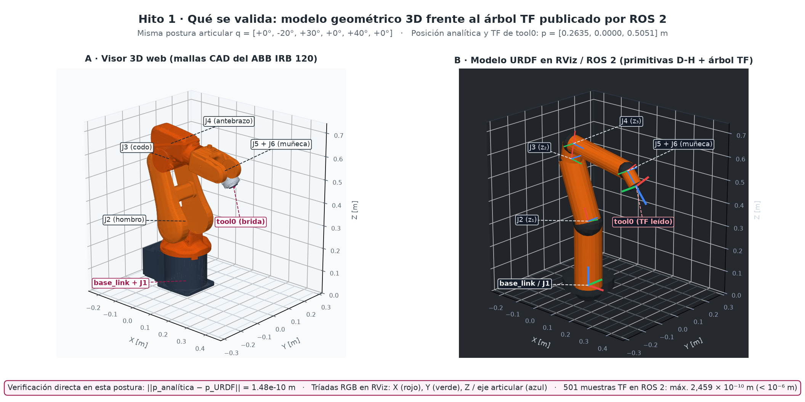

# Visor Web 3D Interactivo · ABB IRB 120 (`02_visor_web/`)

[Volver al Hito 1](../README.md) · [Cómo ejecutar](../01_COMO_EJECUTAR.md) · [Portada principal](../../README.md)

Aplicación web autónoma desarrollada con **Three.js** (módulos locales en `02_vendor/`, sin requerir internet) para explorar la anatomía mecánica, los rangos articulares y la celda propuesta del **ABB IRB 120-3/0.6**.



## Funcionalidades incluidas

- **Explorador estructural (`00` Base + `J1`–`J6` + pinza y pieza):** selección directa haciendo clic sobre la malla 3D o desde el panel lateral, con resaltado emisivo y modo **Aislar pieza**.
- **Modo Seis Ejes:** ficha individual de cada articulación con rango en grados (`±165°`, `±110°`, `−110°/+70°`, `±160°`, `±120°`, `±400°`) y velocidad máxima del catálogo oficial ABB (`Rev. J`).
- **Despiece interactivo (`0–100 %`):** control deslizante que separa radialmente los subconjuntos para distinguir cuerpo giratorio, brazo, codo, antebrazo, muñeca y brida.
- **Pestaña Celda de trabajo:** tabla completa de componentes (BOM) para integración con cámara cenital, pinza neumática y controlador IRC5.

## Cómo abrirlo localmente

```bash
# Desde la raíz del repositorio
python -m http.server 8000 --directory 02_hito1_gemelo_digital/02_visor_web
```

Luego abre **<http://localhost:8000/>** en cualquier navegador moderno con WebGL habilitado.
