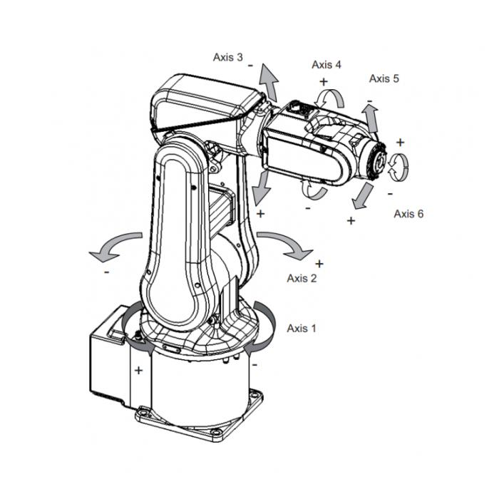

# Hito 1 · Gemelo digital del IRB 120

[Cómo ejecutar](01_COMO_EJECUTAR.md) · [Índice del hito](01_docs/01_INDICE.md) · [Portada del proyecto](../README.md)

El modelo representa seis articulaciones en serie. Para comprobar la geometría se calcula la pose de la herramienta por dos caminos: la composición analítica de las transformaciones y la lectura del árbol TF publicado por ROS 2. Ambas posiciones deben referirse a la misma base y al mismo extremo.

## 1. Explorar el modelo

| Material | Para qué sirve |
| --- | --- |
| [Visor web](02_visor_web/README.md) | Explorar las articulaciones en el navegador. |
| [Modelos URDF](../05_ros2_irb120_description/01_urdf) | Comparar las descripciones manual y generada. |
| [Informe completo](01_docs/01_informe/01_Informe_Hito1_VEVAS.pdf) | Consultar las convenciones y la derivación. |

## 2. De una junta a la herramienta

Cada junta aporta una rotación y un desplazamiento. El orden de multiplicación importa porque la transformación de cada eslabón se expresa en el marco anterior.

$$T_0^6(q)=T_0^1(q_1)\,T_1^2(q_2)\cdots T_5^6(q_6)$$

## 3. Qué se verificó

De las 1 000 configuraciones solicitadas se obtuvieron 501 lecturas válidas. Entre esas lecturas el error máximo de posición fue **2,459 × 10⁻¹⁰ m**, frente al umbral de **10⁻⁶ m**. Las otras 499 configuraciones agotaron el tiempo de espera y quedaron fuera del cálculo.

[Consultar el registro original](01_docs/04_resultados/01_validacion_hito1.txt)

## 4. Material para la exposición

[Presentación PDF](01_docs/02_presentacion/01_Hito1_Gemelo_Digital_IRB120.pdf) · [Hoja de trabajo A–J](01_docs/04_resultados/02_worksheet_A_a_J.pdf)

## 5. Cómo leer los marcos del robot

La base es el punto de partida de la cadena. Al modificar una junta, cambian la orientación o la posición de los eslabones que vienen después. Esto se puede observar manteniendo fijas cinco juntas en el visor y variando la sexta. Un giro de la muñeca y un giro del primer eje producen efectos distintos sobre la herramienta porque se realizan alrededor de ejes distintos.

| Elemento | Qué se examina | Dónde se ve |
| --- | --- | --- |
| Eslabón | El cuerpo rígido y su geometría | Visor 3D |
| Articulación | Eje de giro y conexión entre eslabones | URDF |
| Marco | Origen y orientación que acompañan al eslabón | Figura y visualización TF |
| Herramienta | Pose acumulada respecto a la base | Resultado de cinemática directa |

## 6. Cómo explicar la comprobación

1. Fija un vector de seis ángulos. Usar el mismo orden articular permite comparar ambas representaciones.
2. Calcula dónde termina la cadena mediante las transformaciones del informe. La última columna de la matriz homogénea contiene la posición.
3. Localiza el mismo extremo en el árbol de transformaciones del modelo. Comprueba que ambos resultados estén expresados respecto a la misma base.
4. Compara el error con el umbral e indica cuántas lecturas entraron al cálculo. El registro del grupo incluye la cobertura y el error para que puedan interpretarse juntos.

El Hito 2 utiliza esta cinemática directa para comprobar cada solución de la cinemática inversa. Volver a calcular la pose a partir de los ángulos permite detectar un orden de ejes incorrecto incluso cuando la postura del visor parece plausible.
