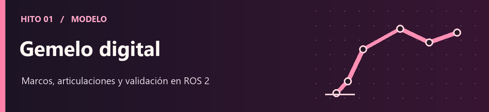
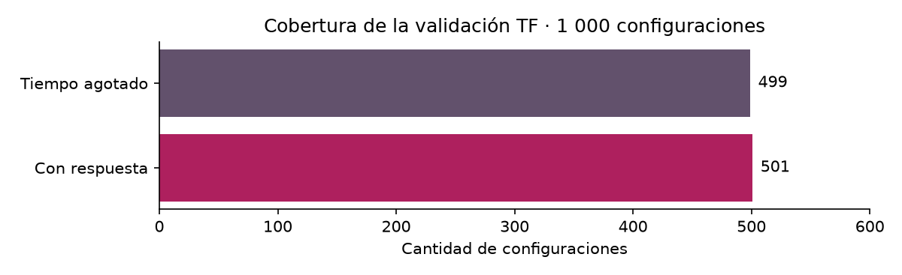

# Hito 1 · Gemelo digital del ABB IRB 120

[Cómo ejecutar](01_COMO_EJECUTAR.md) · [Índice del hito](01_docs/01_INDICE.md) · [Bitácora técnica H1](01_docs/05_bitacora/README.md) · [Videos H1](../06_videos/01_hito1_gemelo_digital/README.md) · [Portada del proyecto](../README.md)

El gemelo digital representa las seis articulaciones rotativas en serie del **ABB IRB 120-3/0.6**. Para validar su geometría sin recurrir a ajustes visuales manuales, se calcula la pose de la brida (`tool0`) por dos vías independientes: la composición analítica de matrices Denavit-Hartenberg en Python (`float64`) y la lectura en vivo del árbol de transformaciones **TF** publicado por `robot_state_publisher` en **ROS 2**.

---

## 1. Qué se está validando: los dos modelos en la misma postura

En la figura superior ambos modelos adoptan exactamente el mismo vector articular $q = [0^\circ, -20^\circ, +30^\circ, 0^\circ, +40^\circ, 0^\circ]$:

- **Izquierda — Visor 3D web ([`02_visor_web/`](02_visor_web/README.md)):** ensambla las mallas CAD del fabricante para inspeccionar la anatomía física de `base_link`, los seis ejes (`J1`–`J6`) y la brida `tool0`.
- **Derecha — Modelo URDF en RViz ([`irb120.urdf`](../05_ros2_irb120_description/01_urdf/irb120.urdf)):** construye el árbol cinemático `base_link → link_1 → … → link_6 → tool0` exclusivamente desde la tabla D-H factorizada ($\text{Origin}_i = B_{i-1}\,R_z(\text{off}_i)$), mostrando las tríadas RGB de cada marco TF.

### Cobertura y resultado sobre 1.000 intentos en ROS 2

| Indicador de validación | Valor registrado | Referencia / criterio |
| --- | --- | --- |
| **Configuraciones publicadas** | `1 000` | Muestreo uniforme dentro de límites ABB (`semilla = 7`) |
| **Lecturas válidas sincronizadas** | **`501`** | Marca temporal `stamp(TF) >= stamp(JointState)` |
| **Lecturas excluidas por timeout** | `499` | Descartadas tras `2,0 s` para no contaminar con poses previas |
| **Error posicional máximo** | **`2,459 × 10⁻¹⁰ m`** | Umbral del hito: `1,0 × 10⁻⁶ m` (**`4 100×` por debajo**) |
| **Error posicional medio** | `1,498 × 10⁻¹⁰ m` | Error interno `float64` sin ROS: `3,68 × 10⁻¹⁶ m` |
| **Error angular máximo** | `1,092 × 10⁻⁹` | Norma de Frobenius $\|R_{\text{ana}}^T R_{\text{tf}} - I\|_F$ |

> [!NOTE]
> **Por qué se separan las 501 lecturas válidas de los 499 timeouts:** publicar configuraciones en ráfaga puede hacer que `lookup_transform` devuelva aún la postura anterior. El validador [`validate_tf.py`](../05_ros2_irb120_description/04_scripts/validate_tf.py) exige coincidencia de marca temporal y excluye cualquier consulta que agote su ventana. Ver el detalle completo en la [Bitácora del Hito 1](01_docs/05_bitacora/README.md) y en el [registro literal de salida](01_docs/04_resultados/01_validacion_hito1.txt).

---

## 2. De la base a `tool0`: cadena cinemática y verificación de marcos

Cada articulación aporta una rotación alrededor de su eje local $z_{i-1}$ y un desplazamiento rígido hacia el eslabón siguiente:

$$T_0^6(q)=T_0^1(q_1)\,T_1^2(q_2)\,T_2^3(q_3)\,T_3^4(q_4)\,T_4^5(q_5)\,T_5^6(q_6)$$

En el cero mecánico de ABB ($q = 0$), la inspección directa de cotas predice sin multiplicar matrices:
- **Alcance horizontal:** $x = d_4 + d_6 = 0{,}302 + 0{,}072 = \mathbf{0{,}374\text{ m}}$
- **Altura de la brida:** $z = d_1 + a_2 + a_3 = 0{,}290 + 0{,}270 + 0{,}070 = \mathbf{0{,}630\text{ m}}$
- **Centro de muñeca esférica:** $O_4 = O_5 = [0{,}302,\; 0{,}000,\; 0{,}630]\text{ m}$ (punto donde concurren `J4`, `J5` y `J6`).

---

## 3. Entregables y herramientas del Hito 1

| Recurso | Propósito | Enlace |
| --- | --- | --- |
| **Informe completo (PDF)** | Derivación D-H → URDF, gráficas de convergencia y análisis de precisión `float64` vs `float32`. | [Abrir informe](01_docs/01_informe/01_Informe_Hito1_VEVAS.pdf) |
| **Presentación y hoja A–J** | Diapositivas de exposición y hoja de trabajo resuelta. | [Presentación PDF](01_docs/02_presentacion/01_Hito1_Gemelo_Digital_IRB120.pdf) · [Worksheet A–J](01_docs/04_resultados/02_worksheet_A_a_J.pdf) |
| **Visor web 3D** | Explorador interactivo Three.js con despiece, ficha de ejes y celda propuesta. | [Abrir guía del visor](02_visor_web/README.md) |
| **Doble URDF + comparador** | `irb120_manual.urdf` (deducido a mano) frente a `irb120.urdf` (generado por script). | [Ver URDFs](../05_ros2_irb120_description/01_urdf/) · [`compare_urdf.py`](../05_ros2_irb120_description/04_scripts/compare_urdf.py) |
| **Bitácora técnica Hito 1** | Decisiones de diseño en formato `Problema → Cambio → Resultado → Evidencia`. | [Leer bitácora](01_docs/05_bitacora/README.md) |
