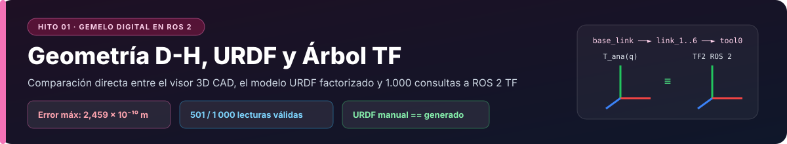
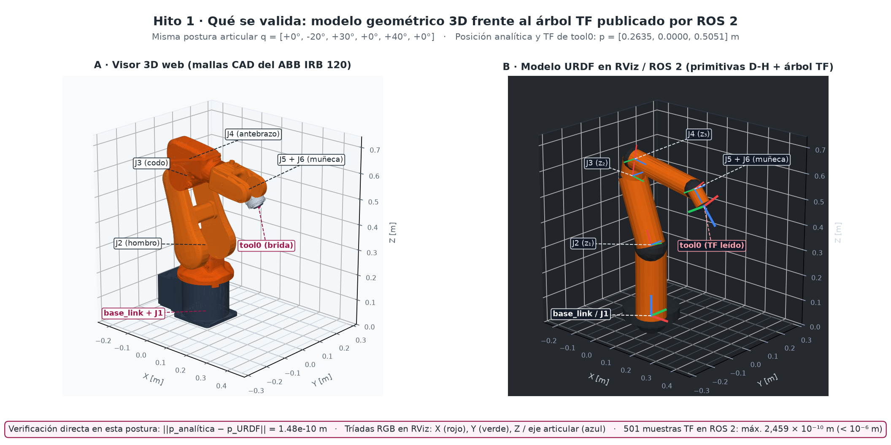
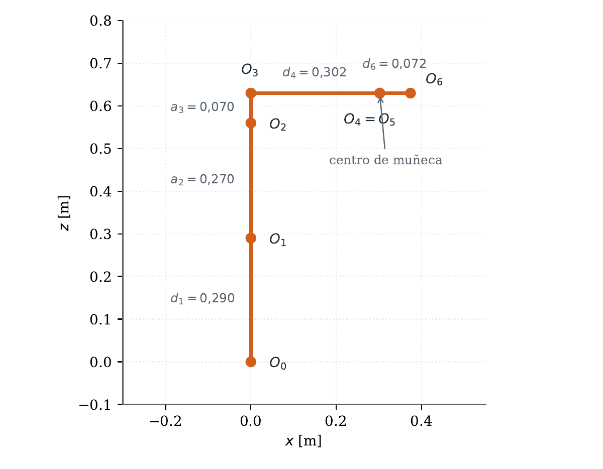

 

  <a href="01_COMO_EJECUTAR.md"><kbd>Cómo ejecutar</kbd></a>&nbsp;
  <a href="01_docs/05_bitacora/README.md"><kbd>Bitácora técnica (H1-01..04)</kbd></a>&nbsp;
  <a href="01_docs/01_informe/01_Informe_Hito1_VEVAS.pdf"><kbd>Informe PDF</kbd></a>&nbsp;
  <a href="02_visor_web/README.md"><kbd>Visor Web 3D</kbd></a>&nbsp;
  <a href="../06_videos/01_hito1_gemelo_digital/README.md"><kbd>Videos H1</kbd></a>&nbsp;
  <a href="../README.md"><kbd>← Portada principal</kbd></a>

## 1. Qué se está validando: los dos modelos en la misma postura

Antes de leer una cifra de error, conviene observar **qué dos representaciones del ABB IRB 120 se comparan**. Ambas reciben exactamente los mismos seis ángulos articulares y deben ubicar la brida `tool0` en la misma posición y orientación respecto de `base_link`:

| Aspecto comparado | Panel A · Visor 3D Web ([`02_visor_web/`](02_visor_web/README.md)) | Panel B · Modelo URDF en RViz ([`irb120.urdf`](../05_ros2_irb120_description/01_urdf/irb120.urdf)) |
| --- | --- | --- |
| **Geometría utilizada** | Mallas superficiales CAD (`.gltf` / `.stl`) de los subconjuntos mecánicos ABB | Primitivas cilíndricas y esféricas dimensionadas directamente desde `DH_TABLE` |
| **Qué permite inspeccionar** | Anatomía física de carcasa, base, hombro, codo, muñeca y brida | Ejes exactos de rotación $z_{i-1}$, orígenes `xyz/rpy` y árbol TF `base_link → tool0` |
| **Postura mostrada arriba** | $q = [0^\circ, -20^\circ, +30^\circ, 0^\circ, +40^\circ, 0^\circ]$ | $q = [0^\circ, -20^\circ, +30^\circ, 0^\circ, +40^\circ, 0^\circ]$ |
| **Posición resultante de `tool0`** | $p = [0{,}2635,\; 0{,}0000,\; 0{,}5051]\text{ m}$ | $p_{\text{TF}} = [0{,}2635,\; 0{,}0000,\; 0{,}5051]\text{ m}$ ($\Delta = 1{,}48 \times 10^{-10}\text{ m}$) |

---

## 2. Resultado de la validación sobre 1.000 intentos en ROS 2

Una vez identificados `base_link`, los seis ejes y `tool0`, el nodo [`validate_tf.py`](../05_ros2_irb120_description/04_scripts/validate_tf.py) publica **1.000 configuraciones articulares aleatorias** dentro de los límites del catálogo ABB y contrasta cada transformada devuelta por `/tf` contra `forward_kinematics(q)`:

| Métrica del registro oficial ([`01_validacion_hito1.txt`](01_docs/04_resultados/01_validacion_hito1.txt)) | Valor medido | Umbral exigido / Interpretación |
| --- | :---: | --- |
| **Intentos publicados en `/joint_states`** | `1 000` | Semilla reproducible `rng = 7` sobre todo el espacio articular |
| **Muestras válidas con marca temporal sincronizada** | **`501`** | Cumplen `stamp(TF) >= stamp(JointState)` dentro de `2,0 s` |
| **Intentos descartados por timeout de sincronización** | `499` | Excluidos para no comparar una `q` nueva contra una pose TF vieja |
| **Error posicional máximo $\|p_{\text{TF}} - p_{\text{ana}}\|$** | **`2,459 × 10⁻¹⁰ m`** | **`4 100×` por debajo** del umbral del hito (`1,0 × 10⁻⁶ m`) |
| **Error posicional medio** | `1,498 × 10⁻¹⁰ m` | Estabilizado desde las primeras 300 muestras (`2,457 × 10⁻¹⁰ m`) |
| **Error angular máximo $\|R_{\text{ana}}^T R_{\text{TF}} - I\|_F$** | `1,092 × 10⁻⁹` | Coincidencia completa de orientación tridimensional en $SO(3)$ |
| **Verificación interna en Python (`float64`, sin ROS)** | `3,68 × 10⁻¹⁶ m` | Precisión de máquina pura; el `10⁻¹⁰ m` mide el transporte de cuaterniones en TF |

> [!IMPORTANT]
> **Decisión clave de validación (`H1-03`):** Si se lee TF con un `sleep` fijo tras publicar en `/joint_states`, `robot_state_publisher` puede no haber procesado aún el mensaje y devuelve la postura anterior, fingiendo errores de decenas de centímetros. Exigir `stamp_a_ns(tf) >= t_pub_ns` separa limpiamente la exactitud geométrica del modelo (`2,459 × 10⁻¹⁰ m`) de la latencia del middleware (`499` timeouts).

---

## 3. Cómo se tradujo la tabla Denavit-Hartenberg a URDF sin ajustes a ojo

En Denavit-Hartenberg la rotación variable $q_i$ ocurre **al principio** del paso ($A_i = R_z(q_i + \text{off}_i)\,T_z(d_i)\,T_x(a_i)\,R_x(\alpha_i)$), mientras que el estándar URDF exige una transformación constante `Origin` **antes** del giro articular ($T_{\text{padre}\to\text{hijo}} = \text{Origin}_i \cdot R_z(q_i)$). Como las rotaciones alrededor del mismo eje $z$ conmutan, se factoriza:

$$A_i(q_i) = R_z(\text{off}_i)\,R_z(q_i)\,B_i, \qquad B_i = T_z(d_i)\,T_x(a_i)\,R_x(\alpha_i)$$

Reagrupando la cadena completa $T_0^6 = A_1 A_2 A_3 A_4 A_5 A_6$, cada junta URDF recibe de manera exacta:

$$\text{Origin}_i = B_{i-1}\,R_z(\text{off}_i) \quad (B_0 = I), \qquad \text{Origin}_{\text{tool0}} = B_6 = T_z(0{,}072)$$

<table>
  <tr>
    <td width="48%" valign="middle">
      
    </td>
    <td width="52%" valign="top">
      <h4>Comprobación en el cero mecánico ABB (<code>q = 0</code>)</h4>
      <ul>
        <li><b>El offset θ₂ = q₂ − π/2:</b> En el cero de fábrica de ABB el brazo está vertical; en el cero D-H $x_1 \parallel x_2$ exigiría el brazo horizontal. El desfase $-\pi/2$ se absorbe una sola vez en <code>joint_2</code> del URDF, nunca en <code>/joint_states</code>.</li>
        <li><b>Cierre horizontal:</b> $x = d_4 + d_6 = 0{,}302 + 0{,}072 = \mathbf{0{,}374\text{ m}}$.</li>
        <li><b>Cierre vertical:</b> $z = d_1 + a_2 + a_3 = 0{,}290 + 0{,}270 + 0{,}070 = \mathbf{0{,}630\text{ m}}$.</li>
        <li><b>Centro de muñeca:</b> $O_4 = O_5 = [0{,}302, 0, 0{,}630]\text{ m}$, punto concurrente que habilita el método de Pieper en el Hito 2.</li>
        <li><b>Prueba de ejes colineales:</b> Perturbar únicamente <code>J4</code> o <code>J6</code> cambia la orientación de <code>tool0</code> pero produce desplazamiento <b>0,0000 m</b>.</li>
      </ul>
    </td>
  </tr>
</table>

---

## 4. Doble URDF y flujo de verificación automática

~~~mermaid
flowchart LR
 A["Tabla D-H\nfk_irb120.py"] --> B["Generador automático\ngenerate_urdf.py + add_visuals.py"]
 C["Deducción manual\nirb120_manual.urdf"] --> D{"compare_urdf.py"}
 B --> E["irb120.urdf"]
 E --> D
 D -->|"Diferencia 0.000e+00\nen las 7 juntas"| F["robot_state_publisher\n(/tf en ROS 2)"]
 A --> G["validate_tf.py\n(501 muestras válidas)"]
 F --> G
~~~

Se conservan deliberadamente **dos archivos URDF** en [`05_ros2_irb120_description/01_urdf/`](../05_ros2_irb120_description/01_urdf/):
1. [`irb120_manual.urdf`](../05_ros2_irb120_description/01_urdf/irb120_manual.urdf): escrito y comentado junta por junta para documentar el razonamiento geométrico.
2. [`irb120.urdf`](../05_ros2_irb120_description/01_urdf/irb120.urdf): generado por script sin intervención humana. Ejecutar `python 05_ros2_irb120_description/04_scripts/compare_urdf.py` certifica que ambos describen exactamente el mismo manipulador (`RESULTADO: IDENTICOS`).

---

## 5. Mapa completo de materiales del Hito 1

| Documento o módulo | Contenido | Enlace |
| --- | --- | --- |
| **Informe técnico del Hito 1** | Desarrollo matemático completo, figuras vectoriales y análisis de escalas de error. | [Abrir PDF](01_docs/01_informe/01_Informe_Hito1_VEVAS.pdf) · [Fuente LaTeX](01_docs/01_informe/01_fuente/informe.tex) |
| **Presentación y Hoja A–J** | Diapositivas de defensa del Hito 1 y resolución de las actividades A–J de cátedra. | [Presentación PDF](01_docs/02_presentacion/01_Hito1_Gemelo_Digital_IRB120.pdf) · [Worksheet A–J](01_docs/04_resultados/02_worksheet_A_a_J.pdf) |
| **Visor interactivo 3D** | Aplicación Three.js autónoma con vista por ejes, explosión de conjuntos y BOM de celda. | [Guía del visor](02_visor_web/README.md) · [`index.html`](02_visor_web/index.html) |
| **Bitácora técnica Hito 1** | Cuatro decisiones de ingeniería documentadas (`Problema → Cambio → Resultado → Evidencia`). | [Leer bitácora](01_docs/05_bitacora/README.md) |
| **Guía paso a paso de ejecución** | Comandos para abrir el visor en Windows/Linux, compilar con `colcon` y correr `validate_tf.py`. | [Abrir `01_COMO_EJECUTAR.md`](01_COMO_EJECUTAR.md) |
