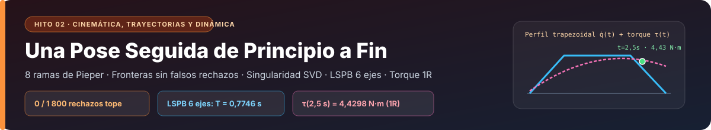

 

  <a href="../../README.md"><kbd>← Volver al Hito 2</kbd></a>&nbsp;
  <a href="../../../01_docs/01_CRONOLOGIA.md"><kbd>Cronología general</kbd></a>&nbsp;
  <a href="../01_informe/02_anexo_tecnico.md"><kbd>Anexo técnico</kbd></a>&nbsp;
  <a href="../04_resultados/resultados.json"><kbd>Registro JSON</kbd></a>

## Resumen ejecutivo de correcciones y decisiones

Tres de los fallos más importantes de este hito **sobrevivieron sin detectarse a 2.000 pruebas aleatorias uniformes** y solo emergieron cuando se diseñaron bancos de prueba dirigidos específicamente a fronteras articulares, muñeca extendida y congruencias de $2\pi$. Cada entrada sigue el esquema **Problema → Cambio → Resultado → Archivo de evidencia**.

| ID | Hallazgo / Problema | Cambio de ingeniería | Antes → Después |
| :---: | --- | --- | :---: |
| **[`H2-01`](#h2-01--eliminación-de-los-193-rechazos-falsos-sobre-los-límites-articulares)** | Ruido `float64` de `atan2` dejaba soluciones exactas a `~10⁻¹⁶ rad` fuera del tope ABB | Tolerancia numérica `TOL_LIMITE = 1e-9 rad` + `recortar_a_limites()` (`clip`) | `193` rechazos → **`0` rechazos** (en `1 800` fronteras) |
| **[`H2-02`](#h2-02--resolución-exacta-en-la-banda-casi-singular-de-muñeca-q5--10⁻⁷510⁻⁵-rad)** | Derivada infinita de `arccos(c5)` en $|c_5| \to 1$ borraba ramas regulares cercanas a $q_5 = 0$ | Medir $|s_5| = \operatorname{hypot}(R_{36}[0,2], R_{36}[1,2])$ y usar `atan2(|s5|, c5)` | Falla en `[10⁻⁶, 3×10⁻⁵]` → **100 % resueltas** |
| **[`H2-03`](#h2-03--expansión-de-vueltas-equivalentes-en-j6-400-para-evitar-giros-de-360)** | `atan2` devolvía $(-\pi, \pi]$ ignorando que `J6` admite $\pm 400^\circ$, provocando vueltas enteras | Expandir congruencias $q_i \pm 2\pi n$ admisibles antes del selector ponderado | Giro `6,2832 rad` → **`8,88 × 10⁻¹⁶ rad`** |
| **[`H2-04`](#h2-04--etiquetado-geométrico-biunívoco-de-las-8-ramas-de-pieper)** | El signo crudo de $q_3$ clasificaba mal el codo por el ángulo estructural $\psi = 1{,}343\text{ rad}$ | Etiquetar codo con $\sin(q_3 + \psi)$ y hombro comparando $q_1$ con el acimut de $p_W$ | Ambigüedad en ramas → **8 etiquetas exactas** |
| **[`H2-05`](#h2-05--sincronización-lspb-multi-junta-y-aislamiento-declarado-del-modelo-dinámico-1r)** | Llegadas desfasadas entre ejes y ausencia de masas/inercias oficiales de 6 GDL en ABB | Reescalado de $V_i$ hacia $T_{\max}$ (`0,7746 s`) y validación 1R separada (`W10-S01`) | $\tau(2{,}5\text{ s}) = \mathbf{4{,}4298\text{ N}\cdot\text{m}}$ (ref. `4,429`) |

---

## H2-01 · Eliminación de los 193 rechazos falsos sobre los límites articulares

> [!IMPORTANT]
> **Lección metodológica:** Un muestreo aleatorio uniforme del interior de una caja de 6 dimensiones tiene probabilidad cero de caer sobre sus caras. Si un error vive sobre un tope articular, hay que ir a buscarlo explícitamente sobre el tope.

- **Problema:** Al evaluar **1.800 poses generadas con al menos una junta exactamente en su límite de catálogo ABB** (`±165°`, `±110°`, `−110°/+70°`, `±160°`, `±120°`, `±400°`), el filtro descartaba **193 poses alcanzables** porque `atan2` entregaba valores como `1.9198621771937629 rad` frente al límite `1.9198621771937625 rad` (exceso de `4 × 10⁻¹⁶ rad`, puro redondeo IEEE 754).
- **Cambio:** En [`pieper.py`](../../../05_ros2_irb120_description/04_scripts/pieper.py) se introdujo `TOL_LIMITE = 1e-9 rad` (`5,7 × 10⁻⁸ grados`) en `dentro_de_limites()` seguido de `recortar_a_limites()`, que aplica `np.clip` únicamente cuando la configuración ya está dentro de esa banda de redondeo, manteniendo rechazo estricto ante cualquier exceso mecánico real.
- **Resultado:** Los rechazos en las **1.800 poses sobre fronteras bajaron de `193` a `0`**, con error máximo de posición FK de `4,98 × 10⁻¹⁶ m`.
- **Archivo de evidencia:** [`pieper.py`](../../../05_ros2_irb120_description/04_scripts/pieper.py) · [`resultados.json`](../04_resultados/resultados.json) · [`02_anexo_tecnico.md`](../01_informe/02_anexo_tecnico.md)

---

## H2-02 · Resolución exacta en la banda casi singular de muñeca (`|q5| = 10⁻⁷..5×10⁻⁵ rad`)

- **Problema:** En la versión preliminar de Pieper se obtenía $q_5 = \pm\arccos(R_{36}[2,2])$. Como $1 - \cos(q_5) \approx q_5^2 / 2$, para $|q_5| = 10^{-7}\text{ rad}$ resulta $c_5 = 1 - 5\times 10^{-15}$, perdiendo más de la mitad de los dígitos significativos y disparando falsamente la rama singular en toda una franja regular $|q_5| < 4{,}5 \times 10^{-5}\text{ rad}$.
- **Cambio:** Se calculó el módulo del seno directamente desde las entradas fuera de la diagonal de la tercera columna, $|s_5| = \operatorname{hypot}(R_{36}[0,2], R_{36}[1,2])$, y se reconstruyó $q_5 = \pm\operatorname{atan2}(|s_5|, c_5)$ con umbral `tol_s5 = 1e-12`.
- **Resultado:** Resolución exacta y estable en las cinco escalas de prueba (`1e-7`, `1e-6`, `1e-5`, `3e-5` y `5e-5 rad`).
- **Archivo de evidencia:** [`pieper.py`](../../../05_ros2_irb120_description/04_scripts/pieper.py) · [`resultados.json`](../04_resultados/resultados.json)

---

## H2-03 · Expansión de vueltas equivalentes en `J6` (`±400°`) para evitar giros de `360°`

- **Problema:** La sexta articulación del ABB IRB 120 permite $\pm 400^\circ$ ($\pm 6{,}9813\text{ rad}$), más de una vuelta completa por sentido. Como `atan2` devuelve siempre el ángulo principal en $(-\pi, \pi]$, al partir de $q_6 = +6{,}0\text{ rad}$ (`+343,8°`) y pedir la misma pose actual, el resolvedor devolvía $6{,}0 - 2\pi = -0{,}2832\text{ rad}$, planificando un giro inútil de $-360^\circ$.
- **Cambio:** Se añadió `representantes_admisibles(q)` en [`pieper.py`](../../../05_ros2_irb120_description/04_scripts/pieper.py) para generar todas las combinaciones $q_i \pm 2\pi n$ que caen dentro de `JOINT_LIMITS` antes de minimizar el costo ponderado $w = [4, 3, 2, 1, 1, 0{,}5]$.
- **Resultado:** El movimiento innecesario cayó de **`6,2832 rad` a `8,88 × 10⁻¹⁶ rad`** (`q6_elegido = 6,0000 rad`).
- **Archivo de evidencia:** [`pieper.py`](../../../05_ros2_irb120_description/04_scripts/pieper.py) · [`resultados.json`](../04_resultados/resultados.json)

---

## H2-04 · Etiquetado geométrico biunívoco de las 8 ramas de Pieper

- **Problema:** En un brazo con excentricidad en el codo ($a_3 = 0{,}070\text{ m}$, $d_4 = 0{,}302\text{ m}$), el cambio geométrico entre «codo arriba» y «codo abajo» no ocurre en $q_3 = 0$, sino en $\gamma = q_3 + \psi = 0$ con $\psi = \operatorname{atan2}(d_4, a_3) = 1{,}343\text{ rad}$ (`76,9°`). Leer el signo de $q_3$ asignaba la misma etiqueta a dos ramas distintas.
- **Cambio:** En `etiquetar(q)` se evaluó el signo de $\sin(q_3 + \psi)$ para el codo, el signo de $q_5$ para la muñeca y la diferencia angular entre $q_1$ y $\operatorname{atan2}(y_W, x_W)$ para distinguir hombro frontal de hombro posterior.
- **Resultado:** Las 8 soluciones quedan clasificadas sin colisiones semánticas en [`11_hito2_pose_y_ramas.png`](../../../01_docs/06_figuras/11_hito2_pose_y_ramas.png), en el notebook y en `resolver_en_vivo.py`.
- **Archivo de evidencia:** [`pieper.py`](../../../05_ros2_irb120_description/04_scripts/pieper.py) · [`01_Hito2_VEVAS.ipynb`](../../02_notebooks/01_Hito2_VEVAS.ipynb)

---

## H2-05 · Sincronización LSPB multi-junta y aislamiento declarado del modelo dinámico 1R

- **Problema:** **(1)** Al calcular un perfil trapezoidal independiente por eje hacia $q^*$, `J6` terminaría en una fracción del tiempo de `J2`, desfigurando la trayectoria espacial. **(2)** En esa trayectoria sincronizada de 6 ejes, `J2` adopta un perfil triangular sin tramo de velocidad constante ($t_{\text{crucero}} = 0\text{ s}$), por lo que no permite mostrar qué ocurre con el torque cuando $\ddot{q} = 0$, además de que ABB no publica inercias de los 6 eslabones.
- **Cambio:** Se implementó `LSPBSincronizado` fijando $T = \max_i T_i$ y reduciendo únicamente $V_i$ en las juntas rápidas. En paralelo, [`dinamica_1r.py`](../../../05_ros2_irb120_description/04_scripts/dinamica_1r.py) verificó la relación angular $\phi = \pi - q_2$ ($\sin\phi = \sin q_2$, $\ddot{\phi} = -\ddot{q}_2$) y evaluó en un bloque explícitamente separado el perfil trapezoidal de referencia de cátedra (`0 → 2 rad` en `3 s`).
- **Resultado:** Sincronización exacta en **`T = 0,7746 s`** con $\dot{q}(0) = \dot{q}(T) = 0$, y validación exacta en $t = 2{,}5\text{ s}$ con $\tau = -0{,}2500 + 4{,}6798 = \mathbf{4{,}4298\text{ N}\cdot\text{m}}$ (además de evidenciar $|\tau|_{\max} = 4{,}8909\text{ N}\cdot\text{m}$ con $\ddot{q} = 0$ en crucero).
- **Archivo de evidencia:** [`12_hito2_trayectoria_pose.png`](../../../01_docs/06_figuras/12_hito2_trayectoria_pose.png) · [`recuadro_torque_1r.svg`](../../../01_docs/06_figuras/recuadro_torque_1r.svg) · [`salida_dinamica_1r.txt`](../04_resultados/salida_dinamica_1r.txt)
