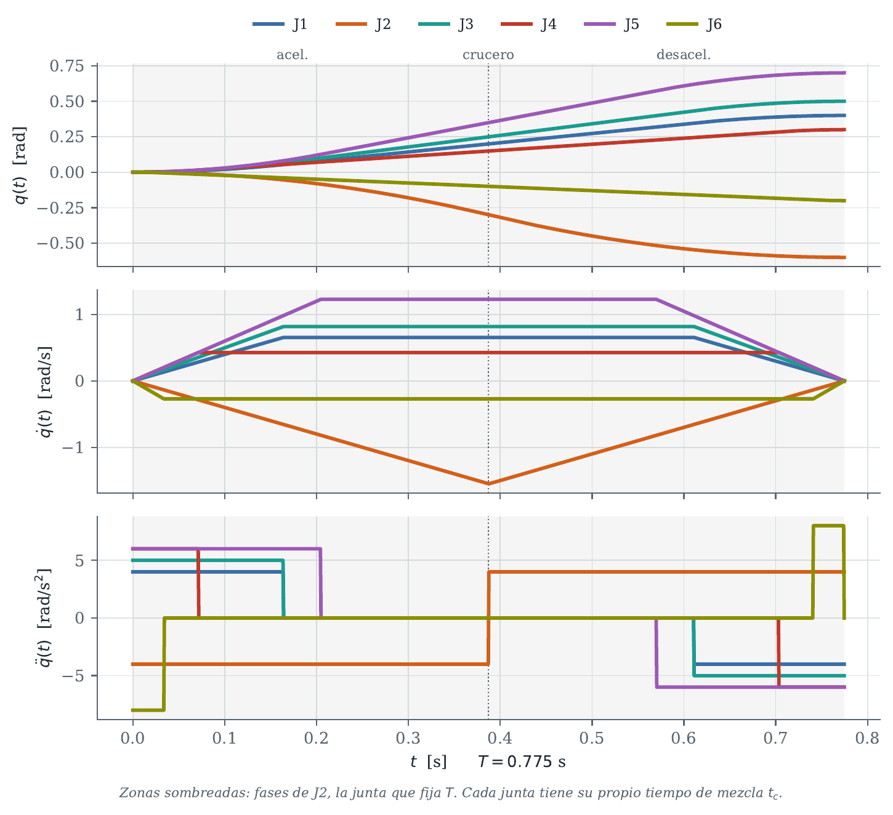

# Hito 2 · Cinemática inversa, trayectorias y dinámica

[Cómo ejecutar](01_COMO_EJECUTAR.md) · [Índice del hito](01_docs/01_INDICE.md) · [Portada del proyecto](../README.md)

Una pose objetivo fija la posición y la orientación de la herramienta. El programa calcula posturas articulares candidatas, comprueba los límites y elige una solución tomando como referencia la postura inicial. La trayectoria determina cómo llegan las seis juntas al objetivo.

## 1. Cómo se resuelve una pose

~~~mermaid
flowchart TD
 A["Pose de la herramienta"] --> B["Ramas de Pieper"]
 B --> C["Comprobar pose y límites"]
 C --> D["Elegir postura articular"]
 D --> E["Jacobiano y singularidad"]
 D --> F["Perfil LSPB de seis juntas"]
~~~

En la singularidad de muñeca estudiada el Jacobiano tiene rango 5. Una tarea cartesiana puede exigir una velocidad que las juntas no consiguen reproducir en esa postura. El notebook permite comparar una tarea compatible con otra que deja un residuo.

## 2. Leer la trayectoria

El tramo de aceleración aumenta la velocidad, el tramo central la mantiene y el tramo final la reduce hasta llegar al objetivo. El perfil sincronizado ajusta los tiempos para que las juntas terminen juntas.

[Abrir la figura LSPB en PDF](01_docs/04_resultados/01_figuras/fig_lspb.pdf)

## 3. Interpretar el torque

El ejemplo dinámico de una junta separa el aporte de la aceleración y el de la gravedad. A los **2,5 s**, el registro da **−0,2500 N·m** de aporte inercial y **4,6798 N·m** gravitatorio. Su suma es **4,4298 N·m**.

$$\tau=J\ddot q + m g l_c\sin(q)$$

## 4. Reproducir y defender

| Material | Para qué sirve |
| --- | --- |
| [Notebook](02_notebooks/01_Hito2_VEVAS.ipynb) | Recorrer los cálculos y las gráficas en orden. |
| [Resultados JSON](01_docs/04_resultados/resultados.json) | Revisar semillas, errores y valores de referencia. |
| [Informe del Hito 2](01_docs/01_informe/01_Informe_Hito2.pdf) | Consultar los supuestos de la resolución y el alcance del modelo. |

## 5. Resultados que conviene distinguir

| Ensayo del registro | Resultado | Qué se puso a prueba |
| --- | --- | --- |
| 2 000 poses generadas | 0 poses sin solución | Recuperar al menos una configuración para una pose generada por el modelo |
| 1 800 casos en fronteras | 0 rechazos después de la corrección | Tratar las configuraciones cercanas a los topes articulares |
| Muñeca singular | Rango 5 | Detectar la pérdida de una dirección instantánea de movimiento |
| Ejemplo reducido de dinámica | 4,4298 N·m en 2,5 s | Reproducir el cálculo de torque de una junta |

Las ocho ramas analíticas representan alternativas geométricas. Para elegir una postura también cuentan los límites articulares y la distancia a la configuración de partida. Dos soluciones pueden colocar la herramienta en el mismo sitio y exigir recorridos articulares muy diferentes.

## 6. Del perfil al esfuerzo

Para leer esta figura, ubica primero los cambios de fase en la trayectoria. Durante un tramo de velocidad constante la aceleración es cero, pero la gravedad puede seguir exigiendo torque. En la desaceleración, el término inercial puede cambiar de signo mientras la contribución gravitatoria conserva el suyo. Así se interpreta la suma que aparece en el registro a los 2,5 s.

Durante la exposición conviene volver a la pregunta de cada modelo. La cinemática inversa responde qué posturas alcanzan la pose, el Jacobiano relaciona velocidades, el perfil LSPB fija la evolución temporal y el ejemplo dinámico estima el esfuerzo de su junta de referencia.
