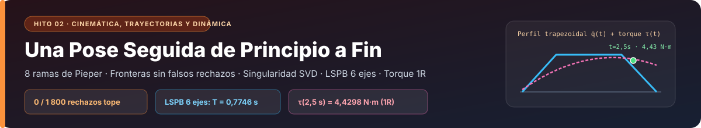
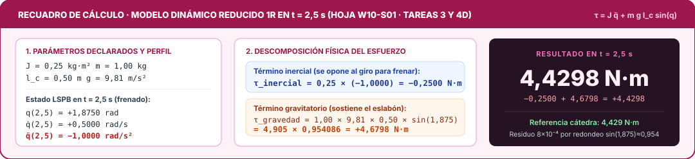
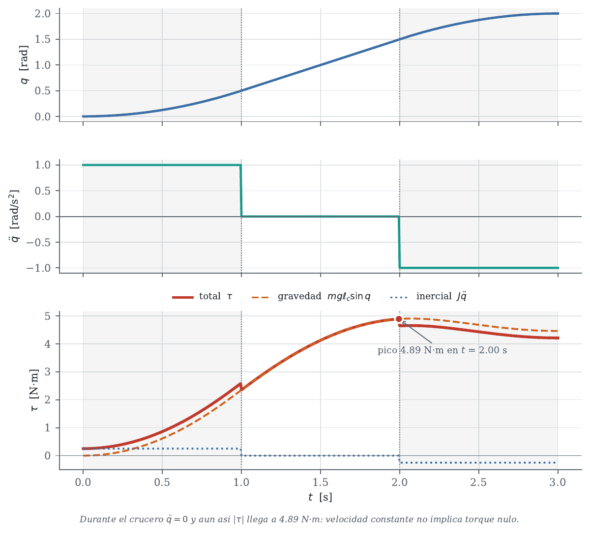

 

  <a href="01_COMO_EJECUTAR.md"><kbd>Cómo ejecutar</kbd></a>&nbsp;
  <a href="02_notebooks/01_Hito2_VEVAS.ipynb"><kbd>Notebook ejecutable</kbd></a>&nbsp;
  <a href="01_docs/05_bitacora/README.md"><kbd>Bitácora técnica (H2-01..05)</kbd></a>&nbsp;
  <a href="01_docs/01_informe/01_Informe_Hito2.pdf"><kbd>Informe IEEE PDF</kbd></a>&nbsp;
  <a href="01_docs/04_resultados/resultados.json"><kbd>Resultados JSON</kbd></a>&nbsp;
  <a href="../README.md"><kbd>← Portada principal</kbd></a>

## Hilo conductor del capítulo

En lugar de presentar ecuaciones desconectadas, este documento sigue **el mismo ejemplo numérico real del cuaderno [`01_Hito2_VEVAS.ipynb`](02_notebooks/01_Hito2_VEVAS.ipynb)** (celdas 4, 5, 17 y 18) desde la pose cartesiana deseada hasta la ley horaria de las seis articulaciones, y reserva una sección propia con recuadro visual para el cálculo de referencia del torque dinámico 1R.

~~~mermaid
flowchart LR
 A["1 · Pose objetivo T_d\np_d = [0.1791, 0.0906, 0.5740] m"] --> B["2 · Centro de muñeca p_W\nDesacoplamiento posición / orientación"]
 B --> C["3 · 8 ramas de Pieper\n7 violan topes · gana Rama #1 (q*)"]
 C --> D["4 · Jacobiano J(q*)\nrango = 6 · análisis de q₅ → 0"]
 C --> E["5 · LSPB sincronizado\n6 juntas llegan en T = 0,7746 s"]
~~~

---

## 1. Pose objetivo y resolución de las 8 ramas de Pieper

Dada la pose objetivo $T_d \in SE(3)$ generada en el cuaderno a partir de $q_{\text{ref}} = [0{,}4,\; -0{,}6,\; 0{,}5,\; 0{,}3,\; 0{,}7,\; -0{,}2]\text{ rad}$, el eje $z_6$ solo traslada $d_6 = 0{,}072\text{ m}$ hasta la brida. Retrocediendo esa distancia aparece el **centro de muñeca**, que depende exclusivamente de $(q_1, q_2, q_3)$:

$$p_W = p_d - d_6\,z_6^d = \begin{bmatrix}0{,}179120\\0{,}090613\\0{,}574048\end{bmatrix} - 0{,}072\,z_6^d = \begin{bmatrix}0{,}129915\\0{,}054927\\0{,}612641\end{bmatrix}\text{ m}, \qquad r_W = 0{,}3522\text{ m} \le 0{,}5800\text{ m}$$

Con el eslabón equivalente del antebrazo $k = \sqrt{a_3^2 + d_4^2} = 0{,}3100\text{ m}$ y $\psi = \operatorname{atan2}(d_4, a_3) = 1{,}343\text{ rad}$, las tres elecciones binarias (**hombro frontal/posterior × codo arriba/abajo × muñeca no invertida/invertida**) producen exactamente $2^3 = 8$ ramas analíticas:

> [!TIP]
> **Decisión tomada mirando esta gráfica:** Las ocho configuraciones colocan `tool0` exactamente en $p_d$ con error posicional entre $2{,}78 \times 10^{-17}\text{ m}$ y $1{,}59 \times 10^{-16}\text{ m}$ (precisión de punto flotante `float64`), pero **siete exceden los límites mecánicos de `J3`, `J4` o `J5`**. Se elige la **Rama #1** (`codo arriba / muñeca no invertida / hombro frontal`), única físicamente ejecutable y de mínimo desplazamiento ponderado desde el reposo ($\text{costo} = 2{,}8200$ con pesos $w = [4, 3, 2, 1, 1, 0{,}5]$).

<b>Ver tabla numérica completa de las 8 ramas en radianes y grados (celdas 4–5 del notebook)</b>

| # | `[q1, q2, q3, q4, q5, q6]` [rad] | Error FK $\Delta E$ [m] | Configuración geométrica | Veredicto de límites ABB |
| :---: | :---: | :---: | --- | --- |
| **1 ★** | `[+0.4000, -0.6000, +0.5000, +0.3000, +0.7000, -0.2000]` | `1,59 × 10⁻¹⁶` | Codo arriba · muñeca no inv. · hombro frontal | **Admisible (`q*` elegida)** |
| 2 | `[+0.4000, -0.6000, +0.5000, -2.8416, -0.7000, +2.9416]` | `1,59 × 10⁻¹⁶` | Codo arriba · muñeca inv. · hombro frontal | Rechazada (`J4 = -162,8° < -160°`) |
| 3 | `[+0.4000, +1.4243, -3.1861, +0.2635, +2.3218, +0.2144]` | `2,78 × 10⁻¹⁷` | Codo abajo · muñeca no inv. · hombro frontal | Rechazada (`J3`, `J5`) |
| 4 | `[+0.4000, +1.4243, -3.1861, -2.8781, -2.3218, -2.9272]` | `3,10 × 10⁻¹⁷` | Codo abajo · muñeca inv. · hombro frontal | Rechazada (`J3`, `J4`, `J5`) |
| 5 | `[-2.7416, -1.4243, +0.5000, -2.6230, +2.7474, +0.5173]` | `5,55 × 10⁻¹⁷` | Codo arriba · muñeca no inv. · hombro posterior | Rechazada (`J5 = +157,4° > +120°`) |
| 6 | `[-2.7416, -1.4243, +0.5000, +0.5186, -2.7474, -2.6243]` | `5,55 × 10⁻¹⁷` | Codo arriba · muñeca inv. · hombro posterior | Rechazada (`J5 = -157,4° < -120°`) |
| 7 | `[-2.7416, +0.6000, -3.1861, -2.9307, +1.1417, -0.0565]` | `6,21 × 10⁻¹⁷` | Codo abajo · muñeca no inv. · hombro posterior | Rechazada (`J3`, `J4`) |
| 8 | `[-2.7416, +0.6000, -3.1861, +0.2109, -1.1417, +3.0851]` | `6,21 × 10⁻¹⁷` | Codo abajo · muñeca inv. · hombro posterior | Rechazada (`J3 = -182,5° < -110°`) |

---

## 2. Jacobiano geométrico y diagnóstico de singularidad ($q_5 \to 0$)

Antes de mover hacia $q^*$, [`jacobiano.py`](../05_ros2_irb120_description/04_scripts/jacobiano.py) construye las 6 columnas $J_i = [z_{i-1} \times (p_e - p_{i-1});\; z_{i-1}]$ (validadas contra derivación manual en $q=0$ con residuo $2{,}08 \times 10^{-18}$ y contra diferencias finitas centradas con $3{,}42 \times 10^{-8}$):

- **En la postura elegida $q^*$ ($q_5 = +0{,}70\text{ rad}$):** $\operatorname{rango}(J) = 6$, la movilidad instantánea es completa en traslación y rotación.
- **Al aproximarse a la singularidad de muñeca ($q_5 \to 0$):** los ejes `J4` y `J6` se vuelven colineales, $\operatorname{rango}(J)$ cae de `6` a **`5`** ($\sigma_{\min} = 9{,}78 \times 10^{-18}$), una tarea incompatible deja un residuo irreducible de **`0,442357`** y la exigencia cinemática/dinámica diverge con leyes de potencia exactas $\lVert\dot{q}\rVert \sim q_5^{-1}$ y $\|\tau\| \sim q_5^{-2}$ ([`fig_divergencia.pdf`](01_docs/04_resultados/01_figuras/fig_divergencia.pdf)).

---

## 3. Trayectoria LSPB sincronizada de las seis juntas hacia $q^*$

Para viajar desde el reposo $q_0 = [0,0,0,0,0,0]$ hasta la postura elegida $q^*$ con límites $V_{\max} = [2{,}0,\; 2{,}0,\; 2{,}5,\; 3{,}0,\; 3{,}0,\; 4{,}0]\text{ rad/s}$ y $A_{\max} = [4{,}0,\; 4{,}0,\; 5{,}0,\; 6{,}0,\; 6{,}0,\; 8{,}0]\text{ rad/s}^2$, `LSPBSincronizado` coordina las seis curvas:

> [!TIP]
> **Decisión tomada mirando esta gráfica:** Como `J2` debe recorrer $-0{,}6000\text{ rad}$ bajo $A_{\max,2} = 4{,}0\text{ rad/s}^2$, su perfil óptimo resulta **triangular** ($t_c = 0{,}3873\text{ s}$, crucero de $0\text{ s}$) e impone el tiempo mínimo global **$T = 0{,}7746\text{ s}$**. En lugar de dejar que `J1`, `J3`, `J4`, `J5` y `J6` terminen antes, se reducen únicamente sus velocidades de crucero manteniendo intactas sus aceleraciones para lograr arranque y parada simultáneos ($\dot{q}(0) = \dot{q}(T) = 0$) dentro de límites en las 2.000 muestras evaluadas.

| Junta | Desplazamiento $h$ [rad] | Mezcla $t_c$ [s] | Crucero $V$ [rad/s] | Régimen del perfil | Cumple límites en `[0, T]` |
| :---: | :---: | :---: | :---: | :---: | :---: |
| **`J1`** | `+0,4000` | `0,1637` | `0,6548` | Trapezoidal reescalado | Sí |
| **`J2` (rectora)** | **`−0,6000`** | **`0,3873`** | **`1,5492`** | **Triangular ($2 t_c = T$)** | **Sí** |
| **`J3`** | `+0,5000` | `0,1637` | `0,8185` | Trapezoidal reescalado | Sí |
| **`J4`** | `+0,3000` | `0,0711` | `0,4264` | Trapezoidal reescalado | Sí |
| **`J5`** | `+0,7000` | `0,2047` | `1,2283` | Trapezoidal reescalado | Sí |
| **`J6`** | `−0,2000` | `0,0337` | `0,2700` | Trapezoidal reescalado | Sí |

---

## 4. Modelo dinámico reducido 1R · Cálculo en $t = 2{,}5\text{ s}$

Dado que ABB no publica las masas ni los tensores de inercia de los seis eslabones del IRB 120 —y en la trayectoria anterior `J2` carece de tramo de crucero por ser triangular—, la dinámica se verifica sobre el **modelo lagrangiano 1R de referencia de la cátedra** (`W10-S01`, $q_0 = 0 \to q_f = 2\text{ rad}$ en $t_f = 3\text{ s}$, $|\ddot{q}_c| = 1\text{ rad/s}^2$, $t_c = 1{,}0\text{ s}$):

> [!TIP]
> **Decisión tomada mirando esta gráfica:** Durante el crucero ($1{,}0\text{ s} \le t \le 2{,}0\text{ s}$) la aceleración es exactamente cero ($\ddot{q} = 0$) y, sin embargo, $|\tau(t)|$ sube de **`2,3516 N·m` hasta el pico global de `4,8909 N·m`** porque el motor sostiene el momento gravitatorio $m g \ell_c \sin q$. Esto demuestra dos principios para la defensa: **(1)** velocidad constante no implica torque nulo y **(2)** *singularidad* (pérdida cinemática de rango en $J$) y *torque elevado* (demanda dinámica de esfuerzo) son fenómenos independientes.

---

## 5. Pruebas de robustez en fronteras y catálogo de módulos

| Banco de verificación ([`resultados.json`](01_docs/04_resultados/resultados.json)) | Semilla / Casos | Antes | Después | Archivo donde se verifica |
| --- | :---: | :---: | :---: | --- |
| **Cobertura regular del espacio alcanzable** | `20261018` · `2 000` poses | `0` sin solución | **`0` sin solución** (`4,98 × 10⁻¹⁶ m`) | [`pieper.py`](../05_ros2_irb120_description/04_scripts/pieper.py) |
| **Fronteras articulares exactas** | `18026` · `1 800` poses | `193` rechazos | **`0` rechazos** | [`02_anexo_tecnico.md`](01_docs/01_informe/02_anexo_tecnico.md) |
| **Banda casi singular de muñeca (`|q5| ≤ 5×10⁻⁵`)** | `5` escalas log | Falla `arccos` | **Resuelve las `5` escalas** | [`pieper.py`](../05_ros2_irb120_description/04_scripts/pieper.py) |
| **Continuidad de vueltas en `J6` (`q6 = 6,0 rad`)** | Caso borde `±400°` | Giro `6,2832 rad` | **`8,88 × 10⁻¹⁶ rad`** | [`resultados.json`](01_docs/04_resultados/resultados.json) |

### Documentación y recursos del Hito 2

- **Cuaderno interactivo completo:** [`01_Hito2_VEVAS.ipynb`](02_notebooks/01_Hito2_VEVAS.ipynb) (36 celdas ejecutadas).
- **Informe en formato IEEE y Anexo:** [Informe PDF](01_docs/01_informe/01_Informe_Hito2.pdf) · [Anexo técnico de fronteras](01_docs/01_informe/02_anexo_tecnico.md).
- **Bitácora técnica del Hito 2:** [Cinco entradas `Problema → Cambio → Resultado → Evidencia`](01_docs/05_bitacora/README.md).
- **Código explicado módulo por módulo:** [16 guías en `01_docs/03_guias/01_codigo/`](01_docs/03_guias/01_codigo/README.md) y [Manual de estudio y defensa](01_docs/03_guias/01_MANUAL_HITO2.md).
