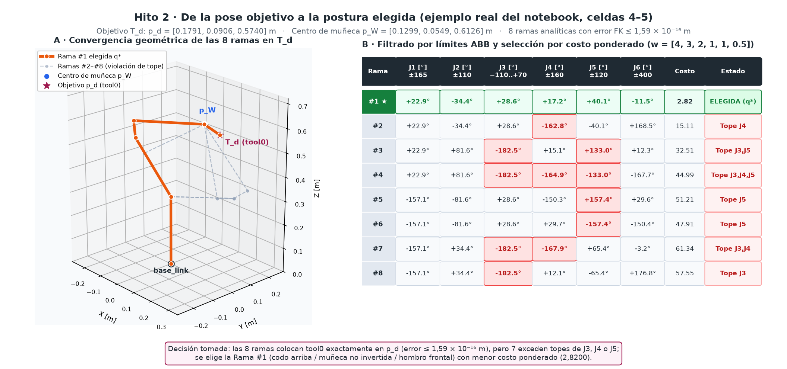
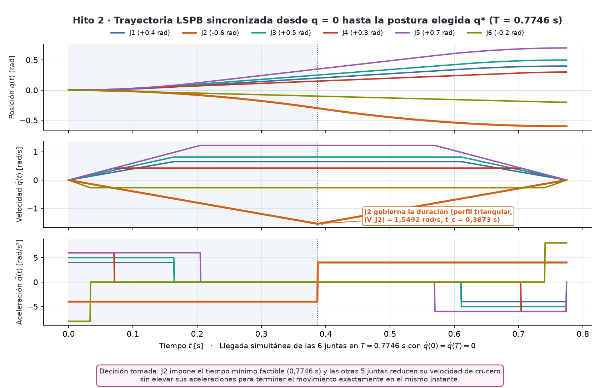

# Hito 2 · Cinemática inversa, trayectorias y dinámica

[Cómo ejecutar](01_COMO_EJECUTAR.md) · [Índice del hito](01_docs/01_INDICE.md) · [Bitácora técnica H2](01_docs/05_bitacora/README.md) · [Videos H2](../06_videos/02_hito2_cinematica_dinamica/README.md) · [Portada del proyecto](../README.md)

En lugar de mostrar módulos aislados, este recorrido sigue **una misma pose real del cuaderno [`01_Hito2_VEVAS.ipynb`](02_notebooks/01_Hito2_VEVAS.ipynb)** (celdas 4, 5, 17 y 18) desde la especificación cartesiana de la herramienta hasta la trayectoria sincronizada de las seis juntas, separando al final en su propio bloque el cálculo de referencia del torque dinámico 1R.

---

## 1. Pose objetivo y selección entre las 8 ramas de Pieper

Se parte de la pose objetivo $T_d \in SE(3)$ empleada en el cuaderno (correspondiente a $q_{\text{ref}} = [0{,}4,\; -0{,}6,\; 0{,}5,\; 0{,}3,\; 0{,}7,\; -0{,}2]\text{ rad}$):

- **Posición deseada de `tool0`:** $p_d = [0{,}17912,\; 0{,}09061,\; 0{,}57405]\text{ m}$
- **Centro de muñeca desacoplado ($p_W = p_d - d_6 z_6^d$):** $p_W = [0{,}12992,\; 0{,}05493,\; 0{,}61264]\text{ m}$ (radio desde el hombro $r_W = 0{,}3522\text{ m} \le 0{,}5800\text{ m}$, dentro del espacio alcanzable).

> **Decisión tomada mirando esta gráfica:** Aunque las 8 ramas analíticas reconstruyen exactamente la misma pose en `tool0` ($\Delta E \le 1{,}59 \times 10^{-16}\text{ m}$), las ramas `#2` a `#8` quedan descartadas porque violan los límites mecánicos de `J3`, `J4` o `J5`; se selecciona la **Rama #1** (`codo arriba / muñeca no invertida / hombro frontal`, $q^* = [+22{,}9^\circ, -34{,}4^\circ, +28{,}6^\circ, +17{,}2^\circ, +40{,}1^\circ, -11{,}5^\circ]$), que respeta todos los topes y minimiza el costo articular ponderado ($\text{costo} = 2{,}8200$).

---

## 2. Trayectoria LSPB sincronizada de las seis juntas hacia $q^*$

Con la postura elegida $q^*$ como destino desde el reposo ($q_0 = 0$) y límites $V_{\max} = [2{,}0,\; 2{,}0,\; 2{,}5,\; 3{,}0,\; 3{,}0,\; 4{,}0]\text{ rad/s}$, $A_{\max} = [4{,}0,\; 4{,}0,\; 5{,}0,\; 6{,}0,\; 6{,}0,\; 8{,}0]\text{ rad/s}^2$, el planificador `LSPBSincronizado` coordina los seis ejes:

> **Decisión tomada mirando esta gráfica:** El eje `J2` ($\Delta q_2 = -0{,}60\text{ rad}$) alcanza un perfil límite **triangular** sin tramo de crucero ($t_c = 0{,}3873\text{ s}$) y fija el tiempo mínimo global en **$T = 0{,}7746\text{ s}$**; por ello se reescalan hacia abajo las velocidades de crucero de `J1`, `J3`, `J4`, `J5` y `J6` sin elevar ninguna aceleración, logrando que las seis juntas arranquen y se detengan exactamente al unísono ($\dot{q}(0)=\dot{q}(T)=0$).

---

## 3. Ejemplo de referencia de dinámica reducida 1R

> [!IMPORTANT]
> **Recuadro de cálculo · Torque del modelo reducido 1R en $t = 2{,}5\text{ s}$ (`4,4298 N·m`)**
>
> ABB no publica masas ni tensores de inercia de los seis eslabones del IRB 120. Siguiendo la guía oficial (hoja `W10-S01`, Tareas 3 y 4D), se evalúa el modelo lagrangiano de una articulación horizontal con parámetros declarados por la cátedra ($J = 0{,}25\text{ kg}\cdot\text{m}^2$, $m = 1{,}00\text{ kg}$, $\ell_c = 0{,}50\text{ m}$, $g = 9{,}81\text{ m/s}^2$) sobre el perfil LSPB de referencia ($q_0 = 0 \to q_f = 2\text{ rad}$ en $t_f = 3\text{ s}$, $|\ddot{q}_c| = 1\text{ rad/s}^2 \Rightarrow t_c = 1{,}0\text{ s}$, $V = 1{,}0\text{ rad/s}$):
>
> $$\tau(t) = J\,\ddot{q}(t) + m\,g\,\ell_c\,\sin\big(q(t)\big)$$
>
> **Evaluación paso a paso en el instante de control $t = 2{,}5\text{ s}$ (fase de desaceleración):**
> - Estado cinemático: $q(2{,}5) = 1{,}8750\text{ rad}$, $\quad \dot{q}(2{,}5) = 0{,}5000\text{ rad/s}$, $\quad \ddot{q}(2{,}5) = -1{,}0000\text{ rad/s}^2$
> - Aporte inercial (frenado): $\tau_{\text{inercial}} = 0{,}25 \times (-1{,}0000) = \mathbf{-0{,}2500\text{ N}\cdot\text{m}}$
> - Aporte gravitatorio: $\tau_{\text{gravedad}} = 1{,}00 \times 9{,}81 \times 0{,}50 \times \sin(1{,}8750) = \mathbf{+4{,}6798\text{ N}\cdot\text{m}}$
> - **Torque total resultante:** $\tau(2{,}5\text{ s}) = -0{,}2500 + 4{,}6798 = \mathbf{4{,}4298\text{ N}\cdot\text{m}}$ *(solucionario de cátedra: `4,429 N·m`; la diferencia de `0,0008 N·m` proviene únicamente de redondear $\sin(1{,}875) \approx 0{,}954$ en el cálculo manual).*

> **Decisión tomada mirando esta gráfica:** El pico de esfuerzo ($|\tau|_{\max} = 4{,}8909\text{ N}\cdot\text{m}$ en $t = 1{,}995\text{ s}$) ocurre cuando la aceleración es nula ($\ddot{q} = 0$), demostrando que velocidad constante no implica torque cero y que no basta dimensionar un motor mirando únicamente los tramos de aceleración máxima.

---

## 4. Síntesis de pruebas dirigidas y singularidad de muñeca

| Ensayo verificable | Antes | Después | Qué demuestra |
| --- | --- | --- | --- |
| **2 000 poses aleatorias alcanzables** | `0` fallos | `0` poses sin solución | Cobertura analítica general con error posicional máx. `4,98 × 10⁻¹⁶ m` |
| **1 800 poses exactamente sobre topes** | `193` rechazos | **`0` rechazos** | `TOL_LIMITE = 1e-9 rad` + `clip` corrige redondeo de `atan2` en fronteras |
| **Muñeca casi singular (`|q5| = 10⁻⁷..5×10⁻⁵`)** | Falsa singularidad | **Resuelve 100 %** | Medir $|s_5| = \operatorname{hypot}(R_{36}[0,2], R_{36}[1,2])$ evita la pérdida de precisión de `arccos` |
| **Giro de `J6` ante pose ya alcanzada** | `6,2832 rad` (`360°`) | **`8,88 × 10⁻¹⁶ rad`** | Expansión de congruencias $q_i \pm 2\pi n$ aprovecha el rango $\pm 400^\circ$ de la brida |
| **Singularidad exacta ($q_5 = 0$)** | — | **Rango `5` de `6`** | Leyes $\lVert\dot{q}\rVert \sim q_5^{-1}$ y $\|\tau\| \sim q_5^{-2}$ ante tarea incompatible (residuo `0,4424`) |

---

## 5. Material reproducible y documentación del Hito 2

| Material | Propósito | Enlace |
| --- | --- | --- |
| **Notebook ejecutable** | Desarrollo completo con salidas verificadas y demostración de singularidad. | [`01_Hito2_VEVAS.ipynb`](02_notebooks/01_Hito2_VEVAS.ipynb) |
| **Informe IEEE y Anexo técnico** | Marco teórico, formulación y pruebas dirigidas en fronteras. | [Informe PDF](01_docs/01_informe/01_Informe_Hito2.pdf) · [Anexo técnico](01_docs/01_informe/02_anexo_tecnico.md) |
| **Bitácora técnica Hito 2** | Cinco entradas `Problema → Cambio → Resultado → Evidencia` sobre los hallazgos del hito. | [Leer bitácora](01_docs/05_bitacora/README.md) |
| **Registro JSON y salidas CLI** | Semillas, entorno y salidas literales de los módulos numéricos. | [`resultados.json`](01_docs/04_resultados/resultados.json) · [Carpeta `04_resultados/`](01_docs/04_resultados/) |
| **Guías línea por línea** | Explicación detallada de los 16 scripts del paquete compartido. | [Explorar `01_codigo/`](01_docs/03_guias/01_codigo/README.md) |
