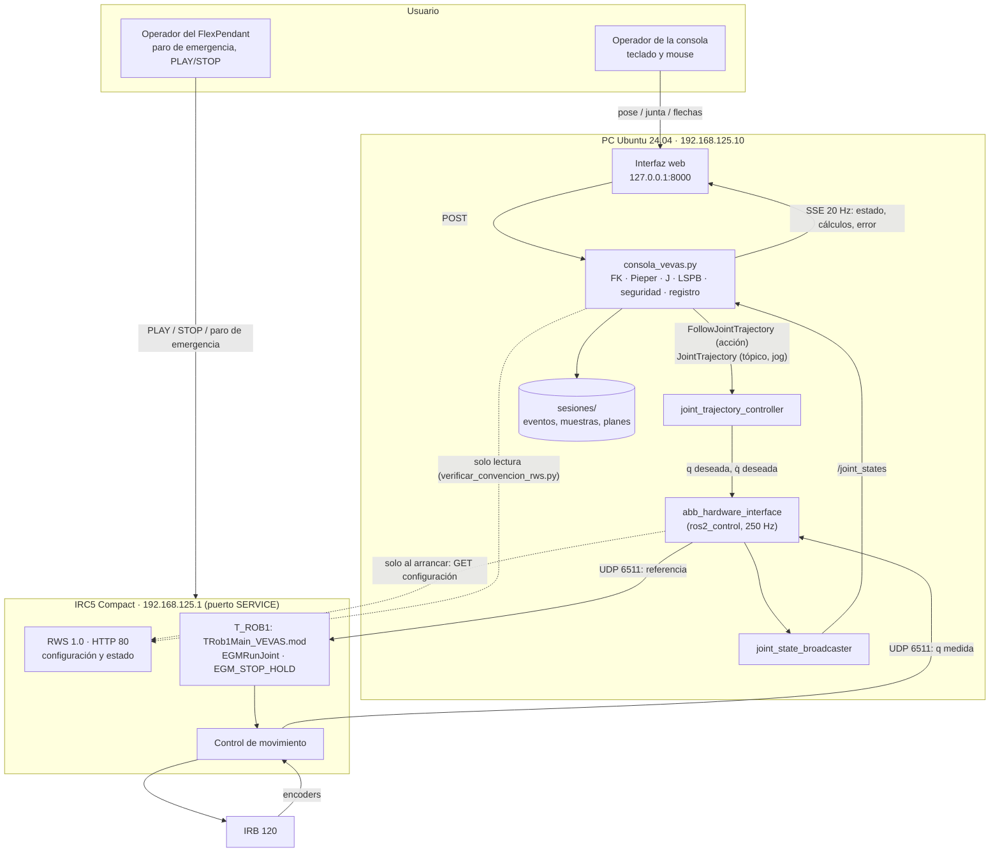

# Arquitectura del sistema (Gate 0, dominio 1)

Grupo VEVAS · ABB IRB 120-3/0.6 · IRC5 Compact · ROS 2 Jazzy

## Diagrama bidireccional: comando y retorno de estado

Línea llena: lo que pasa durante el movimiento. Línea punteada: solo lecturas por RWS.

## Señales

| Señal | Origen → destino | Unidad | Frecuencia | Para qué |
|---|---|---|---|---|
| Plan (trayectoria LSPB muestreada cada 20 ms) | consola → JTC | rad, rad/s, s | una vez por plan | Mover entre dos posturas |
| Punto de jog | consola → JTC | rad | 25 Hz mientras se aprieta la tecla | Mover con las flechas |
| Referencia EGM | hardware interface → IRC5 | grados (EGM) | 250 Hz | Lo que el robot debe seguir |
| Posición medida | IRC5 → hardware interface → `/joint_states` | rad | 250 Hz / 100 Hz | Retorno de estado |
| Estado de la consola | consola → navegador | mm, grados | 20 Hz | Mostrar cálculos y error |
| Configuración y pose del controlador | IRC5 → PC (RWS) | grados, mm, cuaternión | a pedido | Arranque del driver y validación S1 |

## Arquitecturas candidatas (matriz A/B de W12-S02)

| Campo | Ruta A: `abb_ros2` (RWS + EGM) | Ruta B: `abb_driver` (RAPID + sockets) |
|---|---|---|
| Interfaz | `abb_hardware_interface` (ros2_control) + EGM UDP | Módulos RAPID `ROS_*` con TCP sockets |
| Versiones admitidas | RobotWare 6.x (RWS 1.0), ROS 2 Humble/Jazzy | IRC5, ROS 1 (Kinetic a Noetic) |
| Prerrequisito del controlador | 689-1 EGM y 616-1 PC Interface | Ninguna opción paga (PC Interface ayuda) |
| Evidencia local | Las dos opciones vistas en el FlexPendant; RobotWare 6.12.01.00 | — |
| Canal de comando | Referencias articulares 250 Hz por EGM | Trayectorias por socket, RAPID las ejecuta con MoveAbsJ |
| Canal de estado | EGM (q medida, 250 Hz) → `/joint_states` | Socket de estado de RAPID |
| Prueba de solo lectura | `curl` RWS, `verificar_convencion_rws.py`, driver con la consola en solo lectura | Lectura del socket de estado |
| Autorización necesaria | Configurar `ROB_1` (UDPUC) y cargar el RAPID: encargado | Cargar módulos RAPID: encargado |
| Criterio PASS | `/joint_states` real coincide con el FlexPendant; FK propia = pose del controlador | — |
| Decisión | **Elegida** | Descartada: ROS 1 y menor desempeño; la ruta A está disponible |

## Decisiones técnicas justificadas

| Decisión | Por qué |
|---|---|
| Ubuntu 24.04 + ROS 2 Jazzy | Combinación probada con `abb_ros2`; Ubuntu 26.04 no tenía soporte confirmado |
| Consola propia en vez de MoveIt | Regla anti caja negra del PFI: IK con nuestro Pieper, trayectoria con nuestra LSPB |
| Servidor web local con biblioteca estándar | No instalar nada extra en la PC del laboratorio; escucha solo en 127.0.0.1 |
| Toda la matemática en Python, la web solo dibuja | Una sola fuente de verdad; la misma que se prueba con pytest |
| Detectar el hardware y quedarse en solo lectura ante la duda | Que nunca se mueva el robot real por error creyendo que es simulación |
| RAPID sin movimiento al arrancar | El ejemplo original movía el robot a "home" a 200 mm/s al pulsar PLAY |
