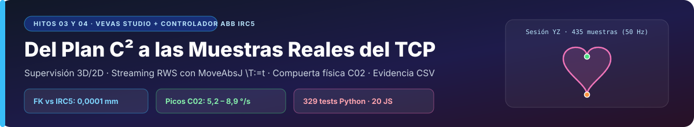
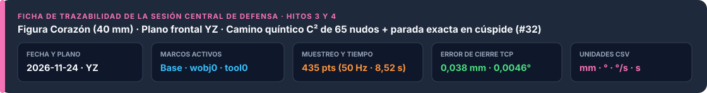
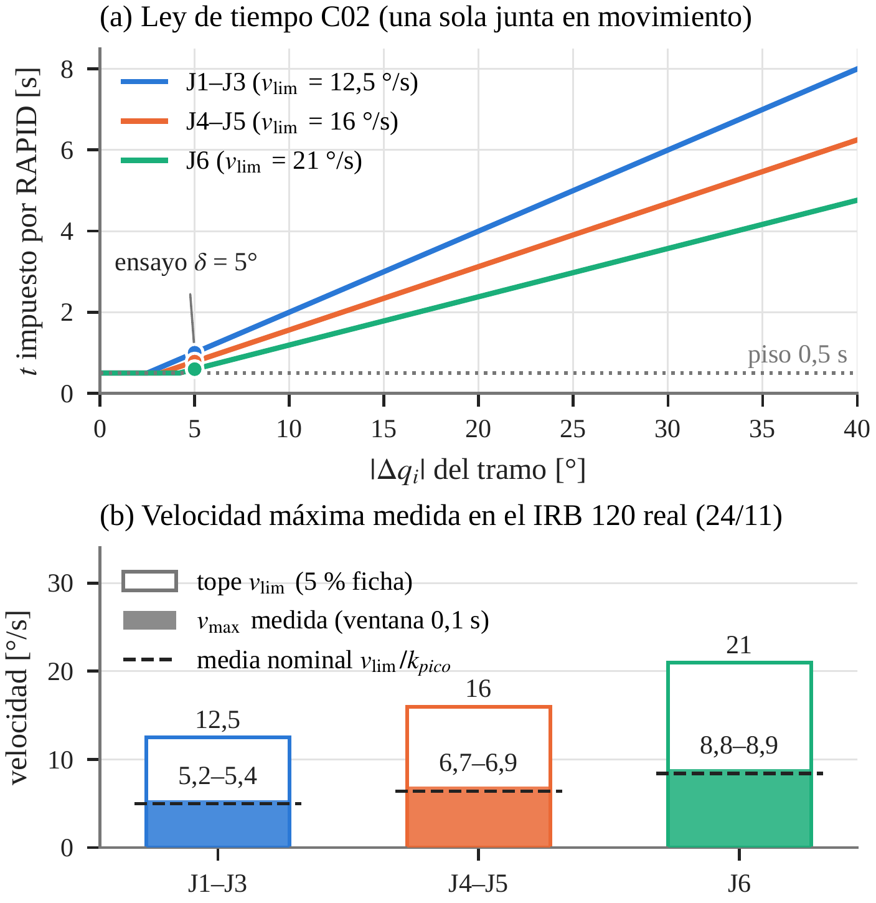
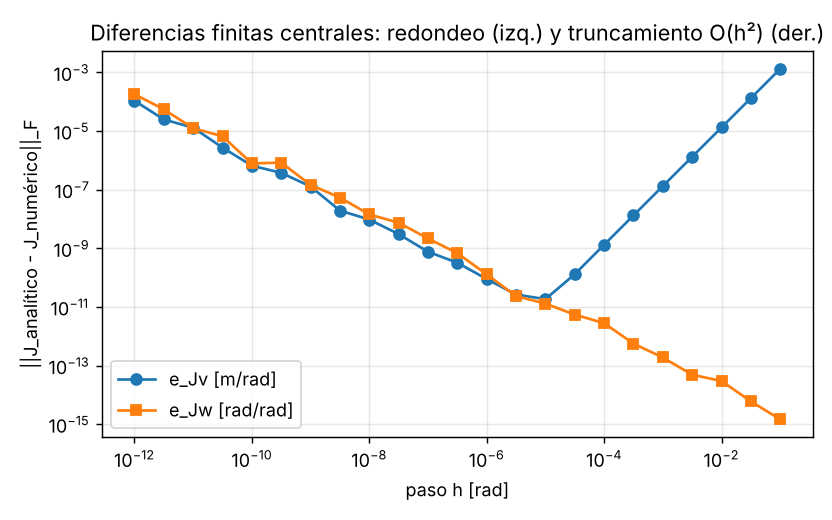

<div align="center">



<br>

<p>
  <a href="../../README.md"><kbd>← Volver a Hitos 3 y 4</kbd></a>&nbsp;
  <a href="01_sesion_evidencia/README.md"><kbd>Datos CSV/JSON de la sesión</kbd></a>&nbsp;
  <a href="../../02_vevas_studio/01_docs/01_datos/01_validacion_offline/01_resumen.md"><kbd>Validación offline S0</kbd></a>&nbsp;
  <a href="../05_bitacora/06_bitacora.md"><kbd>Bitácora W12</kbd></a>&nbsp;
  <a href="../../../06_videos/README.md"><kbd>Videos asociados</kbd></a>
</p>

</div>


## 1. Evidencia visual de sesión: figura solicitada, plan y muestras del TCP




### Resumen numérico y archivos enlazados de esta sesión

| Indicador | Valor | Archivo de respaldo |
| --- | --- | --- |
| **Figura, tamaño y plano** | Corazón · `40 mm` · Plano **`YZ` («De frente»)** | [`plan_001_corazon_yz_40mm.json`](01_sesion_evidencia/plan_001_corazon_yz_40mm.json) |
| **Postura articular de partida** | `[0°, −20°, +30°, 0°, +40°, 0°]` (`σ_min = 0,2610`) | [`resumen_corazon_yz_40mm.json`](01_sesion_evidencia/resumen_corazon_yz_40mm.json) |
| **Duración y frecuencia de registro** | `8,52 s` · `435` muestras en ejecución (`50 Hz`, paso `20 ms`) | [`muestras_corazon_yz_40mm.csv`](01_sesion_evidencia/muestras_corazon_yz_40mm.csv) |
| **Desviación geométrica al contorno** | Media **`0,491 mm`** · Máxima `1,464 mm` | Calculada sobre los `65` nudos en milímetros |
| **Error dinámico de seguimiento $e_p(t)$** | Máximo `0,81 mm` (por retardo $\tau = 40\text{ ms}$; `0,00 mm` en parada `#32`) | Panel inferior derecho de la lámina |
| **Error final en el cierre `(0, 0) mm`** | **`0,038 mm`** en posición · **`0,0046°`** articular | Verificación automática de llegada aprobada |
| **Videos vinculados** | Guiones y carpetas para toma SIM e IRC5 real | [`SIM`](../../../06_videos/03_hito3_4_simulacion/README.md) · [`IRC5`](../../../06_videos/04_hito3_4_laboratorio_irc5/README.md) |

<details>
<summary><b>Vista previa de columnas y primeras muestras reales de <code>muestras_corazon_yz_40mm.csv</code></b></summary>

El archivo CSV conserva **28 columnas** con unidades explícitas en sus encabezados (`s`, `deg`, `mm`, `deg/s`):

```text
t_s, estado, plan_id, q1..q6_cmd_deg, q1..q6_med_deg, e1..e6_deg, e_p_mm, e_R_deg, x_mm, y_mm, z_mm, sigma_min, vel_pct, v1..v6_med_deg_s
```

Para volver a generar el CSV, el JSON y la figura desde cero:

```bash
python 01_docs/06_figuras/generar_evidencia_visual.py
```

</details>

---

## 2. Resultados en el controlador ABB IRC5 (24/11/2026)

<table>
  <tr>
    <td width="52%" valign="top">
      <h4 align="center">Verificación presencial C02 · Velocidad medida vs tope RAPID</h4>
      
    </td>
    <td width="48%" valign="top">
      <h4>Lecturas en laboratorio (<a href="../05_bitacora/05_CAMBIOS_24NOV.md">bitácora 24/11</a>)</h4>
      <ul>
        <li><b>Contraste FK vs FlexPendant (<code>S1-001</code>):</b> diferencia posicional de <b>0,0001 mm</b> y angular de <b>0,0000°</b> usando <code>Base</code>, <code>wobj0</code> y <code>tool0</code>.</li>
        <li><b>J1 – J3 (tope C02: 12,5 °/s):</b> picos medidos de <b>5,2 a 5,4 °/s</b> (<code>41,6–43,2 %</code> del límite C02; <code>2,16 %</code> de catálogo).</li>
        <li><b>J4 – J5 (tope C02: 16,0 °/s):</b> picos medidos de <b>6,7 a 6,9 °/s</b> (<code>41,9–43,1 %</code> del límite C02).</li>
        <li><b>J6 + streaming (tope C02: 21,0 °/s):</b> picos medidos de <b>8,8 a 8,9 °/s</b> (<code>41,9–42,4 %</code> del límite C02).</li>
      </ul>
      <p><a href="../01_informe/01_informe_ieee/01_img/fig_c02.pdf">Abrir versión vectorial PDF (<code>fig_c02.pdf</code>) →</a></p>
    </td>
  </tr>
</table>

---

## 3. Validación matemática offline (Nivel S0 · Protocolo W12)

Antes de habilitar cualquier conexión con ROS o con el IRC5, [`validacion_offline.py`](../../02_vevas_studio/02_herramientas/validacion_offline.py) sometió el núcleo cinemático de VEVAS Studio a pruebas masivas y casos trampa deliberados:

<table>
  <tr>
    <td width="50%" valign="top">
      <h4 align="center">Barrido hacia la singularidad de muñeca ($q_5 \to 0$)</h4>
      
      <p>Confirma ley de potencia exacta $\|\dot{q}\| \sim q_5^{-1,00}$ al exigir giro incompatible sobre la muñeca extendida (<a href="../../02_vevas_studio/01_docs/01_datos/01_validacion_offline/singularidad_barrido.csv"><code>singularidad_barrido.csv</code></a>).</p>
    </td>
    <td width="50%" valign="top">
      <h4 align="center">Exactitud del Jacobiano frente a diferencias finitas</h4>
      
      <p>Curva clásica en «V» de truncamiento ($O(h^2)$) vs cancelación numérica, alcanzando <b>8,93 × 10⁻¹¹ m/rad</b> en $h = 10^{-6}$ (<a href="../../02_vevas_studio/01_docs/01_datos/01_validacion_offline/jacobiano_error_vs_h.csv"><code>jacobiano_error_vs_h.csv</code></a>).</p>
    </td>
  </tr>
</table>

| Banco de datos offline ([`01_validacion_offline/`](../../02_vevas_studio/01_docs/01_datos/01_validacion_offline/01_resumen.md)) | Casos evaluados | Resultado |
| --- | :---: | --- |
| **Cinemática directa aleatoria (`T_0^6 · Rz(π)`)** | `5 000` posturas | Error máximo `6,0 × 10⁻¹⁶ m` frente al URDF de referencia |
| **Casos canónicos y casos trampa (`casos_fk.csv`)** | `7` casos | `FK-N1/N2/L` aprueban; `FK-D-TCP` (`0,120 m`) y `FK-D-ORD` (`0,469 rad`) detectan fallos inducidos |
| **Cinemática inversa multi-rama (`casos_ik.csv`)** | `25` soluciones | Reconstrucción exacta bajo umbral `10⁻⁶ m` y `10⁻⁵ rad` |
