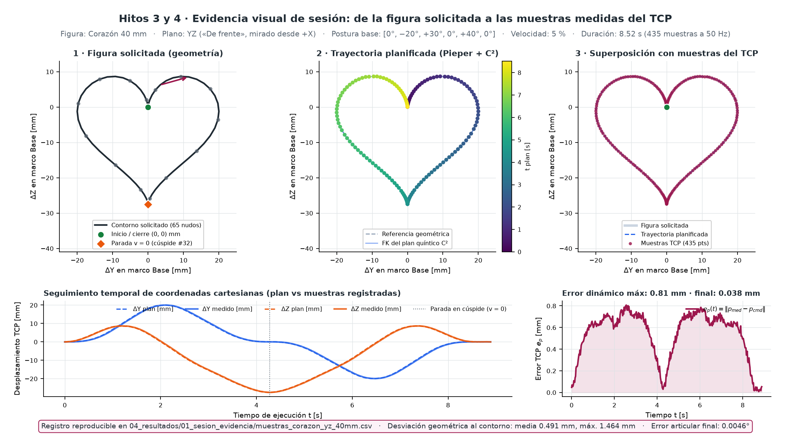
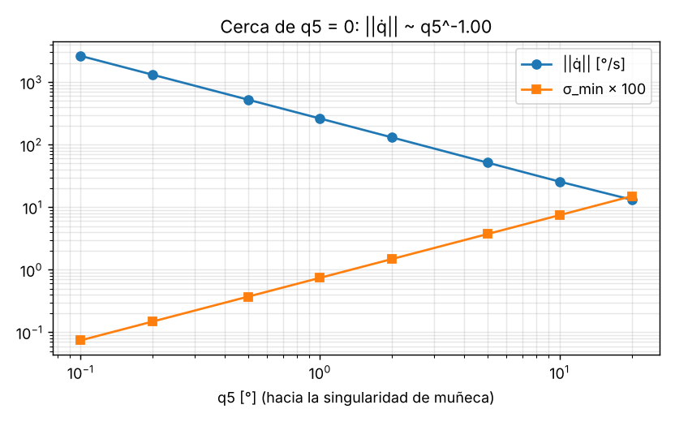

# Resultados · Hitos 3 y 4

[Volver a Hitos 3 y 4](../../README.md) · [Validación en simulación](../06_operacion/04_PRUEBA_SIM_FIGURAS.md) · [Validación offline S0](../../02_vevas_studio/01_docs/01_datos/01_validacion_offline/01_resumen.md)

## 1. Sesión documentada (figura solicitada + plan + muestras del TCP)

- [Carpeta de datos de la sesión (`CSV` + `JSON`)](01_sesion_evidencia/README.md)
- [Videos vinculados de simulación (`06_videos/03_hito3_4_simulacion/`)](../../../06_videos/03_hito3_4_simulacion/README.md)
- [Videos vinculados de laboratorio IRC5 (`06_videos/04_hito3_4_laboratorio_irc5/`)](../../../06_videos/04_hito3_4_laboratorio_irc5/README.md)

## 2. Verificación C02 y barrido offline de singularidades

- [Figura C02 del informe IEEE](../01_informe/01_informe_ieee/01_img/fig_c02.pdf)
- [Registro del 24/11](../05_bitacora/05_CAMBIOS_24NOV.md)
