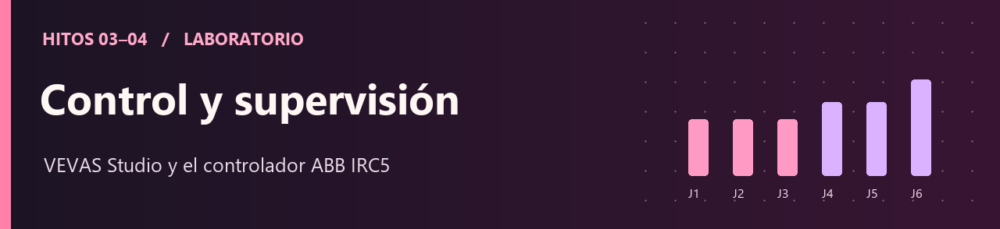

# VEVAS Studio · Consola del IRB 120

## Informe, defensa y guía

| Material | Para qué sirve |
| --- | --- |
| [Informe IEEE · PDF](../01_docs/01_informe/01_Informe_Hito3_4.pdf) | Método, arquitectura, resultados y conclusiones. |
| [Defensa del grupo · PDF](../01_docs/02_presentacion/02_Defensa_Grupo_VEVAS.pdf) | Diapositivas de la exposición. |
| [Guía aportada el 24/11](../01_docs/03_guias/02_Guia_aportada_24NOV.md) | Versión compartida para la entrega. |
| [Guía técnica completa](../01_docs/03_guias/01_GUIA_COMPLETA_HITO3_4.md) | Procedimientos y explicación ampliada del sistema. |

## Áreas del software

| Material | Para qué sirve |
| --- | --- |
| [01 · Documentación](01_docs/README.md) | Manifiesto del modelo y validaciones offline. |
| [02 · Herramientas](02_herramientas/README.md) | Diagnósticos, validación y análisis de sesiones. |
| [03 · Modelo](03_modelo/README.md) | URDF y medidas del entorno. |
| [04 · Plantillas](04_plantillas/README.md) | Formatos de referencia de las sesiones. |
| [05 · RAPID](05_rapid/README.md) | Módulos correspondientes al controlador ABB. |
| [06 · Pruebas](06_tests/README.md) | Pruebas offline de la aplicación y la interfaz. |
| [07 · Núcleo Python](07_vevas/README.md) | Cálculos, estado de la consola y backends. |
| [08 · Interfaz web](08_web/README.md) | Vistas de trayectoria, orientación y velocidades. |

## Trabajar con la consola

La configuración reúne el modelo, el servidor local y los parámetros de la sesión. La consola calcula un plan y la interfaz representa el estado recibido. Para estudiar el comportamiento se puede comenzar con el simulador y contrastar el resultado con los casos offline.

[Ejecutar el simulador](../01_COMO_EJECUTAR.md) · [Leer el capítulo de control](../README.md)
