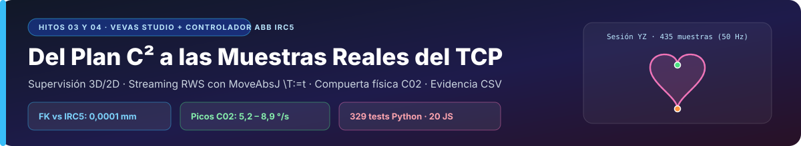
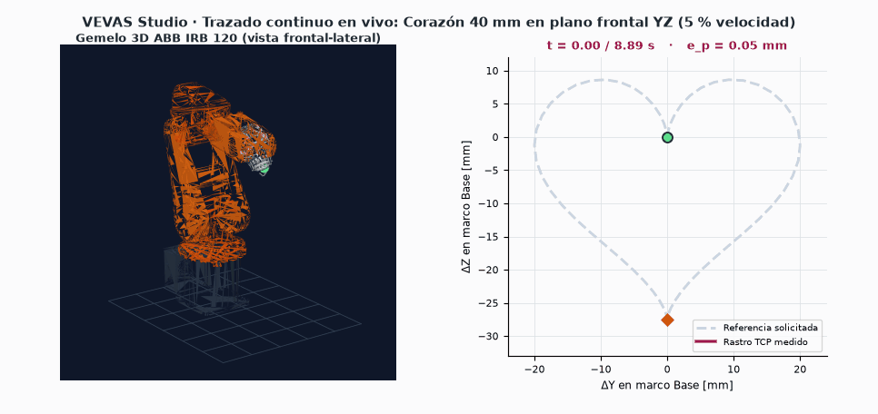

 

  <a href="01_COMO_EJECUTAR.md"><kbd>Cómo ejecutar</kbd></a>&nbsp;
  <a href="02_vevas_studio/README.md"><kbd>VEVAS Studio</kbd></a>&nbsp;
  <a href="01_docs/04_resultados/README.md"><kbd>Panel de resultados</kbd></a>&nbsp;
  <a href="01_docs/05_bitacora/06_bitacora.md"><kbd>Bitácora W12</kbd></a>&nbsp;
  <a href="01_docs/01_informe/01_Informe_Hito3_4.pdf"><kbd>Informe IEEE PDF</kbd></a>&nbsp;
  <a href="01_docs/02_presentacion/02_Defensa_Grupo_VEVAS.pdf"><kbd>Diapositivas Defensa</kbd></a>&nbsp;
  <a href="../README.md"><kbd>← Portada principal</kbd></a>

## 1. Figura central de la defensa: una sesión convertida en evidencia visual

Para demostrar de extremo a extremo cómo **VEVAS Studio** traduce una figura geométrica en órdenes articulares seguras y contrasta el plan con lo observado, la lámina siguiente integra **la figura solicitada**, **el camino quíntico $C^2$ planificado** y **las muestras medidas del TCP** de una misma sesión documentada:

### Enlaces directos y metadatos de esta misma ejecución

| Recurso / Parámetro | Detalle verificable |
| --- | --- |
| **CSV completo de la sesión (`50 Hz`)** | [`muestras_corazon_yz_40mm.csv`](01_docs/04_resultados/01_sesion_evidencia/muestras_corazon_yz_40mm.csv) (`435` muestras en movimiento; columnas `t_s`, `q1..q6_cmd_deg`, `q1..q6_med_deg`, `e1..e6_deg`, `e_p_mm`, `e_R_deg`, `x_mm`, `y_mm`, `z_mm`, `sigma_min`, `v1..v6_med_deg_s`) |
| **Resumen y plan calculado (`JSON`)** | [`resumen_corazon_yz_40mm.json`](01_docs/04_resultados/01_sesion_evidencia/resumen_corazon_yz_40mm.json) · [`plan_001_corazon_yz_40mm.json`](01_docs/04_resultados/01_sesion_evidencia/plan_001_corazon_yz_40mm.json) |
| **Videos vinculados a la sesión** | [Toma de simulación (`06_videos/03_hito3_4_simulacion/`)](../06_videos/03_hito3_4_simulacion/README.md) · [Tomas presenciales IRC5 (`06_videos/04_hito3_4_laboratorio_irc5/`)](../06_videos/04_hito3_4_laboratorio_irc5/README.md) |
| **Geometría, plano y unidades** | **Corazón de `40 mm`** en plano **`YZ` («De frente»**, mirado desde $+X$) · Marco **`Base` (`wobj0`)** · Herramienta **`tool0`** · Unidades: **`mm`**, **`°`**, **`°/s`**, **`s`** |
| **Métricas obtenidas** | Duración `8,52 s` · Desviación media al contorno `0,491 mm` · Error dinámico máx. `0,81 mm` (por retardo $\tau = 40\text{ ms}$, cae a `0 mm` en la parada de la cúspide `#32`) · **Error final `0,038 mm` / `0,0046°`** |

---

## 2. Validación presencial en laboratorio con el ABB IRC5 (24/11/2026)

<table>
  <tr>
    <td width="50%" valign="top">
      <h4 align="center">Compuerta física C02 en RAPID (<code>MoveAbsJ \T:=t</code>)</h4>
      
      
En modo <code>AUTO</code>, <a href="02_vevas_studio/05_rapid/VEVAS_RWS.mod"><code>VEVAS_RWS.mod</code></a> calcula en el propio IRC5 el tiempo mínimo por eje $t = \max(t_{\text{piso}}, 2{,}5|\Delta q_i|/v_{\text{Lim},i})$ para no superar el <b>5 % de catálogo</b> (<code>12,5 / 16,0 / 21,0 °/s</code>). Las velocidades reales medidas quedaron entre el <b>41,6 % y el 43,2 %</b> de ese tope.

    </td>
    <td width="50%" valign="top">
      <h4 align="center">Arquitectura desacoplada de VEVAS Studio</h4>
      
      
La interfaz web 3D/2D nunca habla directo con el robot: toda orden atraviesa <a href="02_vevas_studio/07_vevas/consola.py"><code>Consola</code></a>, supera el revisor de colisiones/singularidades, comprueba las compuertas <b>GO + C02</b> y despacha hacia <code>BackendSim</code>, <code>BackendROS</code> o <code>BackendRWS</code> grabando cada ciclo a <code>50 Hz</code>.

    </td>
  </tr>
</table>

### Resumen cuantitativo de las pruebas de laboratorio y software

| Etapa / Compuerta | Qué se puso a prueba | Resultado verificado | Evidencia en el repositorio |
| --- | --- | --- | --- |
| **Gate 0 · Auditoría IRC5** | Identificación de hardware y opciones del controlador | `IRB 120-3/0.6` (`s/n 120-101516`), `RobotWare 6.12.01.00`, `689-1 EGM`, `616-1 PC Interface`, `StateMachine 1.1` | [`06_bitacora.md` (`G0-001`)](01_docs/05_bitacora/06_bitacora.md) |
| **S0 · Validación offline** | 5.000 poses FK, casos con fallo intencional, IK y Jacobiano vs DF | Error FK `6 × 10⁻¹⁶ m`; detecta errores de TCP/orden (`0,120 m`); $J$ `8,93 × 10⁻¹¹ m/rad` | [`01_resumen.md`](02_vevas_studio/01_docs/01_datos/01_validacion_offline/01_resumen.md) |
| **Gate 1 · Lectura presencial (`S1-001`)** | Coincidencia entre `J1`–`J6` por RWS y pantalla del FlexPendant | **Error XYZ `0,0001 mm` y angular `0,0000°`** con `Base`, `wobj0` y `tool0` | [`05_CAMBIOS_24NOV.md`](01_docs/05_bitacora/05_CAMBIOS_24NOV.md) |
| **C02 · Tope físico en AUTO (`C02-001`)** | Pulsos por junta y streaming en `J6` medidos por RWS (~30 Hz) | Picos **`5,2–5,4 °/s`** (`J1–J3`), **`6,7–6,9 °/s`** (`J4–J5`) y **`8,8–8,9 °/s`** (`J6`) | [`fig_c02.pdf`](01_docs/01_informe/01_informe_ieee/01_img/fig_c02.pdf) |
| **Suite automatizada** | Cobertura de regresión Python y JavaScript | **`329` pruebas Python (`pytest`) + `20` pruebas JS (`node --test`)** | [`06_tests/README.md`](02_vevas_studio/06_tests/README.md) |

---

## 3. Cinco compuertas de seguridad y problemas reales resueltos

1. **Bloqueo por `StateMachine AddIn` y límite de tamaño RWS (`< 4.800` caracteres):** En lugar de depender de una configuración externa frágil, se escribió un servidor RAPID compacto ([`VEVAS_RWS.mod`](02_vevas_studio/05_rapid/VEVAS_RWS.mod), `4.707` caracteres) cargado y verificado por huella SHA/contenido antes de cada movimiento.
2. **Pausas bruscas punto a punto en figuras:** Se implementó **streaming continuo** con `MoveAbsJ \T:=t, z1` en los puntos de paso (acuse inmediato código `3` al encolar) y `fine` únicamente en vértices de cuadrado/triángulo, cúspide del corazón, extremos del saludo y punto final.
3. **Rechazo al trazar figuras partiendo cerca de $q_5 \approx 0^\circ$:** Cuando el brazo está en la singularidad de muñeca, la consola inserta automáticamente un tramo previo revisado `J5 → +30°` con parada y dibuja la figura desde esa postura segura.
4. **Orientación intuitiva para la audiencia («De frente»):** Las cinco figuras (`círculo`, `corazón`, `cuadrado`, `triángulo` y `saludo` en arco) se proyectan por defecto sobre el plano vertical **`YZ`**, ubicando la cámara 3D frente al robot y mostrando en paralelo el lienzo 2D milimetrado con error en vivo.
5. **Transparencia cuando el slider supera el tope físico del RAPID:** El slider permite explorar hasta `50 %` en simulación, pero con el IRC5 bajo C02 la revisión advierte explícitamente cuánto tardará en realidad el controlador (`duracion_c02_s`) y la pestaña **Velocidades** contrasta velocidad medida, planificada y tope por eje.

---

## 4. Navegación rápida para estudio y defensa

| Objetivo | Documento recomendado |
| --- | --- |
| **Leer el artículo completo de ingeniería** | [Informe IEEE Hitos 3 y 4 (`01_Informe_Hito3_4.pdf`)](01_docs/01_informe/01_Informe_Hito3_4.pdf) |
| **Repasar las diapositivas y 20 preguntas del tribunal** | [Diapositivas PDF](01_docs/02_presentacion/02_Defensa_Grupo_VEVAS.pdf) · [Guion y banco Q&A](01_docs/02_presentacion/01_PRESENTACION.md) |
| **Explorar todos los gráficos y CSV de resultados** | [Panel de resultados (`01_docs/04_resultados/README.md`)](01_docs/04_resultados/README.md) |
| **Seguir el manual operativo paso a paso (SIM y laboratorio)** | [Guía completa (855 líneas)](01_docs/03_guias/01_GUIA_COMPLETA_HITO3_4.md) · [Guía aportada 24/11](01_docs/03_guias/02_Guia_aportada_24NOV.md) |
| **Inspeccionar el código fuente de VEVAS Studio** | [Portada de VEVAS Studio (`02_vevas_studio/README.md`)](02_vevas_studio/README.md) |
