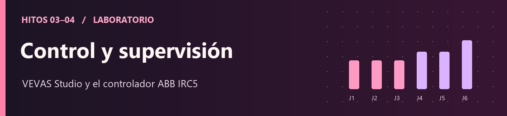
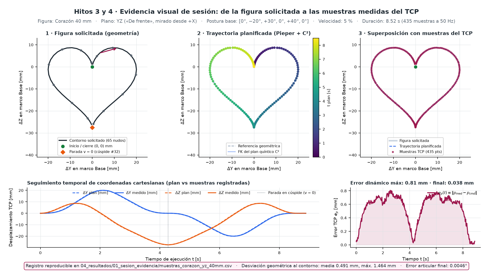
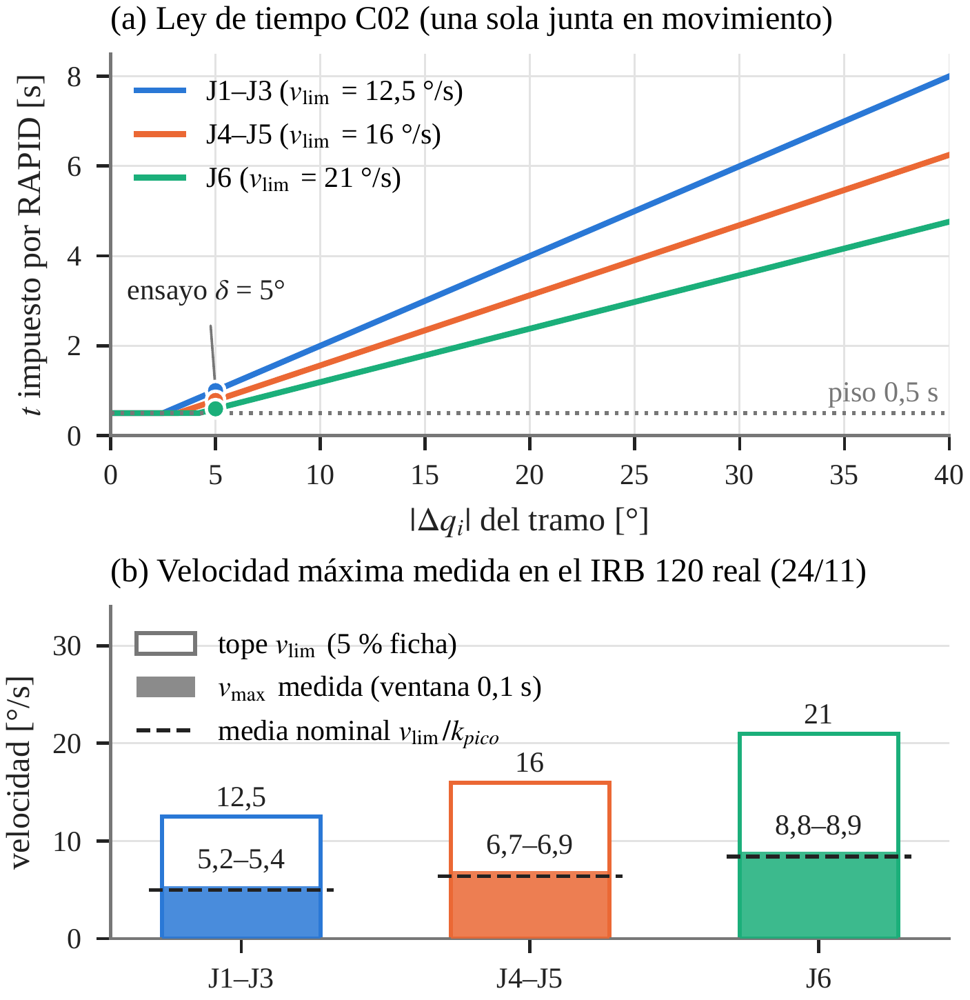
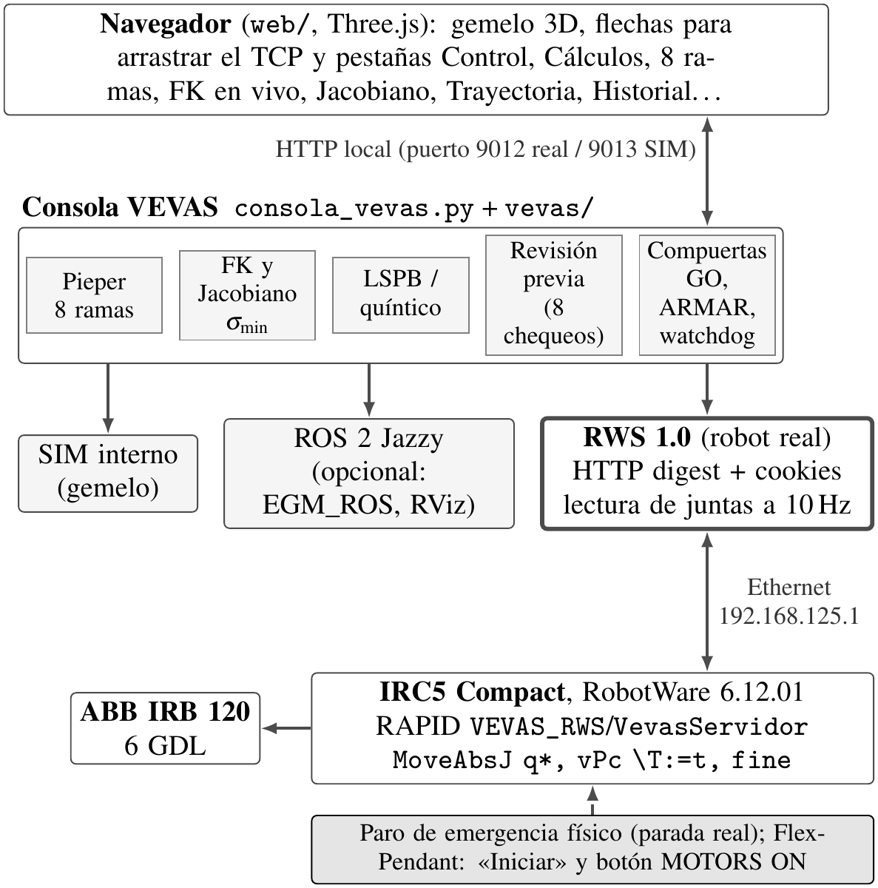

# Hitos 3 y 4 · De la planificación a la evidencia en el controlador ABB IRC5

[Cómo ejecutar](01_COMO_EJECUTAR.md) · [Abrir VEVAS Studio](02_vevas_studio/README.md) · [Bitácora W12](01_docs/05_bitacora/06_bitacora.md) · [Videos H3/4](../06_videos/README.md) · [Portada del proyecto](../README.md)

**VEVAS Studio** integra la cinemática inversa de Pieper, la revisión preventiva de colisiones y singularidades, la generación de trayectorias suaves $C^2$ y la comunicación con el controlador **ABB IRC5** mediante **Robot Web Services (RWS)** y un servidor **RAPID** con velocidad acotada por junta.

---

## 1. Figura central de la defensa: una sesión convertida en evidencia visual

Para defender un movimiento sin ambigüedad se colocan lado a lado **la geometría solicitada**, **la trayectoria planificada** por cinemática inversa + interpolación quíntica $C^2$ y **las muestras medidas del TCP**, acompañadas debajo por la evolución temporal y los archivos de datos de esa misma corrida.

### Trazabilidad de la sesión representada

| Campo | Valor documentado |
| --- | --- |
| **Ejecución y fecha** | Trazado completo de **Corazón (`40 mm`)** · esquema operativo del `2026-11-24` (reproducible offline en modo `SIM` con dinámica de actuador $\tau = 40\text{ ms}$) |
| **Plano y marco** | Plano **`YZ` («De frente»**, mirado desde $+X$ hacia la base) · Marco **`Base` (`wobj0`)** · Herramienta **`tool0`** |
| **Unidades del registro** | Posición TCP en **`mm`** (`x_mm`, `y_mm`, `z_mm`, `e_p_mm`) · Juntas en **`°`** (`q1..q6`) · Velocidades en **`°/s`** · Tiempo en **`s`** |
| **CSV de muestras (`50 Hz`)** | [`muestras_corazon_yz_40mm.csv`](01_docs/04_resultados/01_sesion_evidencia/muestras_corazon_yz_40mm.csv) |
| **Resumen y plan JSON** | [`resumen_corazon_yz_40mm.json`](01_docs/04_resultados/01_sesion_evidencia/resumen_corazon_yz_40mm.json) · [`plan_001_corazon_yz_40mm.json`](01_docs/04_resultados/01_sesion_evidencia/plan_001_corazon_yz_40mm.json) |
| **Videos vinculados** | [Carpeta SIM (`03_hito3_4_simulacion/`)](../06_videos/03_hito3_4_simulacion/README.md) · [Carpeta IRC5 (`04_hito3_4_laboratorio_irc5/`)](../06_videos/04_hito3_4_laboratorio_irc5/README.md) |

---

## 2. Verificación presencial frente al controlador ABB IRC5 (24/11/2026)

### Gate 1 · Coincidencia geométrica con el FlexPendant
En modo de solo lectura sobre el puerto `SERVICE` (`192.168.125.1`), las lecturas RWS de `J1`–`J6` coincidieron con el **FlexPendant DSQC 679** (`RobotWare 6.12.01.00`), arrojando una diferencia de cinemática directa (`Base`, `wobj0`, `tool0`) de **`0,0001 mm`** en posición y **`0,0000°`** en orientación ([entrada `S1-001` en bitácora](01_docs/05_bitacora/06_bitacora.md)).

### Compuerta C02 · Velocidad acotada en RAPID (`MoveAbsJ \T:=t`)

El módulo [`VEVAS_RWS.mod`](02_vevas_studio/05_rapid/VEVAS_RWS.mod) impone en el propio controlador el tiempo mínimo por tramo $t = \max\big(t_{\text{piso}},\, 2{,}5\cdot |\Delta q_i| / v_{\text{Lim},i}\big)$ con $v_{\text{Lim}} = [12{,}5,\; 12{,}5,\; 12{,}5,\; 16{,}0,\; 16{,}0,\; 21{,}0]^\circ\text{/s}$ (`5 %` de la ficha ABB), usando `z1` en puntos intermedios de streaming y `fine` en paradas y extremos:

| Grupo de ejes | Tope C02 (`5 %` ficha) | Pico medido en el IRC5 | Fracción del tope C02 |
| --- | --- | --- | --- |
| **`J1` – `J3`** | `12,5 °/s` | **`5,2 – 5,4 °/s`** | `41,6 – 43,2 %` |
| **`J4` – `J5`** | `16,0 °/s` | **`6,7 – 6,9 °/s`** | `41,9 – 43,1 %` |
| **`J6`** | `21,0 °/s` | **`8,8 – 8,9 °/s`** | `41,9 – 42,4 %` |

[Consultar cambios del 24/11](01_docs/05_bitacora/05_CAMBIOS_24NOV.md) · [Abrir figura vectorial PDF](01_docs/01_informe/01_informe_ieee/01_img/fig_c02.pdf)

---

## 3. Arquitectura y flujo de seguridad

~~~mermaid
flowchart LR
 A["Objetivo\n(pose, junta o figura)"] --> B["Pieper + Camino C²\n(65 nudos)"]
 B --> C["Revisión previa\n(colisiones, σ_min, topes)"]
 C --> D{"Compuertas\nGO + C02"}
 D -->|SIM| E["Simulador interno\n(τ = 40 ms, 250 Hz)"]
 D -->|IRC5 Real| F["Streaming RWS\nMoveAbsJ \\T:=t, z1/fine"]
 E --> G["Registro 50 Hz\nmuestras.csv + resumen.json"]
 F --> G
~~~

---

## 4. Entregables principales de los Hitos 3 y 4

| Material | Para qué sirve | Enlace |
| --- | --- | --- |
| **Informe IEEE · PDF** | Arquitectura, formulación de seguridad C02, incidentes reales resueltos y métricas experimentales. | [Abrir PDF](01_docs/01_informe/01_Informe_Hito3_4.pdf) |
| **Diapositivas de defensa** | Presentación final del Grupo VEVAS y guion con banco de 20 preguntas. | [Defensa PDF](01_docs/02_presentacion/02_Defensa_Grupo_VEVAS.pdf) · [Guion y Q&A](01_docs/02_presentacion/01_PRESENTACION.md) |
| **VEVAS Studio (código y tests)** | Aplicación completa (`07_vevas/`, `08_web/`, `05_rapid/`) con `329` pruebas Python y `20` JS. | [Abrir VEVAS Studio](02_vevas_studio/README.md) |
| **Guía completa y guía 24/11** | Procedimientos paso a paso de simulación, diagnóstico de red, GO y operación en celda. | [Guía completa](01_docs/03_guias/01_GUIA_COMPLETA_HITO3_4.md) · [Guía 24/11](01_docs/03_guias/02_Guia_aportada_24NOV.md) |
| **Bitácora formal W12** | Entradas `G0-001` a `C02-001` y seguimiento cronológico de laboratorio. | [Leer `06_bitacora.md`](01_docs/05_bitacora/06_bitacora.md) |
