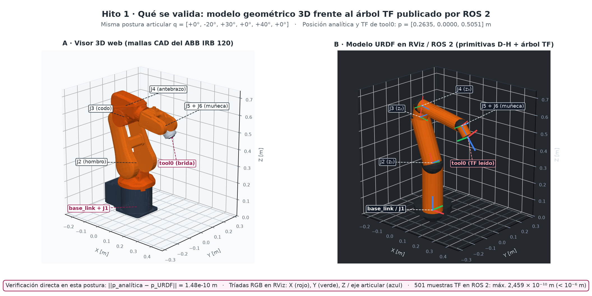
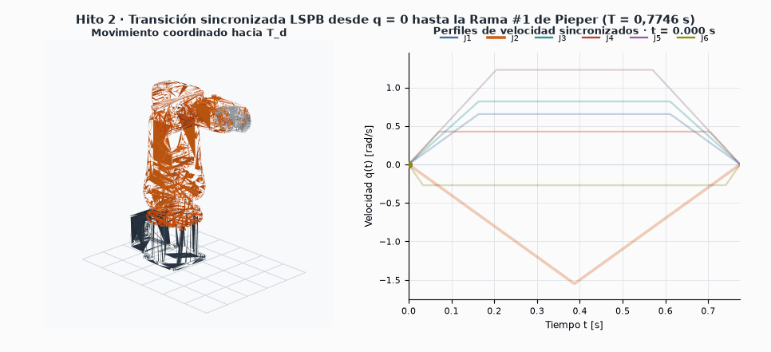
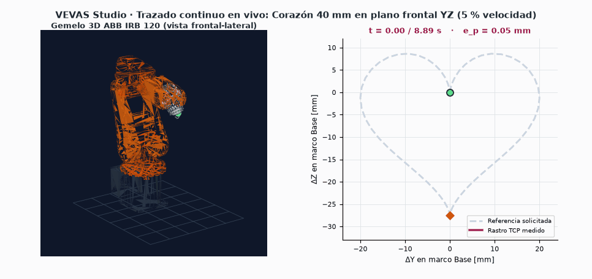
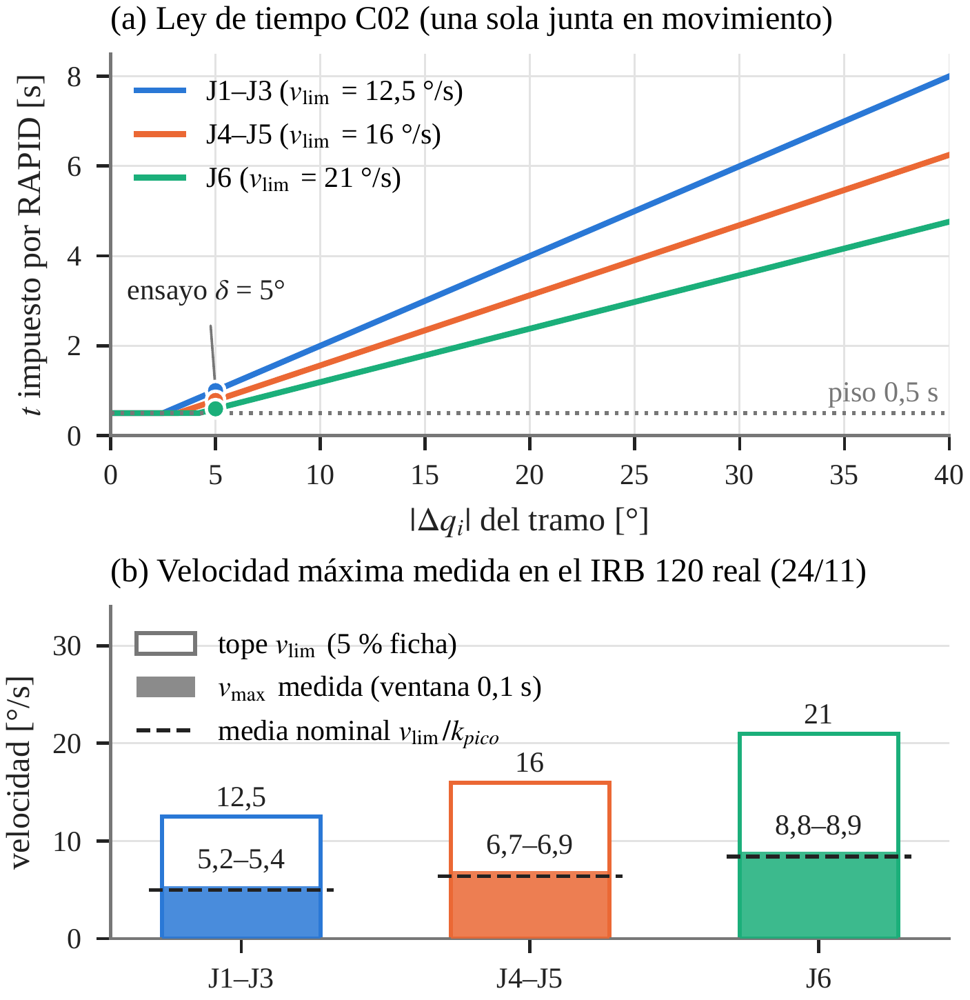

 

  <a href="01_hito1_gemelo_digital/README.md"><kbd>01 · Videos Hito 1</kbd></a>&nbsp;
  <a href="02_hito2_cinematica_dinamica/README.md"><kbd>02 · Videos Hito 2</kbd></a>&nbsp;
  <a href="03_hito3_4_simulacion/README.md"><kbd>03 · Videos SIM</kbd></a>&nbsp;
  <a href="04_hito3_4_laboratorio_irc5/README.md"><kbd>04 · Videos IRC5 Real</kbd></a>&nbsp;
  <a href="05_defensa_ejecutiva/README.md"><kbd>05 · Video Defensa</kbd></a>&nbsp;
  <a href="../README.md"><kbd>← Portada principal</kbd></a>

## 1. Galería visual de sesiones y guiones por hito

Cada subcarpeta organiza las tomas de demostración del **ABB IRB 120 + IRC5** junto con su escena de referencia, sus unidades, su plano de proyección y el enlace directo al archivo `CSV` o `JSON` que respalda lo mostrado en pantalla.

<table>
  <tr>
    <td width="50%" valign="top">
      <h4 align="center"><a href="01_hito1_gemelo_digital/README.md">01 · Hito 1 — Visor 3D frente a RViz y TF</a></h4>
      
      
<b>Tomas previstas:</b> recorrido por <code>base_link</code>, <code>J1</code>–<code>J6</code> y <code>tool0</code> en ambos entornos + ejecución de <code>validate_tf.py</code> (501 muestras sincronizadas).

    </td>
    <td width="50%" valign="top">
      <h4 align="center"><a href="02_hito2_cinematica_dinamica/README.md">02 · Hito 2 — Pose completa, Pieper y LSPB</a></h4>
      
      
<b>Tomas previstas:</b> <code>resolver_en_vivo.py</code> con pose dictada, selección de la Rama #1, sincronización LSPB (<code>0,7746 s</code>) y paso por singularidad $q_5 \to 0$.

    </td>
  </tr>
  <tr>
    <td width="50%" valign="top">
      <h4 align="center"><a href="03_hito3_4_simulacion/README.md">03 · Hitos 3/4 SIM — Figuras YZ y vista TCP</a></h4>
      
      
<b>Tomas previstas:</b> trazado del corazón de <code>40 mm</code> en plano frontal <code>YZ</code> al <code>5 %</code>, superposición 2D del TCP (<a href="../04_hito3_4_control_real/01_docs/04_resultados/01_sesion_evidencia/muestras_corazon_yz_40mm.csv">CSV asociado</a>) y aborto seguro.

    </td>
    <td width="50%" valign="top">
      <h4 align="center"><a href="04_hito3_4_laboratorio_irc5/README.md">04 · Hitos 3/4 IRC5 — Gate 1, C02 y streaming</a></h4>
      
      
<b>Tomas previstas:</b> lectura RWS igual al FlexPendant (<code>0,0001 mm</code>), verificación presencial C02 en <code>AUTO</code> (<code>5,2–8,9 °/s</code>) y trazado continuo con paro a mano.

    </td>
  </tr>
</table>

---

## 2. Índice de carpetas y archivos esperados

| Carpeta | Nombre canónico del archivo `.mp4` | Plano / Modo / Unidades | Registro cuantitativo vinculado |
| --- | --- | --- | --- |
| [`01_hito1_gemelo_digital/`](01_hito1_gemelo_digital/README.md) | `2026-10_hito1_validacion_tf_501_muestras.mp4` | `ROS 2 TF` · `m, rad` | [`01_validacion_hito1.txt`](../02_hito1_gemelo_digital/01_docs/04_resultados/01_validacion_hito1.txt) |
| [`02_hito2_cinematica_dinamica/`](02_hito2_cinematica_dinamica/README.md) | `2026-10_hito2_demo_recorrido_pose.mp4` | `CLI / Notebook` · `SI` | [`resultados.json`](../03_hito2_cinematica_dinamica/01_docs/04_resultados/resultados.json) |
| [`03_hito3_4_simulacion/`](03_hito3_4_simulacion/README.md) | `2026-11-24_hito3_4_sim_corazon_yz_40mm_5pct.mp4` | Plano `YZ` · `SIM` · `mm, °, °/s, s` | [`muestras_corazon_yz_40mm.csv`](../04_hito3_4_control_real/01_docs/04_resultados/01_sesion_evidencia/muestras_corazon_yz_40mm.csv) |
| [`04_hito3_4_laboratorio_irc5/`](04_hito3_4_laboratorio_irc5/README.md) | `2026-11-24_hito3_4_c02_verificacion_5pct.mp4` | `AUTO · C02 5 %` · `mm, °, °/s, s` | [`06_bitacora.md`](../04_hito3_4_control_real/01_docs/05_bitacora/06_bitacora.md) |
| [`05_defensa_ejecutiva/`](05_defensa_ejecutiva/README.md) | `2026-11_defensa_ejecutiva_grupo_vevas.mp4` | Síntesis `1080p · 3–5 min` | [`02_Defensa_Grupo_VEVAS.pdf`](../04_hito3_4_control_real/01_docs/02_presentacion/02_Defensa_Grupo_VEVAS.pdf) |

> [!NOTE]
> **Recomendación para archivos `.mp4` mayores a `50 MB`:** Aloja los archivos pesados en la sección **Releases** de GitHub (o Google Drive institucional) y conserva junto a cada toma una copia completada de [`plantilla_metadatos_video.json`](plantilla_metadatos_video.json) para mantener el clonado del repositorio instantáneo.
