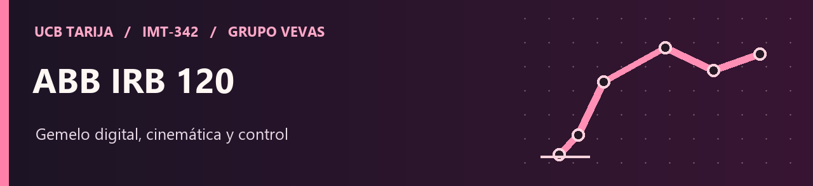

<p align="center">
  <a href="https://github.com/FlorenciaFrigerio/pfi-vevas-irb120/actions/workflows/ci.yml"></a>
  
  
  
  <a href="LICENSE"></a>
</p>

<p align="center">
  <a href="01_docs/02_INDICE.md"><b>Índice general</b></a> ·
  <a href="01_docs/04_LISTA_DE_ENTREGA.md"><b>Lista de entrega</b></a> ·
  <a href="01_docs/01_CRONOLOGIA.md"><b>Cronología y bitácoras</b></a> ·
  <a href="06_videos/README.md"><b>Videos por hito</b></a> ·
  <a href="01_docs/07_CATALOGO_DE_ARCHIVOS.md"><b>Catálogo completo</b></a>
</p>

# Proyecto Final Integrador · ABB IRB 120 · Grupo VEVAS

Desarrollo integral de un gemelo digital validado en **ROS 2**, un motor analítico de cinemática inversa, singularidades, trayectorias **LSPB** y dinámica reducida, y la plataforma **VEVAS Studio** para supervisión y control seguro del manipulador industrial **ABB IRB 120-3/0.6** con controlador **IRC5**.

---

## Panorama visual de los cuatro hitos

| Hito | Qué se construye y qué se demuestra | Evidencia principal |
| --- | --- | --- |
| **[01 · Gemelo digital](02_hito1_gemelo_digital/README.md)** | Modelo URDF generado desde Denavit-Hartenberg frente al visor 3D CAD y al árbol TF de ROS 2 en la misma postura (`base_link`, `J1`–`J6`, `tool0`). | **Error máx. `2,459 × 10⁻¹⁰ m`** en `501 / 1 000` lecturas sincronizadas ([registro](02_hito1_gemelo_digital/01_docs/04_resultados/01_validacion_hito1.txt) · [bitácora](02_hito1_gemelo_digital/01_docs/05_bitacora/README.md)) |
| **[02 · Cinemática y dinámica](03_hito2_cinematica_dinamica/README.md)** | Una misma pose seguida de principio a fin: pose objetivo $T_d$, 8 ramas de Pieper, postura elegida $q^*$, perfil LSPB sincronizado (`0,7746 s`) y recuadro 1R. | **`0` rechazos en `1 800` fronteras**, rango `5` en $q_5=0$ y **$\tau(2{,}5\text{ s}) = 4{,}4298\text{ N}\cdot\text{m}$** ([JSON](03_hito2_cinematica_dinamica/01_docs/04_resultados/resultados.json) · [bitácora](03_hito2_cinematica_dinamica/01_docs/05_bitacora/README.md)) |
| **[03–04 · Control del robot](04_hito3_4_control_real/README.md)** | Integración con el ABB IRC5 vía RWS/RAPID (`MoveAbsJ \T:=t`), compuerta física C02 al `5 %` y comparación directa entre figura solicitada, plan y muestras del TCP. | **FK `0,0001 mm` vs FlexPendant**, picos C02 `5,2–8,9 °/s` y [sesión CSV + figura central](04_hito3_4_control_real/01_docs/04_resultados/01_sesion_evidencia/README.md) ([bitácora W12](04_hito3_4_control_real/01_docs/05_bitacora/06_bitacora.md)) |


> [!TIP]
> **Figura central para la defensa:** La lámina superior reúne en una misma vista la geometría solicitada, el camino quíntico $C^2$ planificado y las muestras registradas del TCP ([CSV de la sesión](04_hito3_4_control_real/01_docs/04_resultados/01_sesion_evidencia/muestras_corazon_yz_40mm.csv) · [videos asociados](06_videos/03_hito3_4_simulacion/README.md)).

---

## Informes IEEE, presentación y material multimedia

| Entregable | Descripción | Enlace directo |
| --- | --- | --- |
| **Informe Hito 1** | Geometría D-H, derivación algebraica de orígenes URDF y validación frente a TF. | [Abrir PDF](02_hito1_gemelo_digital/01_docs/01_informe/01_Informe_Hito1_VEVAS.pdf) |
| **Informe Hito 2** | Desacoplamiento de Pieper, pruebas en fronteras, análisis SVD de singularidad, LSPB y torque 1R. | [Abrir PDF](03_hito2_cinematica_dinamica/01_docs/01_informe/01_Informe_Hito2.pdf) |
| **Informe Hitos 3 y 4** | Arquitectura VEVAS Studio, protocolo RWS/RAPID, compuerta C02 y validación en laboratorio. | [Abrir PDF](04_hito3_4_control_real/01_docs/01_informe/01_Informe_Hito3_4.pdf) |
| **Diapositivas de defensa** | Presentación ejecutiva completa del Grupo VEVAS y banco de 20 preguntas de defensa. | [Diapositivas PDF](04_hito3_4_control_real/01_docs/02_presentacion/02_Defensa_Grupo_VEVAS.pdf) · [Guion y Q&A](04_hito3_4_control_real/01_docs/02_presentacion/01_PRESENTACION.md) |
| **Carpeta de videos** | Organización por hito, guiones de grabación, metadatos de plano/unidades y sesiones vinculadas. | [Explorar `06_videos/`](06_videos/README.md) |

---

## Arquitectura del repositorio

```text
pfi-vevas-irb120/
├── .github/workflows/ci.yml          # Verificación continua: enlaces, pytest, JS, notebook y ROS 2 colcon
├── 01_docs/                          # Índice general, cronología, catálogo, lista de entrega y figuras
├── 02_hito1_gemelo_digital/          # Informe LaTeX, visor web 3D (GLTF), validación TF y bitácora H1
├── 03_hito2_cinematica_dinamica/     # Informe IEEE, anexo técnico, notebook ejecutable y bitácora H2
├── 04_hito3_4_control_real/          # Informe IEEE, defensa, bitácora W12, evidencias CSV y VEVAS Studio
├── 05_ros2_irb120_description/       # Paquete ROS 2 (URDF manual/generado, RViz, launch y módulos Python)
└── 06_videos/                        # Estructura audiovisual por hito vinculada a CSV y sesiones
```

---

## Verificación automática en `main`

Cada commit en `main` o `dev` ejecuta el flujo [`.github/workflows/ci.yml`](.github/workflows/ci.yml) sobre cuatro trabajos independientes:

1. **Integridad documental:** comprueba todos los enlaces relativos Markdown del repositorio (`0` enlaces rotos).
2. **Suite Python y Notebook:** ejecuta `compare_urdf.py`, los módulos científicos de los Hitos 1 y 2, el cuaderno completo [`01_Hito2_VEVAS.ipynb`](03_hito2_cinematica_dinamica/02_notebooks/01_Hito2_VEVAS.ipynb) con `nbconvert --execute` y la suite completa de `pytest` en [`06_tests/`](04_hito3_4_control_real/02_vevas_studio/06_tests/README.md).
3. **Suite JavaScript:** corre las `20` pruebas unitarias de interfaz, orientación y velocidades con `node --test`.
4. **Compilación ROS 2 Jazzy:** construye `irb120_description` con `colcon build` dentro del contenedor oficial `ros:jazzy-ros-base-noble` y verifica la instalación de los modelos URDF y el archivo de lanzamiento.

---

## Equipo y cátedra

**Grupo VEVAS** · Robótica IMT-342 · Gestión II-2026  
Carrera de Ingeniería Mecatrónica · Departamento de Ciencias de la Tecnología e Innovación  
**Universidad Católica Boliviana «San Pablo», Sede Tarija**

- Susann A. Baldiviezo Castellanos
- Alejandro J. Bejarano Romero
- Florencia Frigerio Arízaga
- Benjamín Soruco Guzmán

**Docente:** M.Sc. Ing. Bernardo Quiroga Turdera

---

<details>
<summary><b>Notas técnicas ampliadas y comandos rápidos de ejecución (Hitos 1, 2 y 3/4)</b></summary>

### 1. Comandos rápidos para Hito 2 y demostración en vivo

```bash
cd 05_ros2_irb120_description/04_scripts

# Recorrido completo narrado (FK -> Pieper -> Jacobiano -> Singularidad -> LSPB -> Torque 1R)
python3 demo_recorrido.py --seguido
python3 resolver_en_vivo.py --demo

# Regenerar las figuras visuales de evidencia (Hitos 1, 2 y 3/4)
python3 ../../01_docs/06_figuras/generar_evidencia_visual.py
```

### 2. Lanzamiento de VEVAS Studio (Hitos 3 y 4)

```bash
cd 04_hito3_4_control_real/02_vevas_studio
python3 vevas.py --modo sim --puerto 9012 --abrir

# Pruebas locales
python3 -m pytest 06_tests -q
node --test 06_tests/*.mjs
```

### 3. Compilación y visualización en ROS 2 Jazzy (Hito 1)

```bash
cd ~/ros2_ws && colcon build --packages-select irb120_description
source install/setup.bash
ros2 launch irb120_description display.launch.py
```

### 4. Tabla Denavit-Hartenberg empleada en todo el repositorio

Parametrización de Truc & Lam (2020), contrastada con las cotas oficiales del manual ABB IRB 120 (`x = 0,374 m`, `z = 0,630 m` en `q = 0`):

| $i$ | $\theta_i$ | $d_i$ [m] | $a_i$ [m] | $\alpha_i$ | Interpretación física |
| --- | --- | --- | --- | --- | --- |
| 1 | $q_1$ | `0,290` | `0,000` | $-\pi/2$ | Altura de la columna base |
| 2 | $q_2 - \pi/2$ | `0,000` | `0,270` | $0$ | Brazo inferior (offset entre cero ABB vertical y cero D-H horizontal) |
| 3 | $q_3$ | `0,000` | `0,070` | $-\pi/2$ | Codo con excentricidad lateral corta |
| 4 | $q_4$ | `0,302` | `0,000` | $+\pi/2$ | Antebrazo hacia el centro de muñeca |
| 5 | $q_5$ | `0,000` | `0,000` | $-\pi/2$ | Muñeca esférica ($a_4 = a_5 = 0$) |
| 6 | $q_6$ | `0,072` | `0,000` | $0$ | Distancia a la brida de salida (`tool0`) |

### 5. Alcance y limitaciones declaradas

- Los parámetros dinámicos del modelo 1R ($J = 0{,}25\text{ kg}\cdot\text{m}^2$, $m = 1{,}0\text{ kg}$, $\ell_c = 0{,}50\text{ m}$) provienen de la hoja oficial de cátedra, dado que ABB no publica masas ni tensores de inercia de los seis eslabones.
- Los archivos operativos de seguridad (`GO_VEVAS.json`, `evidencia_c02.json` y `sesiones/` crudas de laboratorio) están excluidos por `.gitignore` para impedir reutilizar autorizaciones caducadas.
- Licencia MIT ([`LICENSE`](LICENSE)).

</details>
