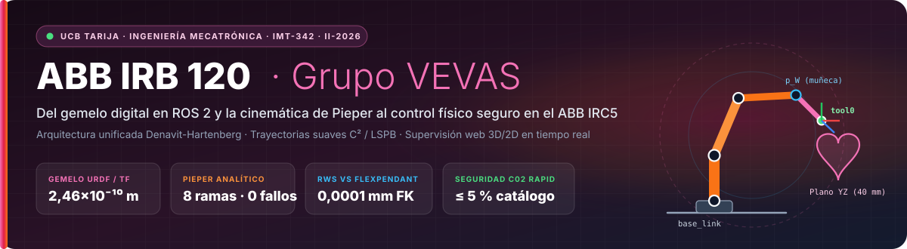
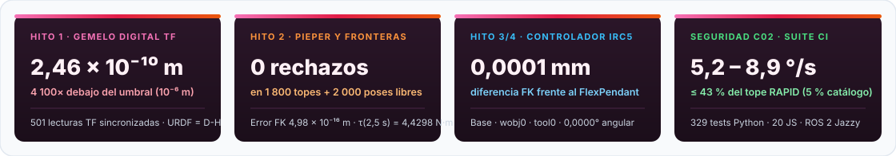
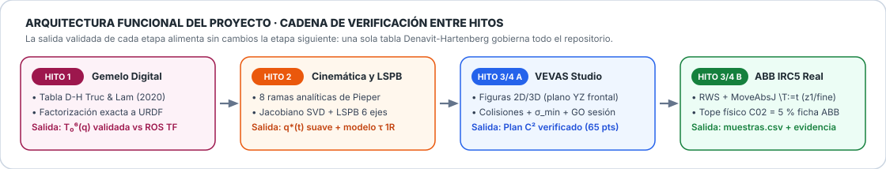
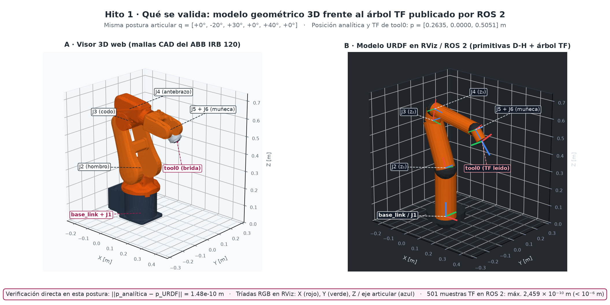
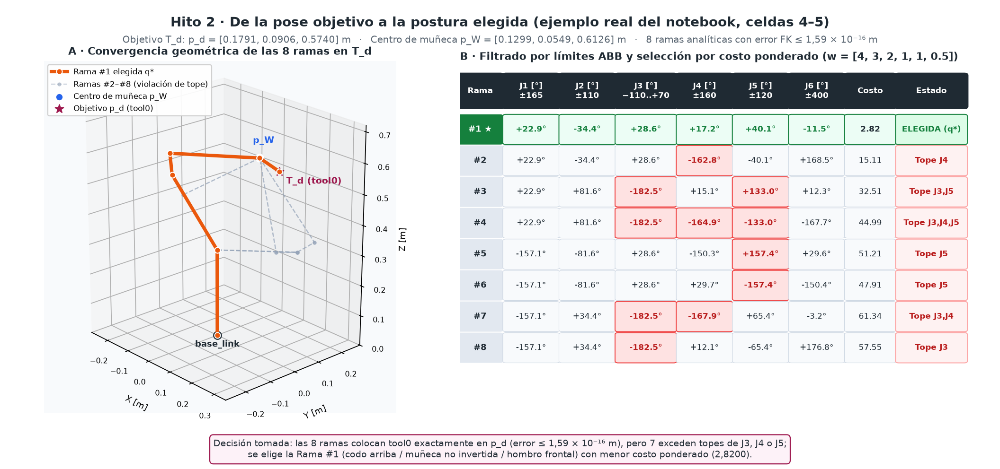
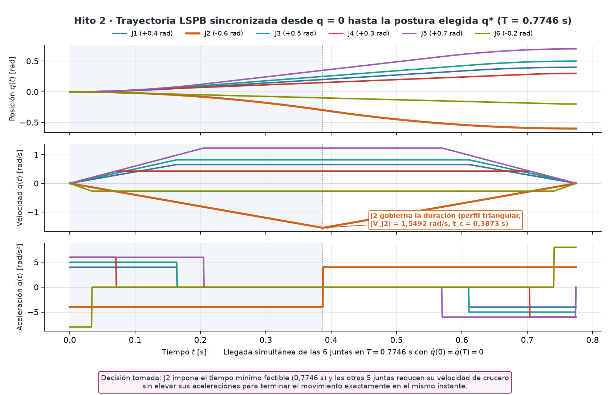
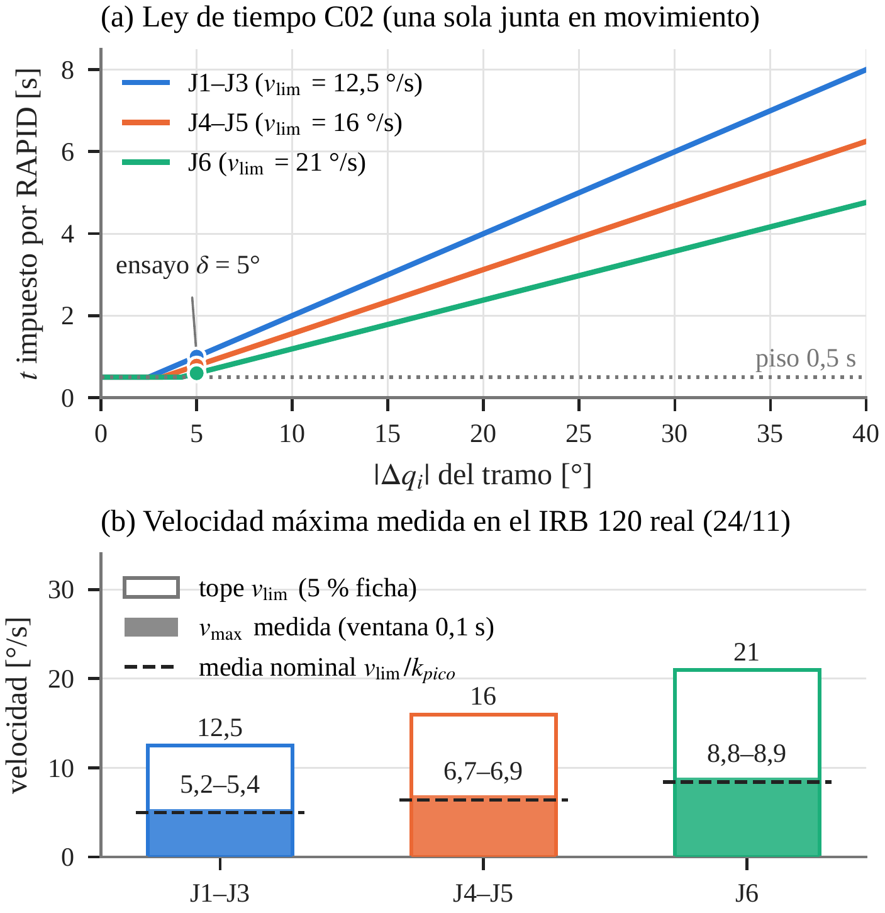
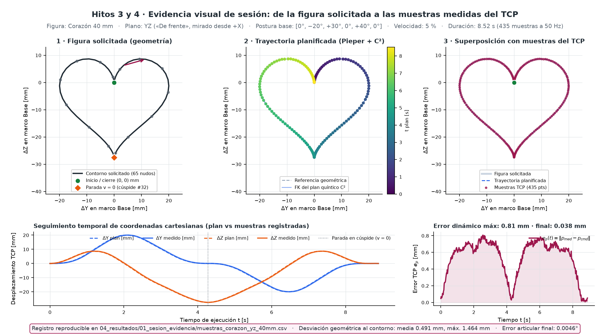
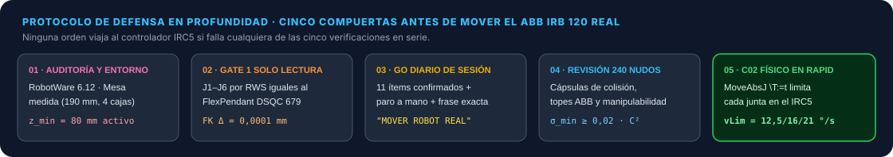

<div align="center">



<br>

<p>
  <a href="https://github.com/FlorenciaFrigerio/pfi-vevas-irb120/actions/workflows/ci.yml"></a>
  
  
  
  
  <a href="LICENSE"></a>
</p>

<p>
  <a href="02_hito1_gemelo_digital/README.md"><kbd>01 · Gemelo Digital</kbd></a>&nbsp;
  <a href="03_hito2_cinematica_dinamica/README.md"><kbd>02 · Cinemática y Dinámica</kbd></a>&nbsp;
  <a href="04_hito3_4_control_real/README.md"><kbd>03–04 · Control Real IRC5</kbd></a>&nbsp;
  <a href="04_hito3_4_control_real/02_vevas_studio/README.md"><kbd>VEVAS Studio</kbd></a>&nbsp;
  <a href="06_videos/README.md"><kbd>06 · Galería de Videos</kbd></a>&nbsp;
  <a href="01_docs/04_LISTA_DE_ENTREGA.md"><kbd>Lista de Entrega</kbd></a>
</p>

</div>







## 1. Evidencia visual de los cuatro hitos de un vistazo

Cada etapa del proyecto produce una evidencia gráfica y numérica directamente verificable: desde la identidad geométrica de los marcos del **ABB IRB 120** hasta las muestras medidas del **TCP** al trazar figuras sobre un plano frontal.

<table>
  <tr>
    <td width="50%" valign="top">
      <h4 align="center"><a href="02_hito1_gemelo_digital/README.md">Hito 1 · Qué modelos se comparan</a></h4>
      <a href="02_hito1_gemelo_digital/README.md">
        
      </a>
      <p><b>Visor 3D CAD frente a RViz / ROS 2 TF:</b> misma postura articular con <code>base_link</code>, <code>J1</code>–<code>J6</code> y <code>tool0</code> identificados. Error máximo <b>2,459 × 10⁻¹⁰ m</b> en 501 lecturas sincronizadas.</p>
    </td>
    <td width="50%" valign="top">
      <h4 align="center"><a href="03_hito2_cinematica_dinamica/README.md">Hito 2 · De la pose objetivo a la rama elegida</a></h4>
      <a href="03_hito2_cinematica_dinamica/README.md">
        
      </a>
      <p><b>Desacoplamiento de Pieper sobre una pose real del notebook:</b> las 8 ramas convergen con error ≤ <b>1,59 × 10⁻¹⁶ m</b>; 7 violan topes ABB y se elige la Rama #1 (costo <b>2,8200</b>).</p>
    </td>
  </tr>
  <tr>
    <td width="50%" valign="top">
      <h4 align="center"><a href="03_hito2_cinematica_dinamica/README.md">Hito 2 · Sincronización LSPB de 6 juntas</a></h4>
      <a href="03_hito2_cinematica_dinamica/README.md">
        
      </a>
      <p><b>Llegada simultánea en T = 0,7746 s:</b> <code>J2</code> gobierna el tiempo con perfil triangular y las otras 5 juntas reducen su velocidad de crucero sin elevar aceleraciones.</p>
    </td>
    <td width="50%" valign="top">
      <h4 align="center"><a href="04_hito3_4_control_real/README.md">Hitos 3 y 4 · Compuerta física C02 en el IRC5</a></h4>
      <a href="04_hito3_4_control_real/README.md">
        
      </a>
      <p><b>Tope impuesto en RAPID (5 % de ficha ABB):</b> picos medidos en laboratorio de <b>5,2–5,4 °/s</b> (<code>J1–J3</code>), <b>6,7–6,9 °/s</b> (<code>J4–J5</code>) y <b>8,8–8,9 °/s</b> (<code>J6</code>).</p>
    </td>
  </tr>
</table>

### Figura central de defensa · Sesión completa del TCP (geometría + plan + medición)



> [!TIP]
> **Cómo leer esta figura en la defensa:** El panel **(1)** fija el contorno pedido en milímetros (`Corazón 40 mm`, plano frontal `YZ`, inicio en `(0, 0) mm` y parada `v = 0` en la cúspide `#32`). El panel **(2)** muestra el camino quíntico $C^2$ calculado por Pieper y verificado contra colisiones y singularidades. El panel **(3)** superpone las **435 muestras medidas del TCP a 50 Hz**, cerrando en **`0,038 mm`** y **`0,0046°`**.  
> **Datos abiertos de esta misma sesión:** [`muestras_corazon_yz_40mm.csv`](04_hito3_4_control_real/01_docs/04_resultados/01_sesion_evidencia/muestras_corazon_yz_40mm.csv) · [`resumen_corazon_yz_40mm.json`](04_hito3_4_control_real/01_docs/04_resultados/01_sesion_evidencia/resumen_corazon_yz_40mm.json) · [`06_videos/03_hito3_4_simulacion/`](06_videos/03_hito3_4_simulacion/README.md)

---

## 2. Biblioteca de entregables, presentaciones y bitácoras

| Hito / Área | Informe técnico (PDF) | Presentación / Guion | Bitácora de decisiones | Evidencia reproducible |
| --- | --- | --- | --- | --- |
| **01 · Gemelo digital** | [Informe Hito 1](02_hito1_gemelo_digital/01_docs/01_informe/01_Informe_Hito1_VEVAS.pdf) | [Diapositivas Hito 1](02_hito1_gemelo_digital/01_docs/02_presentacion/01_Hito1_Gemelo_Digital_IRB120.pdf) · [Hoja A–J](02_hito1_gemelo_digital/01_docs/04_resultados/02_worksheet_A_a_J.pdf) | [Bitácora Hito 1 (`H1-01`..`H1-04`)](02_hito1_gemelo_digital/01_docs/05_bitacora/README.md) | [`01_validacion_hito1.txt`](02_hito1_gemelo_digital/01_docs/04_resultados/01_validacion_hito1.txt) · [`Visor 3D`](02_hito1_gemelo_digital/02_visor_web/README.md) |
| **02 · Cinemática y dinámica** | [Informe IEEE Hito 2](03_hito2_cinematica_dinamica/01_docs/01_informe/01_Informe_Hito2.pdf) · [Anexo](03_hito2_cinematica_dinamica/01_docs/01_informe/02_anexo_tecnico.md) | [Guion diapositivas](03_hito2_cinematica_dinamica/01_docs/02_presentacion/01_guion_integrante_1_diapos.md) · [Recorrido](03_hito2_cinematica_dinamica/01_docs/02_presentacion/02_guion_recorrido_exposicion.md) | [Bitácora Hito 2 (`H2-01`..`H2-05`)](03_hito2_cinematica_dinamica/01_docs/05_bitacora/README.md) | [`01_Hito2_VEVAS.ipynb`](03_hito2_cinematica_dinamica/02_notebooks/01_Hito2_VEVAS.ipynb) · [`resultados.json`](03_hito2_cinematica_dinamica/01_docs/04_resultados/resultados.json) |
| **03–04 · Control real IRC5** | [Informe IEEE Hitos 3/4](04_hito3_4_control_real/01_docs/01_informe/01_Informe_Hito3_4.pdf) | [Defensa Grupo VEVAS](04_hito3_4_control_real/01_docs/02_presentacion/02_Defensa_Grupo_VEVAS.pdf) · [20 preguntas Q&A](04_hito3_4_control_real/01_docs/02_presentacion/01_PRESENTACION.md) | [Bitácora W12 (`06_bitacora.md`)](04_hito3_4_control_real/01_docs/05_bitacora/06_bitacora.md) · [24/11](04_hito3_4_control_real/01_docs/05_bitacora/05_CAMBIOS_24NOV.md) | [`Sesión CSV`](04_hito3_4_control_real/01_docs/04_resultados/01_sesion_evidencia/README.md) · [`Resultados H3/4`](04_hito3_4_control_real/01_docs/04_resultados/README.md) |
| **06 · Videos y multimedia** | [Guía de seguridad y video](04_hito3_4_control_real/01_docs/03_guias/08_GUIA_6_SEGURIDAD_GO_Y_VIDEO.md) | [Escaleta video defensa (4 min)](06_videos/05_defensa_ejecutiva/README.md) | [Cronología general](01_docs/01_CRONOLOGIA.md) | [Carpeta `06_videos/`](06_videos/README.md) · [`Metadatos JSON`](06_videos/plantilla_metadatos_video.json) |

---

## 3. Una sola fuente geométrica: Tabla Denavit-Hartenberg y URDF

Todo el repositorio comparte la misma parametrización Denavit-Hartenberg estándar (Truc & Lam, 2020), contrastada contra las dimensiones nominales del manual técnico oficial del **ABB IRB 120-3/0.6** (alcance al centro de muñeca $a_2 + \sqrt{a_3^2 + d_4^2} = 0{,}270 + 0{,}310 = 0{,}580\text{ m}$):

| Eje $i$ | $\theta_i$ [rad] | $d_i$ [m] | $a_i$ [m] | $\alpha_i$ [rad] | Rango ABB [°] | Vel. catálogo [°/s] | Función geométrica |
| :---: | :---: | :---: | :---: | :---: | :---: | :---: | --- |
| **1** | $q_1$ | `0,290` | `0,000` | $-\pi/2$ | `−165 a +165` | `250` | Giro acimutal de la columna base |
| **2** | $q_2 - \pi/2$ | `0,000` | `0,270` | `0` | `−110 a +110` | `250` | Elevación del brazo (reconcilia cero vertical ABB con cero D-H) |
| **3** | $q_3$ | `0,000` | `0,070` | $-\pi/2$ | `−110 a +70` | `250` | Articulación de codo con offset lateral corto |
| **4** | $q_4$ | `0,302` | `0,000` | $+\pi/2$ | `−160 a +160` | `320` | Rotación longitudinal del antebrazo |
| **5** | $q_5$ | `0,000` | `0,000` | $-\pi/2$ | `−120 a +120` | `320` | Inclinación de muñeca esférica ($a_4 = a_5 = 0$) |
| **6** | $q_6$ | `0,072` | `0,000` | `0` | `−400 a +400` | `420` | Giro axial de la brida de salida (`tool0`) |

> [!NOTE]
> **Verificación inmediata de cierre en $q = [0,0,0,0,0,0]$:** Sin multiplicar matrices, las cotas de catálogo determinan la brida en $x = d_4 + d_6 = 0{,}302 + 0{,}072 = \mathbf{0{,}374\text{ m}}$, $y = \mathbf{0{,}000\text{ m}}$ y $z = d_1 + a_2 + a_3 = 0{,}290 + 0{,}270 + 0{,}070 = \mathbf{0{,}630\text{ m}}$. En VEVAS Studio, el marco `tool0` incorpora además el giro estándar $R_z(\pi)$ de ABB, coincidiendo con el FlexPendant del laboratorio en **`0,0001 mm`** y **`0,0000°`**.

---

## 4. Hallazgos técnicos clave y defensas de ingeniería

### A · Pruebas dirigidas a fronteras y singularidades (Hito 2)
Un muestreo uniforme visita los topes articulares con probabilidad casi nula. Al someter el motor cinemático a bancos dirigidos aparecieron y se corrigieron tres fallos sutiles:

| Caso límite evaluado | Antes de la corrección | Después de la corrección | Solución implementada en [`pieper.py`](05_ros2_irb120_description/04_scripts/pieper.py) |
| --- | :---: | :---: | --- |
| **1 800 poses exactamente sobre topes ABB** | `193` rechazos falsos | **`0` rechazos** | Margen numérico `TOL_LIMITE = 1e-9 rad` + `clip` exclusivamente para ruido de redondeo de `atan2`. |
| **Muñeca casi extendida (`|q5| = 10⁻⁷..5×10⁻⁵ rad`)** | Falsa singularidad | **100 % resueltas** | Cálculo directo de $|s_5| = \operatorname{hypot}(R_{36}[0,2], R_{36}[1,2])$ y `atan2` en lugar de `arccos(c5)`. |
| **Giro de `J6` (`±400°`) ante pose ya alcanzada** | `6,2832 rad` (`360°`) | **`8,88 × 10⁻¹⁶ rad`** | Expansión de congruencias $q_i \pm 2\pi n$ dentro de límites antes de medir el costo ponderado. |

### B · Cinco compuertas de seguridad antes de mover el ABB IRB 120 real (Hitos 3 y 4)



1. **Gate 0 y entorno medido:** identificación de controlador (`RobotWare 6.12.01.00`), modelo de mesa abierta a `190 mm` con cuatro cajas de exclusión y cota vertical mínima $z_{\min} = 80\text{ mm}$.
2. **Gate 1 de solo lectura:** contraste en vivo entre `J1`–`J6` leídas por RWS y el FlexPendant antes de autorizar cualquier escritura.
3. **GO diario de sesión (`GO_VEVAS.json`):** autorización local con vigencia diaria, confirmación explícita de zona despejada, paro de emergencia a mano y frase obligatoria `"MOVER ROBOT REAL"`.
4. **Revisión preventiva de 240 muestras:** cada plan comprueba cápsulas de colisión, límites articulares con margen, manipulabilidad escalada $\sigma_{\min}$ y continuidad $C^2$.
5. **Compuerta física C02 en RAPID (`VEVAS_RWS.mod`):** el propio controlador ABB calcula $t = \max(t_{\text{piso}},\, 2{,}5\cdot |\Delta q_i| / v_{\text{Lim},i})$, garantizando físicamente que ningún eje supere el `5 %` de la velocidad de catálogo incluso si el usuario sube el slider en pantalla.

---

## 5. Estructura numerada del repositorio

```text
pfi-vevas-irb120/
├── .github/workflows/ci.yml             # CI en main: enlaces, pytest (329), Node (20), notebook y colcon ROS 2
├── 01_docs/                             # Índice general, cronología, lista de entrega, catálogo y 18 figuras PNG/SVG
├── 02_hito1_gemelo_digital/             # Informe LaTeX, visor web 3D (GLTF), validación TF y bitácora técnica H1
├── 03_hito2_cinematica_dinamica/        # Informe IEEE, anexo técnico, notebook ejecutable y bitácora técnica H2
├── 04_hito3_4_control_real/             # Informe IEEE, defensa, bitácora W12, sesión CSV y app VEVAS Studio
│   └── 02_vevas_studio/                 # Consola web 3D/2D, cliente RWS, módulos RAPID, simulador y 26 suites de test
├── 05_ros2_irb120_description/          # Paquete ROS 2 ament_cmake: URDF manual/generado, RViz, launch y scripts
└── 06_videos/                           # Evidencias audiovisuales organizadas por hito + metadatos JSON
```

[Explorar el mapa de carpetas](01_docs/05_MAPA_DEL_REPOSITORIO.md) · [Consultar el catálogo numerado completo (385 archivos)](01_docs/07_CATALOGO_DE_ARCHIVOS.md)

---

## 6. Guía rápida de ejecución y reproducción

### A · Explorar el visor 3D del Hito 1 (sin instalar ROS)
```bash
python -m http.server 8000 --directory 02_hito1_gemelo_digital/02_visor_web
# Abrir http://localhost:8000/ en el navegador
```

### B · Correr el recorrido narrado y el resolvedor en vivo del Hito 2
```bash
cd 05_ros2_irb120_description/04_scripts
python demo_recorrido.py --seguido          # Las 6 etapas encadenadas (FK -> Pieper -> J -> Sing. -> LSPB -> 1R)
python resolver_en_vivo.py --demo           # Seis casos borde resueltos en vivo
python compare_urdf.py                      # Verifica identidad exacta entre URDF manual y generado
```

### C · Abrir VEVAS Studio en modo Simulación (Windows o Ubuntu)
```bash
cd 04_hito3_4_control_real/02_vevas_studio
python -m pip install -r requirements.txt
python vevas.py --modo sim --puerto 9012 --abrir
```

### D · Ejecutar las suites de pruebas y regenerar todas las figuras visuales
```bash
# Pruebas unitarias e integración de VEVAS Studio
cd 04_hito3_4_control_real/02_vevas_studio
python -m pytest 06_tests -q
node --test 06_tests/*.mjs

# Regenerar las figuras 10..13 y la sesión CSV desde cero
cd ../..
python 01_docs/06_figuras/generar_evidencia_visual.py
```

### E · Compilar y lanzar en ROS 2 Jazzy (Ubuntu 24.04)
```bash
mkdir -p ~/ros2_ws/src && ln -s "$(pwd)/05_ros2_irb120_description" ~/ros2_ws/src/irb120_description
cd ~/ros2_ws && colcon build --packages-select irb120_description
source install/setup.bash
ros2 launch irb120_description display.launch.py
```

---

## 7. Integración continua en `main` (GitHub Actions)

El archivo [`.github/workflows/ci.yml`](.github/workflows/ci.yml) verifica automáticamente cada cambio subido al repositorio mediante cuatro trabajos paralelos:

| Job de GitHub Actions | Entorno | Qué certifica en cada commit |
| --- | --- | --- |
| **`enlaces`** | `ubuntu-24.04` | Comprueba que el 100 % de los enlaces e imágenes Markdown apunten a rutas existentes (`0` rotos). |
| **`python-y-notebook`** | `Python 3.12` | Ejecuta `compare_urdf.py`, los módulos del Hito 2, el cuaderno `01_Hito2_VEVAS.ipynb` completo (`nbconvert --execute`) y `pytest` sobre `06_tests/`. |
| **`javascript`** | `Node.js 22` | Ejecuta las `20` pruebas de geometría 2D, cuaterniones/Euler y semáforos de velocidad (`node --test`). |
| **`ros2-colcon`** | `ros:jazzy-ros-base-noble` | Compila `irb120_description` con `colcon build` y comprueba la instalación de los URDF y `display.launch.py`. |

---

## 8. Equipo y cátedra

<div align="center">

**Grupo VEVAS · Robótica (IMT-342) · Gestión II-2026**  
Carrera de Ingeniería Mecatrónica · Departamento de Ciencias de la Tecnología e Innovación  
**Universidad Católica Boliviana «San Pablo» — Sede Tarija**

| Integrantes del equipo | Rol transversal |
| --- | --- |
| **Susann A. Baldiviezo Castellanos** | Modelado cinemático, validación ROS 2, integración y documentación |
| **Alejandro J. Bejarano Romero** | Cinemática inversa, trayectorias, pruebas y validación experimental |
| **Florencia Frigerio Arízaga** | Arquitectura de software, interfaz VEVAS Studio y control RWS/RAPID |
| **Benjamín Soruco Guzmán** | Dinámica, seguridad operativa de celda y pruebas con el ABB IRC5 |

**Docente guía:** M.Sc. Ing. Bernardo Quiroga Turdera · **Licencia:** [MIT](LICENSE)

</div>
