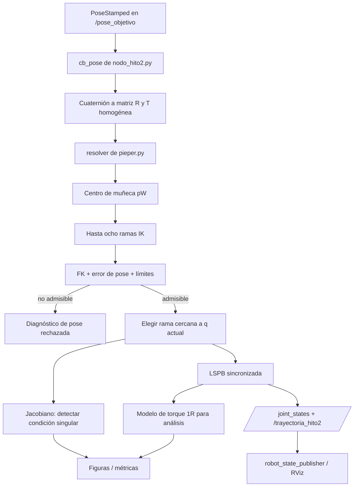

# Secuencia completa: cómo se une el proyecto

Esta es la vista de extremo a extremo. Si te preguntan “¿qué archivo integra el Hito 2?”, la respuesta principal es **`nodo_hito2.py`**: recibe la pose, llama al resolvedor, crea LSPB y publica los mensajes ROS. `resolver_en_vivo.py` ofrece una ruta paralela para demostrar el cálculo desde consola.

## Diagrama



## Paso a paso

### 1. El modelo común calcula la pose
`fk_irb120.py` es la referencia analítica. Convierte los seis ángulos a una pose homogénea y proporciona los límites. En sentido inverso, la FK vuelve a comprobar cada candidata.

### 2. Entra una pose objetivo
`nodo_hito2.py` recibe `geometry_msgs/PoseStamped` por `/pose_objetivo`. Convierte el cuaternión a R y ensambla la matriz T. La ruta de consola hace un trabajo parecido con entradas interactivas en `resolver_en_vivo.py`.

```python
# nodo_hito2.py líneas 109-156
    def cb_pose(self, msg):
        """Pose recibida -> Pieper -> filtrado -> LSPB."""
        p = msg.pose.position
        o = msg.pose.orientation
        try:
            R = quat_a_matriz(o.x, o.y, o.z, o.w)
        except ValueError as e:
            self.avisar(f"RECHAZADA: {e}")
            return

        T_d = np.eye(4)
        T_d[:3, :3] = R
        T_d[:3, 3] = [p.x, p.y, p.z]

        q_obj, admisibles, rechazadas = resolver(T_d, q_actual=self.q_actual)

        if q_obj is None:
            motivos = {}
            for _, m in rechazadas:
                clave = m.split(":")[0]
                motivos[clave] = motivos.get(clave, 0) + 1
            detalle = ", ".join(f"{k} x{v}" for k, v in motivos.items())
            self.avisar(
                f"POSE INALCANZABLE  p=[{p.x:.3f}, {p.y:.3f}, {p.z:.3f}]  "
                f"8 ramas calculadas, 0 admisibles ({detalle})")
            return

        ep, eR = error_pose(q_obj, T_d)

        # Advertencia de singularidad ANTES de mover: si la pose objetivo
        # esta cerca de q5 = 0, la cinematica diferencial inversa exigiria
        # velocidades articulares desmedidas.
        w = medida_manipulabilidad(q_obj)
        aviso_sing = ""
        if abs(q_obj[4]) < 0.05 or w < UMBRAL_W:
            aviso_sing = (f"  [!] CERCA DE SINGULARIDAD: q5 = {q_obj[4]:+.4f} "
                          f"rad, w = {w:.3e}")

        self.traj = LSPBSincronizado(self.q_actual, q_obj, V_MAX, A_MAX)
        self.t0 = self.get_clock().now()

        self.avisar(
            f"ACEPTADA  {len(admisibles)}/8 ramas admisibles  |  "
            f"elegida: {etiquetar(q_obj)}  |  "
            f"dE = {ep:.2e} m, dR = {eR:.2e}  |  "
            f"T = {self.traj.T:.3f} s{aviso_sing}")

        self.publicar_trayectoria(q_obj)
```

### 3. Pieper calcula, verifica y elige
`resolver(T, q_actual)` es el coordinador algorítmico de `pieper.py`: llama al cálculo de ramas, las filtra y aplica el costo de selección. Una rama no queda aceptada hasta reproducir la pose y respetar los topes.

```python
# pieper.py líneas 248-264
def resolver(T_d, q_actual=None, verbose=False):
    """Pipeline completo: Pieper -> filtrado -> seleccion."""
    if q_actual is None:
        q_actual = np.zeros(6)
    crudas = pieper(T_d)
    admisibles, rechazadas = filtrar(crudas, T_d)
    q_sel, costo = elegir(admisibles, q_actual)

    if verbose:
        print(f"  ramas calculadas  {len(crudas)}")
        print(f"  admisibles        {len(admisibles)}")
        print(f"  rechazadas        {len(rechazadas)}")
        for q, motivo in rechazadas:
            print(f"     - {motivo}")
        if q_sel is not None:
            print(f"  elegida           {etiquetar(q_sel)}  (costo {costo:.4f})")
    return q_sel, admisibles, rechazadas
```

### 4. La postura se vuelve trayectoria
Con q objetivo admisible, el nodo crea `LSPBSincronizado(q_actual, q_obj, V_MAX, A_MAX)`. El perfil proporciona q, qdot y qddot en cada tiempo.

```python
# nodo_hito2.py líneas 159-176
    def cb_timer(self):
        """Muestrea el perfil LSPB y publica el estado articular."""
        if self.traj is None:
            return
        t = (self.get_clock().now() - self.t0).nanoseconds * 1e-9
        if t >= self.traj.T:
            t = self.traj.T
            q, _, _ = self.traj(t)
            self.q_actual = q[0]
            self.publicar_estado(self.q_actual)
            self.avisar(f"TRAYECTORIA COMPLETA  q_final = "
                        f"{np.round(self.q_actual, 4).tolist()}")
            self.traj = None
            return

        q, qd, _ = self.traj(t)
        self.q_actual = q[0]
        self.publicar_estado(q[0], qd[0])
```

### 5. ROS recibe el resultado
El timer publica el estado articular mientras avanza. Además, `publicar_trayectoria` emite una trayectoria muestreada para inspección. RViz puede visualizar estados a través de los componentes ROS; eso no convierte el nodo en un controlador de hardware.

```python
# nodo_hito2.py líneas 188-202
    def publicar_trayectoria(self, q_obj, n=50):
        """Publica la trayectoria completa, para quien quiera inspeccionarla."""
        msg = JointTrajectory()
        msg.header.stamp = self.get_clock().now().to_msg()
        msg.joint_names = NOMBRES
        for t in np.linspace(0.0, self.traj.T, n):
            q, qd, qdd = self.traj(t)
            pt = JointTrajectoryPoint()
            pt.positions = [float(v) for v in q[0]]
            pt.velocities = [float(v) for v in qd[0]]
            pt.accelerations = [float(v) for v in qdd[0]]
            pt.time_from_start = Duration(
                sec=int(t), nanosec=int((t % 1.0) * 1e9))
            msg.points.append(pt)
        self.pub_traj.publish(msg)
```

### 6. Análisis y evidencia

| Momento | Código | Pregunta |
|---|---|---|
| Antes o al elegir | `jacobiano.py` y `singularidad.py` | ¿Qué rango y movilidad tiene la postura? |
| Sobre la trayectoria 1R | `dinamica_1r.py` | ¿Qué parte del torque es inercial y cuál gravitatoria? |
| Comunicación | `graficas.py` | ¿Cómo se leen curvas y unidades? |
| Reproducibilidad | `capturar_resultados.py` | ¿Qué semillas, cifras y versiones se registraron? |
| Modelo ROS heredado | `generate_urdf.py`, `compare_urdf.py`, `validate_tf.py` | ¿Cómo se derivó y contrastó el gemelo digital? |

> **Evitar dos publicadores en competencia:** para visualizar el estado que publica el nodo, lanzar la descripción con `gui:=false`; de lo contrario, `joint_state_publisher_gui` también puede publicar `/joint_states`.

## Qué script “une todo” y cuáles son demostradores

- **Integración principal Hito 2:** `nodo_hito2.py` (ROS 2: entrada de pose, resolvedor, trayectoria y tópicos).
- **Demostrador interactivo:** `resolver_en_vivo.py` (construye poses, lista ramas y explica descartes en consola).
- **Reproducción de cifras:** `capturar_resultados.py` (corre módulos y escribe artefactos de resultados; revisar su carpeta de salida antes de ejecutarlo).
- **Cuaderno narrativo:** `notebooks/Hito2_VEVAS.ipynb` reúne el desarrollo teórico, cálculos y salidas registradas.

## Guion oral de 60 segundos

“La pose objetivo llega al nodo ROS. Convertimos su orientación y posición en una transformación homogénea. Pieper retrocede al centro de muñeca, calcula hasta ocho ramas y las valida con cinemática directa y límites ABB. Elegimos una cercana a la postura actual. LSPB describe cómo llegar y el nodo publica estados y trayectoria. El Jacobiano/SVD explica la movilidad de esa postura y el modelo 1R estima el esfuerzo pedagógico. Las pruebas respaldan el cálculo bajo sus escenarios; no son una identificación completa ni control industrial del ABB.”

## Siguiente lectura

Empieza en [`README.md`](README.md) y sigue `01_fk_irb120.md` → `02_pieper.md` → `03_jacobiano.md` → `04_singularidad.md` → `05_lspb.md` → `06_dinamica_1r.md` → `09_nodo_hito2.md`. Los demás scripts complementan visualización, evidencia y gemelo del Hito 1.
