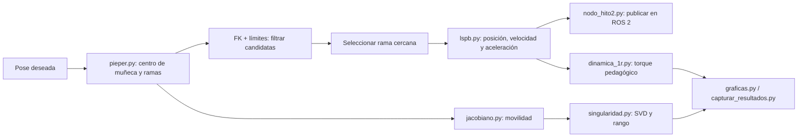

# Guía navegable del código - Hito 2 ABB IRB 120

> Material organizado para abrir cada script en una pestaña Markdown. Cada capítulo cita bloques reales del archivo, explica el propósito y lo conecta con teoría, pruebas y defensa.

## Secuencia completa

### Flujo narrado

1. [`fk_irb120.py`](01_fk_irb120.md) define los parámetros geométricos y permite calcular la pose directa.
2. [`pieper.py`](02_pieper.md) recibe la pose objetivo, resta el offset de herramienta y calcula ramas.
3. Cada candidata se valida por FK y límites; luego se escoge una cercana a la postura actual.
4. [`lspb.py`](05_lspb.md) describe el movimiento en el tiempo.
5. [`nodo_hito2.py`](09_nodo_hito2.md) integra el cálculo con tópicos ROS 2; [`resolver_en_vivo.py`](08_resolver_en_vivo.md) sirve para demostración en consola.
6. [`jacobiano.py`](03_jacobiano.md) y [`singularidad.py`](04_singularidad.md) describen la movilidad.
7. [`dinamica_1r.py`](06_dinamica_1r.md) evalúa el modelo de torque pedagógico.
8. [`graficas.py`](10_graficas.md) presenta resultados y [`capturar_resultados.py`](11_capturar_resultados.md) registra evidencia.

## Los 15 scripts, orden de estudio

| # | Archivo | Enfoque |
|---:|---|---|
| 1 | [`fk_irb120.py`](01_fk_irb120.md) | Base compartida - dominar |
| 2 | [`pieper.py`](02_pieper.md) | Núcleo Hito 2 - dominar |
| 3 | [`jacobiano.py`](03_jacobiano.md) | Núcleo Hito 2 - dominar |
| 4 | [`singularidad.py`](04_singularidad.md) | Núcleo Hito 2 - dominar con límites |
| 5 | [`lspb.py`](05_lspb.md) | Núcleo Hito 2 - dominar |
| 6 | [`dinamica_1r.py`](06_dinamica_1r.md) | Núcleo Hito 2 - dominar modelo y alcance |
| 7 | [`dinamica.py`](07_dinamica.md) | Complementario - comprender límites |
| 8 | [`resolver_en_vivo.py`](08_resolver_en_vivo.md) | Núcleo de demostración - dominar uso |
| 9 | [`nodo_hito2.py`](09_nodo_hito2.md) | Núcleo de integración - dominar |
| 10 | [`graficas.py`](10_graficas.md) | Complementario - saber leer |
| 11 | [`capturar_resultados.py`](11_capturar_resultados.md) | Complementario - entender escritura y reproducibilidad |
| 12 | [`generate_urdf.py`](12_generate_urdf.md) | Hito 1 - contexto geométrico |
| 13 | [`add_visuals.py`](13_add_visuals.md) | Hito 1 - contexto visual |
| 14 | [`compare_urdf.py`](14_compare_urdf.md) | Hito 1 - apoyo de verificación |
| 15 | [`validate_tf.py`](15_validate_tf.md) | Hito 1 - prueba de integración |

## ¿Qué estudiar a fondo?

**Ocho piezas de lógica e integración:** `fk_irb120.py`, `pieper.py`, `jacobiano.py`, `singularidad.py`, `lspb.py`, `dinamica_1r.py`, `resolver_en_vivo.py` y `nodo_hito2.py`.

**Los otros siete:** `dinamica.py`, `graficas.py`, `capturar_resultados.py`, `generate_urdf.py`, `add_visuals.py`, `compare_urdf.py` y `validate_tf.py`. Deben saber explicar responsabilidad, entrada/salida, relación y límites.

## Reparto sugerido para cuatro

| Persona | Estudio principal | Conexiones que debe explicar |
|---|---|---|
| 1 | FK, D-H y scripts URDF | cómo la geometría alimenta Pieper/Jacobiano |
| 2 | Pieper y resolvedor interactivo | cómo FK valida y límites reducen ramas |
| 3 | Jacobiano y singularidad | rango, SVD, tarea compatible y residuo |
| 4 | LSPB, dinámica 1R y nodo ROS | cómo se convierte solución en trayectoria publicada |

El equipo completo debe poder narrar la secuencia de arriba y defender qué pruebas respaldan cada afirmación.

## Hoja común para estudiar cada archivo

- **Propósito:** ¿qué responsabilidad única tiene?
- **Entrada/salida:** ¿qué datos recibe y qué devuelve/publica?
- **Bloques:** ¿qué hacen las funciones principales y en qué orden?
- **Teoría:** ¿qué ecuación o regla implementan?
- **Relación:** ¿quién lo llama y qué usa?
- **Evidencia:** ¿qué prueba o cifra lo respalda?
- **Límite:** ¿qué NO demuestra?
- **Defensa:** preparar una respuesta oral de 60 segundos y una pregunta cruzada.

## Advertencias técnicas que no deben perderse

- Pieper produce **hasta ocho** ramas; las singularidades pueden hacer que algunas coincidan.
- La cinemática directa vuelve a comprobar las candidatas inversas.
- En una singularidad se pierden direcciones instantáneas; no necesariamente todo movimiento.
- La pseudoinversa puede dejar residuo si el twist pedido no pertenece a la imagen del Jacobiano.
- El modelo 1R usa parámetros docentes. El 2R es complementario y sus masas son estimadas.
- El experimento de torque cerca de q5=0 usa supuestos; no es torque certificado ABB.
- El nodo ROS publica estados/trayectoria para integración; no afirmar que controla hardware industrial.
- `capturar_resultados.py` escribe resultados: revisar los destinos antes de ejecutarlo.

## Fuentes

Los bloques de código se extraen del contenido actual de `scripts/`. Los resultados y límites se contrastan con `notebooks/Hito2_VEVAS.ipynb`, `docs/hito2/anexo_tecnico.md` y `docs/hito2/resultados/`. El README raíz conserva texto antiguo del Hito 1, por lo que no debe ser el único índice del Hito 2.
