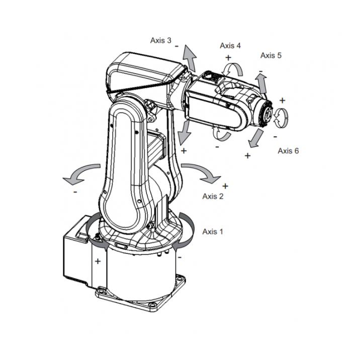

# Hito 1 · Gemelo digital

**Explora el IRB 120 en el visor y consulta cómo se comprobó el modelo.**

[Abrir visor y guía](COMO_EJECUTAR.md) · [Documentación](01_docs/)

## Material del hito

Modelo URDF del ABB IRB 120 y validación de cinemática directa.

[1. Cómo ejecutar](COMO_EJECUTAR.md) · [2. Informe](01_docs/01_informe/01_Informe_Hito1_VEVAS.pdf) · [3. Índice de documentos](01_docs/INDICE.md)

La cinemática directa compone las transformaciones de las seis juntas.

$$T_0^6 = T_0^1 T_1^2 T_2^3 T_3^4 T_4^5 T_5^6$$

[Registro de validación](01_docs/04_resultados/01_validacion_hito1.txt)

Modelo, presentación y validación

- [Presentación del gemelo digital](01_docs/02_presentacion/01_Hito1_Gemelo_Digital_IRB120.pdf)
- [Hoja de trabajo A–J](01_docs/04_resultados/02_worksheet_A_a_J.pdf)
- [Descripción y scripts ROS 2](../ros2_irb120_description/scripts/README.md)

