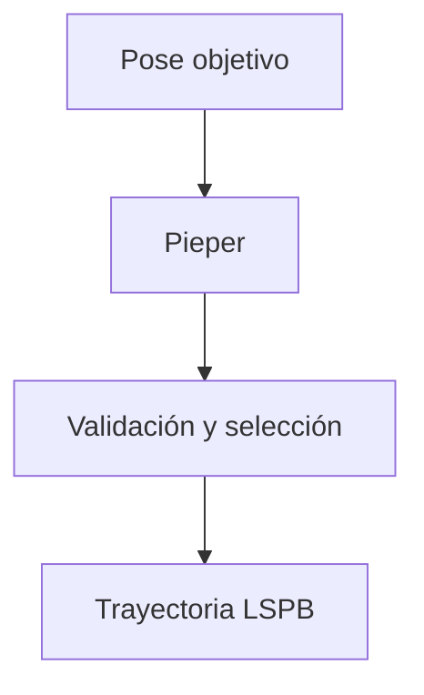

# Hito 2 · Cinemática y dinámica

Cinemática inversa de Pieper, Jacobiano, singularidades, perfiles LSPB y dinámica reducida.

[Cómo ejecutar](COMO_EJECUTAR.md) · [Informe](docs/informe/Informe_Hito2.pdf) · [Índice de documentos](docs/INDICE.md)

El método analítico calcula candidatos articulares y comprueba la pose con cinemática directa.

[Figura de trayectoria LSPB](docs/resultados/figuras/fig_lspb.pdf)
