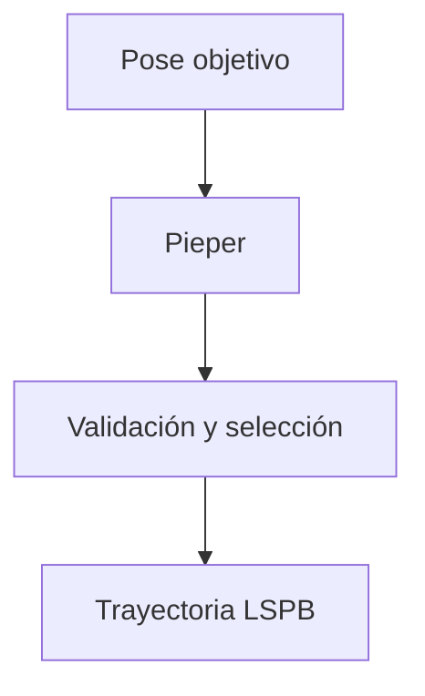

# 02 · Hito 2 · Cinemática y dinámica

 

Cinemática inversa de Pieper, Jacobiano, singularidades, perfiles LSPB y dinámica reducida.

[1. Cómo ejecutar](COMO_EJECUTAR.md) · [2. Informe](docs/informe/01_Informe_Hito2.pdf) · [3. Índice de documentos](docs/INDICE.md)

El método analítico calcula candidatos articulares y comprueba la pose con cinemática directa.

[Figura de trayectoria LSPB](docs/resultados/figuras/fig_lspb.pdf)

Resultados de cinemática y dinámica

La trayectoria LSPB sincroniza el movimiento de las seis juntas. El modelo dinámico reducido usa un perfil de referencia para calcular el torque de una junta.

$$\tau = I\ddot{q} + \tau_g(q)$$

- [Notebook del Hito 2](notebooks/Hito2_VEVAS.ipynb)
- [Resultados reproducibles](docs/resultados/resultados.json)
- [Figura de manipulabilidad](docs/resultados/figuras/fig_manipulabilidad.pdf)
- [Figura del torque 1R](docs/resultados/figuras/fig_torque_1r.pdf)

