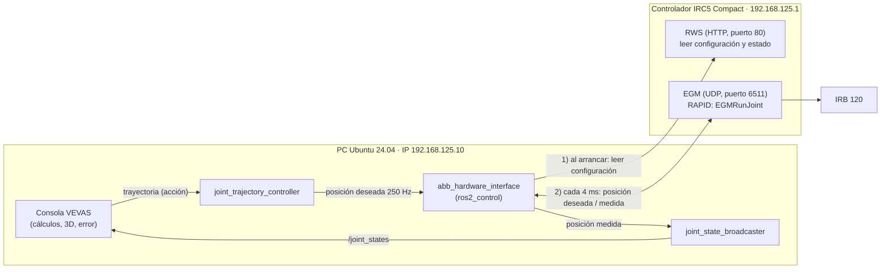

# Guía 2. Cómo conectarse al brazo, de cero hasta tener ROS 2 leyendo y mandando

Grupo VEVAS · ABB IRB 120-3/0.6 con IRC5 Compact (RobotWare 6.12.01.00)

Esta guía va del cable al movimiento, en el orden en que hay que hacerlo. Los pasos 1 a 5 **no mueven el robot** y se pueden hacer apenas haya acceso al laboratorio. Los pasos 6 a 8 cambian la configuración del controlador y los hace o autoriza el encargado. Desde el paso 9 ROS controla el robot.

## 0. Cómo se habla con el robot (idea general)



Hay **dos canales** entre la PC y el controlador:

| Canal | Protocolo | Para qué | Opción del controlador |
|---|---|---|---|
| RWS (Robot Web Services) | HTTP, puerto 80, usuario y clave | Leer estado (juntas, pose, modo) y configuración. El driver lo usa al arrancar. | 616-1 PC Interface |
| EGM (Externally Guided Motion) | UDP, puerto 6511 | Mandar la posición deseada y recibir la medida cada 4 ms. Es lo que mueve el robot. | 689-1 EGM |

Las dos opciones están instaladas en nuestro controlador (se vio en el FlexPendant).

**Nadie de la red puede mover el robot por RWS con nuestra configuración**: la consola y las herramientas de este repo solo hacen lecturas por RWS. El movimiento va únicamente por EGM, y EGM solo actúa mientras el programa RAPID está corriendo en el controlador, que se arranca a mano desde el FlexPendant.

## 1. Cable

1. Controlador encendido y ya arrancado (el FlexPendant muestra la pantalla normal).
2. Selector de modo en **Manual**. Motores apagados está bien: para leer no hace falta encenderlos.
3. Cable de red normal (RJ45) desde la PC al puerto **SERVICE** del IRC5 Compact (el que tiene la IP fija 192.168.125.1). No usar el puerto WAN para empezar.

## 2. IP fija en Ubuntu

Ver el nombre de la tarjeta de red por cable:

```bash
ip -br link
```

Aparece algo como `enp3s0` o `enx00e04c...` (si es un adaptador USB). Usar ese nombre en lugar de `enp3s0`:

```bash
sudo nmcli con add type ethernet ifname enp3s0 con-name abb-service \
  ipv4.method manual ipv4.addresses 192.168.125.10/24 \
  ipv4.never-default yes ipv6.method disabled
sudo nmcli con up abb-service
ip -4 addr show enp3s0
```

`ipv4.never-default yes` hace que el internet siga saliendo por el Wi-Fi. Si el perfil ya existía: `sudo nmcli con delete abb-service` y repetir.

## 3. Ping (guardando la evidencia)

Crear la carpeta de evidencia de Gate 1 y guardar todo con fecha:

```bash
cd ~/abb_ws/src/pfi-vevas-irb120/hito3_4
mkdir -p docs/datos/gate1
ping -c 4 192.168.125.1 | tee docs/datos/gate1/$(date +%F_%H%M)_ping.txt
```

| Resultado | Qué hacer |
|---|---|
| `0% packet loss` | Seguir |
| `Destination Host Unreachable` | Revisar la IP (paso 2) y que el cable esté en SERVICE |
| `100% packet loss` | Otro cable u otro puerto; esperar a que el controlador termine de arrancar |
| `Network is unreachable` | La tarjeta no tiene IP: repetir el paso 2 con el nombre correcto |

## 4. RWS: leer el controlador sin mover nada

```bash
F=docs/datos/gate1/$(date +%F_%H%M)
curl -s --digest -u "Default User:robotics" "http://192.168.125.1/rw/system/robottype?json=1" | tee ${F}_robottype.json
curl -s --digest -u "Default User:robotics" "http://192.168.125.1/rw/system?json=1"           | tee ${F}_system.json
curl -s --digest -u "Default User:robotics" "http://192.168.125.1/rw/panel/opmode?json=1"     | tee ${F}_opmode.json
curl -s --digest -u "Default User:robotics" "http://192.168.125.1/rw/motionsystem/mechunits/ROB_1/jointtarget?json=1" | tee ${F}_jointtarget.json
```

`Default User` y `robotics` son el usuario y la clave de fábrica de RWS (los mismos que usa el driver). Si el laboratorio los cambió, la respuesta es `401` y hay que pedirlos al encargado.

Lo que debe salir: el tipo de robot (IRB 120-3/0.6), la versión de RobotWare, el modo (MANR = manual reducido, AUTO) y los ángulos `rax_1` ... `rax_6` en grados. **Comparar esos ángulos con los del FlexPendant** (Menú → Movimiento, vista de ejes) y sacar una foto del FlexPendant: eso es la prueba S1 con fuente, unidad y hora.

## 5. Nuestra FK contra la del controlador (dominio 2 de la rúbrica)

```bash
python3 herramientas/verificar_convencion_rws.py --posturas 3
```

Qué hace, en palabras simples: le pregunta al controlador "¿en qué ángulos están las juntas?" y "¿dónde está tool0 según vos?". Con esos mismos ángulos calcula nuestra FK y compara las dos poses. Entre postura y postura pide que alguien mueva el robot con el FlexPendant (en Manual, con el dispositivo de habilitación) a otra postura **lejos de q5 = 0** y lo deje quieto.

Si las tres dan `COINCIDE` (e_p < 0.5 mm, e_R < 0.05°), quedan probadas a la vez la tabla D-H, el orden de las juntas, los signos y los offsets. El resultado se guarda en `docs/datos/validacion_rws.csv`. Si alguna da `NO COINCIDE`, el script dice qué signos lo arreglarían.

Reglas del protocolo que cumple este script: compara tool0 contra tool0 (nunca brida contra TCP), lee las juntas antes y después de la pose para asegurarse de que el robot estaba quieto (si no, el resultado es "inconcluso por tiempo") y usa la base del robot como marco.

**Hasta aquí no se movió nada desde la PC.** Con los pasos 3 a 5 guardados ya hay evidencia de Gate 1 (S1) y de validación del modelo propio contra el controlador.

## 6. Elegir cómo arrancar EGM en el controlador (con el encargado)

Hay dos rutas. Para saber cuál usar, en el FlexPendant: Menú → Editor de programas → Módulos, en la tarea `T_ROB1`.

| Si se ve... | Ruta | Cómo se arranca EGM |
|---|---|---|
| Módulos de StateMachine (nombres como `TRobMain`, `TRobEGM`, `TRobRAPID`, `TRobUtility`) | **B: StateMachine** | Desde ROS: `ros2 service call /rws_client/start_egm_joint ...` (necesita modo AUTO) |
| Un programa propio del laboratorio, u otro `main` | **A: módulo VEVAS** | Cargando `rapid/TRob1Main_VEVAS.mod` en un programa aparte, sin borrar el del laboratorio |
| La tarea vacía | **A: módulo VEVAS** | Cargar `rapid/TRob1Main_VEVAS.mod` |

Recomendación: **Ruta A**, porque se entiende completa (el código RAPID está en el repo y se explica en la defensa) y se arranca y se detiene desde el FlexPendant. Nunca borrar módulos de otros grupos: si la tarea ya tiene un programa, el encargado guarda una copia y carga el nuestro como programa nuevo.

Por qué `TRob1Main_VEVAS.mod` y no el original de `abb_ros2`: el original, al pulsar PLAY, mueve el robot solo a la postura [0, 0, 0, 0, 30, 0] a 200 mm/s antes de empezar. El nuestro usa la postura actual (`CJointT()`), así que **al arrancar el robot no se mueve**: solo empieza a seguir lo que manda ROS.

## 7. Configurar el canal UDP de EGM (con el encargado)

En RobotStudio (conectado por el puerto SERVICE) o en el FlexPendant: Controlador → Configuración → Communication → **Transmission Protocol** → Añadir:

| Campo | Valor |
|---|---|
| Name | `ROB_1` |
| Type | `UDPUC` |
| Remote Address | `192.168.125.10` (la IP del Ubuntu) |
| Remote port number | `6511` |
| Local port number | `0` |

Si ya existe un `ROB_1`, **no se sobrescribe**: se revisa con el encargado. Después hay que reiniciar el controlador (reinicio normal).

En el Ubuntu, abrir el puerto en el firewall (solo si `sudo ufw status` dice `active`):

```bash
sudo ufw allow from 192.168.125.1 to any port 6511 proto udp
```

## 8. Revisar el paquete del IRB 120 en ROS 2

En el xacro de `ros2_control` de `abb_irb120_support` (el que hizo Claude Code) tienen que estar estos parámetros:

```xml
<param name="rws_port">${rws_port}</param>
<param name="rws_ip">${rws_ip}</param>
<param name="egm_port">6511</param>
```

y las juntas deben llamarse `joint_1` ... `joint_6`, con interfaces de comando `position` y `velocity` (el driver exige las dos). Para encontrarlo:

```bash
grep -rn "egm_port\|rws_ip" ~/abb_ws/src/abb_irb120
```

## 9. Arrancar el driver con el robot real

Orden importante: primero ROS, después el RAPID. El driver espera hasta 50 segundos a que EGM empiece a mandar datos; si no llegan, se rinde con `Failed to connect to robot`.

Terminal 1 (driver):

```bash
source /opt/ros/jazzy/setup.bash && source ~/abb_ws/install/setup.bash
ros2 launch abb_bringup abb_control.launch.py \
  description_package:=abb_irb120_support description_file:=<NOMBRE_DEL_XACRO>.xacro \
  moveit_config_package:=abb_irb1200_5_90_moveit_config launch_rviz:=false \
  use_fake_hardware:=false rws_ip:=192.168.125.1
```

Mientras dice `Not connected to robot...`, en el FlexPendant:

- Ruta A: Menú → Editor de programas → **PP a Main** → con el dispositivo de habilitación apretado a la mitad (en Manual) o con el selector en AUTO, pulsar **PLAY**. En la pantalla aparece `VEVAS: inicio EGM...` y luego `EGM listo`.
- Ruta B: selector en AUTO, motores ON, y en otra terminal `ros2 service call /rws_client/start_egm_joint abb_robot_msgs/srv/TriggerWithResultCode` (con `ros2 launch abb_bringup abb_rws_client.launch.py robot_ip:=192.168.125.1` corriendo).

Cuando el driver dice `Connected to robot` y `ros2_control hardware interface was successfully started!`, revisar en la terminal 2:

```bash
ros2 control list_hardware_components     # debe decir abb_hardware_interface/ABBSystemHardware, active
ros2 control list_controllers             # joint_state_broadcaster y joint_trajectory_controller: active
ros2 topic echo /joint_states --once      # comparar con el FlexPendant
```

En este punto el robot **sigue quieto**: el `joint_trajectory_controller` arranca manteniendo la posición medida. Guardar la salida de los tres comandos en `docs/datos/gate1/` (es la evidencia S2).

Sobre el modo: no pudimos confirmar en la documentación si EGM acepta el modo Manual reducido con el dispositivo de habilitación. Probar primero así (es lo más seguro: si se suelta el botón, el robot se detiene). Si el controlador no lo permite, el encargado decide si se usa AUTO, siempre con una persona con la mano en el paro de emergencia. Anotar lo que pase en la bitácora.

## 10. La consola, primero en solo lectura

Terminal 3:

```bash
cd ~/abb_ws/src/pfi-vevas-irb120/hito3_4
source /opt/ros/jazzy/setup.bash && source ~/abb_ws/install/setup.bash
python3 consola_vevas.py --modo ros --solo-lectura --abrir
```

La banda de arriba debe decir **ROBOT REAL · SOLO LECTURA**. Se ve el robot real en 3D, la FK en vivo, el Jacobiano en vivo y se pueden calcular planes, pero no se puede armar el movimiento. Mover el robot con el joystick del FlexPendant y ver que el modelo 3D lo sigue: eso es una gran evidencia S2 para el video.

## 11. Mover

Recién con todo lo anterior funcionando, con el GO del día lleno (Guía 6):

```bash
python3 consola_vevas.py --modo ros --real --go GO_VEVAS.json --abrir
```

y seguir la Guía 4 (junta por junta) antes de cualquier otra cosa.

## 12. Apagar

1. PARAR en la consola y cerrar la consola (Ctrl+C).
2. Detener el programa RAPID en el FlexPendant (STOP).
3. Ctrl+C al driver.
4. Motores OFF. Si hay que apagar el controlador: POWER a OFF y **esperar 3 minutos** antes de abrir nada.

## 13. Problemas y soluciones

| Síntoma | Causa probable | Qué hacer |
|---|---|---|
| `curl` responde `401 Unauthorized` | Usuario o clave de RWS distintos | Pedirlos al encargado; usar `--usuario` y `--clave` en el script |
| El driver repite `Failed to collect ... (waiting indefinitely)` | No llega a RWS | `ping`, `curl` del paso 4, y `rws_ip:=192.168.125.1` en el launch |
| `Not connected to robot...` 100 veces y luego `Failed to connect to robot` | El RAPID no se arrancó a tiempo, o EGM no llega por UDP | Arrancar el RAPID antes de 50 s; revisar `ROB_1` (IP y puerto) y el firewall |
| En el FlexPendant: `41822 No data from the UdpUc device` | El controlador no recibe nada de la PC | IP del Ubuntu igual a la del `ROB_1`, puerto 6511, firewall, driver corriendo |
| A veces conecta recién al segundo intento | Comportamiento conocido de EGM | Parar el RAPID y volver a arrancarlo (lo dice la documentación del driver) |
| `Input rejected` al pedir motores ON por ROS | En Manual las órdenes por red se rechazan | Encender motores desde el controlador o usar AUTO (lo decide el encargado) |
| `/joint_states` no coincide con el FlexPendant | Signos, offsets u orden de juntas | Volver al paso 5 y corregir `config.json` |
| Valores raros después de reiniciar el controlador | Contadores de vueltas (batería) | Comparar con la etiqueta de calibración: 5.7978 / 1.0574 / 1.9194 / 3.9979 / 5.2596 / 3.8435 |
| La consola dice "hardware no reconocido" | El `controller_manager` no respondió | Revisar que el driver esté lanzado; la consola se queda en solo lectura por seguridad |
