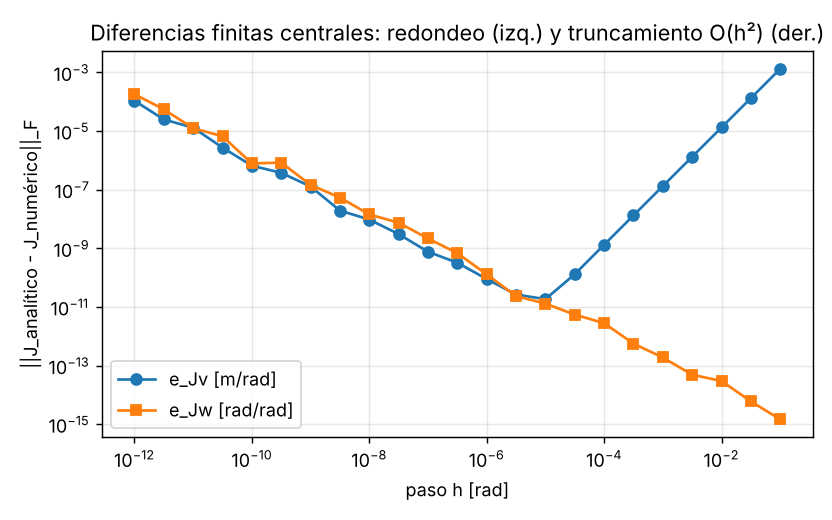
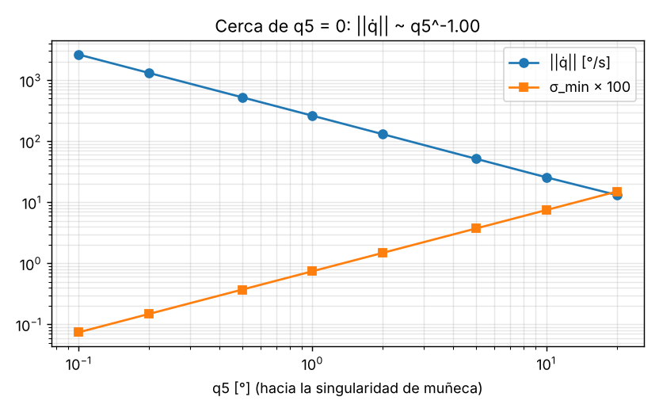

# Validación offline (S0) de FK, IK y Jacobiano

Generado: 2026-11-17T21:29:12 · commit sin_git · modelo vevas/robot_irb120.py sha256 2d5ce43a952b

Nivel de evidencia: S0 (modelo). Demuestra coherencia matemática interna y que la tabla D-H del grupo
coincide con la cadena del URDF de ROS-Industrial. No demuestra nada del robot real.

Condiciones de comparabilidad: base = base del robot ABB; punto comparado = tool0 (brida) en los dos modelos;
orden de juntas joint_1 ... joint_6; ángulos en rad; longitudes en m; signos +1 y offsets 0 (convención ABB).

## Cinemática directa

| Caso | e_p [m] | e_R [rad] | Resultado | Nota |
|---|---|---|---|---|
| FK-N1 | 9.732e-18 | 1.378e-16 | PASS | postura inicial segura |
| FK-N2 | 5.551e-17 | 1.845e-16 | PASS | postura con números feos |
| FK-L | 9.813e-18 | 2.755e-16 | PASS | todas las juntas a 5° o menos de su límite |
| FK-D-TCP | 1.200e-01 | 1.378e-16 | FAIL | MAL A PROPÓSITO: brida vs TCP de 120 mm -> error = 120 mm |
| FK-D-ORD | 3.166e-02 | 4.690e-01 | FAIL | MAL A PROPÓSITO: J4 y J6 intercambiadas |
| FK-MC5000 | 5.959e-16 |  | PASS | peor caso de 5000 (posición u orientación) |

Los dos casos FK-D salen FAIL a propósito: muestran que el protocolo detecta una comparación mal armada
(brida contra TCP, u orden de juntas cambiado). Con los marcos alineados el error es del orden de 1e-16.

## Cinemática inversa (todas las ramas)

| Caso | Ramas que existen | Ramas válidas | Rama elegida |
|---|---|---|---|
| IK-1 | 8 | 1 | 0 |
| IK-2 | 8 | 4 | 0 |
| IK-S | 8 | 0 | None |

Detalle por rama en casos_ik.csv. Dos ramas distintas pueden ser válidas para la misma pose: no se exige q_propia = q_ref.

## Jacobiano

Jacobiano geométrico contra diferencias finitas centrales con h = 1e-6: e_Jv = 8.93e-11 m/rad, e_Jw = 1.29e-10 rad/rad.
Mejor paso de la curva: h = 1e-05 con e_Jv = 1.84e-11. A la derecha domina el truncamiento O(h²), a la izquierda el redondeo.
Verificación de velocidad: ||J_v q̇ - dp/dt|| = 5.30e-11 m/s.

## Singularidad de muñeca

| q5 [°] | σ_min | condición | ||q̇|| [°/s] para girar 0.1 rad/s | rango |
|---|---|---|---|---|
| 20 | 0.1499 | 15.7 | 13.2 | 6 |
| 10 | 0.0747 | 31.8 | 25.7 | 6 |
| 5 | 0.0372 | 64.2 | 51.7 | 6 |
| 2 | 0.0149 | 161.4 | 130.5 | 6 |
| 1 | 0.0074 | 323.4 | 262.2 | 6 |
| 0.5 | 0.0037 | 647.4 | 525.6 | 6 |
| 0.2 | 0.0015 | 1619.3 | 1316.0 | 6 |
| 0.1 | 0.0007 | 3239.3 | 2633.4 | 6 |

Ajuste log-log: ||q̇|| crece como q5^-1.00 (esperado -1): al acercarse a q5 = 0 las juntas tendrían que girar cada vez más rápido.
Pérdida de rango no es torque infinito: τ_ext = Jᵀ F (estática) no es el torque del actuador M q̈ + C q̇ + g.

