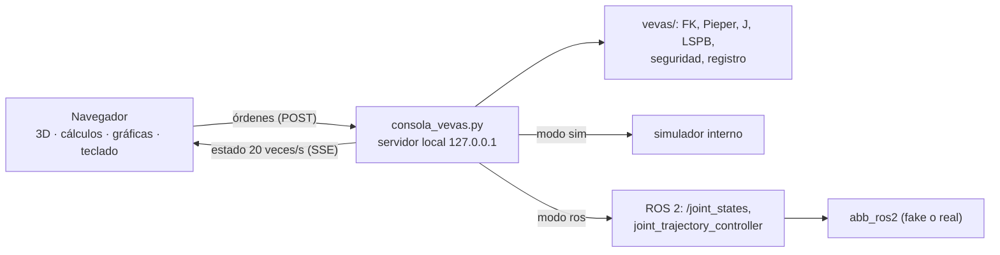

# Guía 5. La consola VEVAS: instalar, abrir y usar

Grupo VEVAS · Interfaz gráfica con cálculos y error en tiempo real

## 1. Qué es y cómo funciona por dentro

La consola es un programa de Python que corre en la PC y muestra todo en una página web local (`http://127.0.0.1:8000`). Python hace **todos** los cálculos (FK, Pieper, Jacobiano, LSPB, errores, seguridad) con nuestro propio código de `hito3_4_control_real/vevas_studio/vevas/`; la página solo los dibuja. No usa MoveIt ni ningún solucionador automático de IK (regla "anti caja negra" de la guía del PFI).



Tiene tres formas de correr:

| Modo | Comando | Para qué | Banda de arriba |
|---|---|---|---|
| Simulación interna | `--modo sim` | Ensayar en cualquier PC (incluso Windows), sin ROS | azul: SIMULACIÓN INTERNA |
| ROS con hardware simulado | `--modo ros` con el driver en `use_fake_hardware:=true` | Probar la cadena ROS completa sin robot | verde: HARDWARE SIMULADO |
| ROS con el robot real | `--modo ros` con el driver en `use_fake_hardware:=false` | Ver el robot real (solo lectura) o moverlo (`--real --go`) | amarilla: SOLO LECTURA / roja: ROBOT REAL |

La consola pregunta al `controller_manager` de ROS qué hardware está cargado y lo muestra en la banda. Si no lo puede identificar, lo trata como real y se queda en solo lectura: mejor pecar de prudente.

## 2. Instalar y abrir (5 minutos)

El repo del grupo va dentro del workspace de ROS, en `~/abb_ws/src/pfi-vevas-irb120`, y la consola en su carpeta `hito3_4_control_real/vevas_studio`:

```bash
cd ~/abb_ws/src
git clone https://github.com/FlorenciaFrigerio/pfi-vevas-irb120.git   # solo la primera vez
cd ~/abb_ws/src/pfi-vevas-irb120 && git pull                           # las veces siguientes
cd ~/abb_ws/src/pfi-vevas-irb120/hito3_4
```

Requisitos: Python 3 con numpy (viene con ROS 2 Jazzy). Para las gráficas de los informes, matplotlib:

```bash
sudo apt install -y python3-numpy python3-matplotlib python3-pytest
```

Comprobar que todo calcula bien (18 pruebas, tarda 10 s):

```bash
python3 -m pytest -q tests/
```

Abrir en simulación:

```bash
python3 consola_vevas.py --modo sim --abrir
```

Si el navegador no se abre solo, entrar a `http://127.0.0.1:8000`. Para salir: Ctrl+C en la terminal (el robot se detiene y se guarda el registro).

En Windows (solo modo simulación): instalar Python 3, `pip install numpy`, y `python consola_vevas.py --modo sim --abrir`.

## 3. Recorrido por la pantalla

### Arriba

- **Banda de color:** en qué modo está. Si dice ROBOT REAL, todo lo que se envíe mueve el robot.
- **Barra de pasos 1 a 7:** Pose → Pieper 8 ramas → Verificación FK → Mejor rama → LSPB → Envío → Error en vivo. Se va pintando de verde a medida que se cumple cada paso (rojo si falla). Es el flujo que pidió el docente.
- **ARMADO / DESARMADO:** el movimiento solo está habilitado si dice ARMADO.
- **Velocidad:** porcentaje de la velocidad de la hoja de datos. Con el robot real el máximo es 10 % (se cambia en `config.json`).
- **PARAR** (o barra espaciadora, o Esc): aborta, el robot se queda quieto y se desarma.

### Izquierda

- **Vista 3D.** Naranja: el robot según los ángulos **medidos**. Celeste transparente (fantasma): lo comandado, o la vista previa del plan antes de enviarlo (se ve el movimiento en bucle). Línea celeste punteada: el camino que va a hacer la punta. Línea amarilla: el camino que hizo la punta real. Plano rojo: altura mínima. Con F (o la casilla) se ven los marcos D-H numerados 0 a 6: sirve para explicar la tabla D-H en la presentación. Mouse: girar con clic izquierdo, mover con clic derecho, zoom con la rueda.
- **Tabla de juntas.** Medida, comandada, error (verde, ámbar o rojo) y una barra con la posición dentro del rango de la junta (las zonas rojas en los bordes son el margen de 5°).
- **Mover con el teclado.** Ver la sección 4.

### Derecha, pestañas

| Pestaña | Qué muestra | Para explicar |
|---|---|---|
| Objetivo | Formularios: pose del TCP, una sola junta, las 6 juntas. Resumen del plan y botón ENVIAR. Armado. | El punto de partida |
| Cálculo paso a paso | Cada cuenta con sus números: T_d, quitar la herramienta, centro de muñeca, q1, triángulo de q2 y q3, R_3^6 y la muñeca, verificación FK, selección, LSPB | Toda la teoría de la Unidad II con datos reales |
| Las 8 ramas | Tabla con las 8 soluciones, sus errores, límites, σ_min y por qué gana una. Pasando el mouse se ve cada rama en 3D | Por qué hay 8 soluciones y cómo se elige |
| Trayectoria LSPB | t_f, t_c, junta que manda, continuidad, y las gráficas de q(t), q̇(t), q̈(t) con el instante actual marcado | Perfil trapezoidal y sincronización |
| FK en vivo | Las 6 matrices A_i y T_0^6 calculadas con los ángulos medidos, actualizándose solas | La directa "en tiempo real" |
| Jacobiano | Valores singulares en barras, rango, condición, det J, indicadores de las 3 singularidades y la matriz J, en vivo | Singularidades |
| Secuencia demo | La trayectoria de demostración (la que generó la IA), con pausas para explicar | El video |
| Bitácora | Último movimiento (errores máximo y final) y todos los eventos | Evidencia |

La casilla **Explicaciones** muestra u oculta los textos de ayuda (dejarla marcada para exponer).

### Abajo a la derecha: error en tiempo real

Siempre visible. Dos gráficas de los últimos 20 segundos: error de cada junta (con las líneas rojas del límite) y e_p, e_R de la punta. Arriba, los números actuales, el semáforo y, mientras se mueve, una barra de progreso con el error máximo hasta ese momento.

## 4. Teclado (para exponer sin mouse)

| Tecla | Hace |
|---|---|
| Espacio o Esc | PARAR |
| Enter | Enviar el plan calculado (con el robot real pide confirmación) |
| M | Cambiar entre mover por juntas o en cartesiano |
| 1 a 6 | Elegir la junta que mueven las flechas |
| → o ↑ / ← o ↓ | Juntas: girar la junta elegida en sentido + / − |
| ↑ / ↓ | Cartesiano: la punta avanza / retrocede en X |
| ← / → | Cartesiano: la punta va a +Y / −Y |
| Re Pág / Av Pág (o W / S) | Cartesiano: sube / baja en Z |
| C | Continuar la secuencia |
| F | Marcos D-H |
| + / − | Velocidad |
| H | Ayuda |

**El robot se mueve solo mientras la tecla está apretada** (hombre muerto). Al soltarla, se detiene. Si el navegador pierde el foco (por ejemplo, alguien hace clic en otra ventana), también se detiene. Las flechas de la pantalla funcionan igual: mantener apretado.

En **cartesiano** la punta se mueve en línea recta manteniendo la orientación. En cada paso (50 por segundo) la consola resuelve Pieper con las 8 ramas y elige la más cercana a la postura actual: es la inversa "en tiempo real". Si para seguir en línea recta alguna junta tendría que girar a más de 45 °/s, se detiene y avisa: es que se está llegando a una singularidad. Es un buen momento para explicarlo en la presentación.

Velocidades del teclado: 5 °/s por junta y 20 mm/s en cartesiano (con el robot real, como máximo 5 °/s y 25 mm/s).

## 5. Uso típico: pedir una pose y mandarla

1. Pestaña Objetivo. Elegir una pose de ejemplo (por ejemplo "Izquierda, herramienta abajo") o escribir x, y, z, Rz, Ry, Rx.
2. Pulsar **Calcular cinemática inversa (Pieper)**. En menos de 10 ms aparece el plan: cuántas ramas existen, cuántas son válidas, cuál se eligió, el error de la verificación FK, t_f y la revisión de seguridad.
3. Ir a **Cálculo paso a paso** y **Las 8 ramas** para ver (y explicar) cada número. El fantasma muestra en 3D el movimiento que se va a hacer.
4. Armar (botón en la pestaña Objetivo).
5. **ENVIAR AL ROBOT** (o Enter).
6. Mirar el error en tiempo real. Al terminar, la pestaña Bitácora muestra el error máximo de seguimiento, el error final y e_p contra la pose pedida.

Si el robot se movió entre que se calculó y se envió (por ejemplo, con las flechas), la consola recalcula la trayectoria desde la postura actual antes de enviar.

## 6. Con ROS 2 y hardware simulado (antes del robot real)

Terminal 1, el driver en modo simulado (los nombres del paquete y del xacro son los de `abb_irb120_support`):

```bash
source /opt/ros/jazzy/setup.bash && source ~/abb_ws/install/setup.bash
ros2 launch abb_bringup abb_control.launch.py \
  description_package:=abb_irb120_support description_file:=<NOMBRE_DEL_XACRO>.xacro \
  moveit_config_package:=abb_irb1200_5_90_moveit_config launch_rviz:=false use_fake_hardware:=true
```

Terminal 2, la consola:

```bash
source /opt/ros/jazzy/setup.bash && source ~/abb_ws/install/setup.bash
cd ~/abb_ws/src/pfi-vevas-irb120/hito3_4 && python3 consola_vevas.py --modo ros --abrir
```

La banda debe decir **ROS 2 · HARDWARE SIMULADO**. Desde acá todo funciona igual que en simulación interna, pero las órdenes pasan por el `joint_trajectory_controller` de verdad. Si se abre RViz en otra terminal, se ve el mismo movimiento ahí.

## 7. Con el robot real

Ver la Guía 2 (conexión) y la Guía 6 (GO y video). Resumen:

```bash
python3 consola_vevas.py --modo ros                              # solo lectura
python3 consola_vevas.py --modo ros --real --go GO_VEVAS.json    # movimiento habilitado
```

Con `--real`, para armar se pide: el archivo GO del día completo, cuatro casillas (supervisor, paro de emergencia, área despejada, velocidad) y escribir la frase `MOVER ROBOT REAL`. La velocidad queda limitada al 10 % y cada envío pide confirmación.

## 8. Registros y análisis

Cada vez que se abre la consola se crea `hito3_4_control_real/vevas_studio/sesiones/<fecha>_<modo>/` con:

| Archivo | Contenido |
|---|---|
| `eventos.jsonl` | Cada evento con su hora: cálculos, planes, envíos, abortos, armado, jog |
| `muestras.csv` | q comandada, q medida, error por junta, e_p, e_R, posición del TCP, σ_min: cada 20 ms al moverse, cada 0.5 s en reposo |
| `planes/plan_NNN.json` | El cálculo completo de cada plan (8 ramas, pasos, LSPB) |
| `resumen.json` | Una línea por movimiento: error máximo, error final, e_p contra la pose pedida |

Para el informe con gráficas y diagnóstico:

```bash
python3 herramientas/analizar_sesion.py --ultima
```

(Guía 7.)

## 9. Problemas comunes

| Síntoma | Qué hacer |
|---|---|
| `Address already in use` | Ya hay una consola abierta. Cerrarla, o usar `--puerto 8001` |
| La página queda en "Conectando..." | La consola no está corriendo o se cerró: mirar la terminal |
| "Todavía no llega la posición del robot" | En modo ros: el driver no está corriendo o `/joint_states` no tiene `joint_1`...`joint_6` (`ros2 topic echo /joint_states --once`) |
| "No se pudo importar rclpy" | Falta `source /opt/ros/jazzy/setup.bash` |
| La acción `follow_joint_trajectory` no está disponible | El `joint_trajectory_controller` no está activo: `ros2 control list_controllers` |
| Aborta apenas se envía, por la interfaz | El navegador estaba en segundo plano: dejar la pestaña de la consola visible |
| El 3D se ve en negro | El navegador no tiene WebGL activado: usar Chrome o Firefox actualizados |
| Pantalla chica (1366×768) | Pantalla completa con F11 y zoom al 80–90 % (Ctrl −) |
