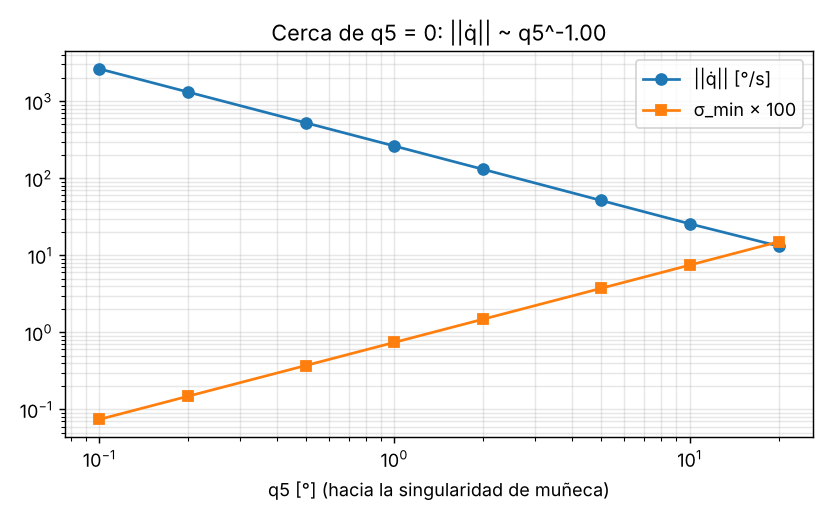

# Resultados

[Validación en simulación](../06_operacion/PRUEBA_SIM_FIGURAS.md) y [resultados de validación offline](../../vevas_studio/01_docs/datos/validacion_offline/resumen.md).

- [Figura C02 del informe IEEE](../01_informe/informe_ieee/img/fig_c02.pdf)
- [Registro del 24/11](../05_bitacora/CAMBIOS_24NOV.md)
