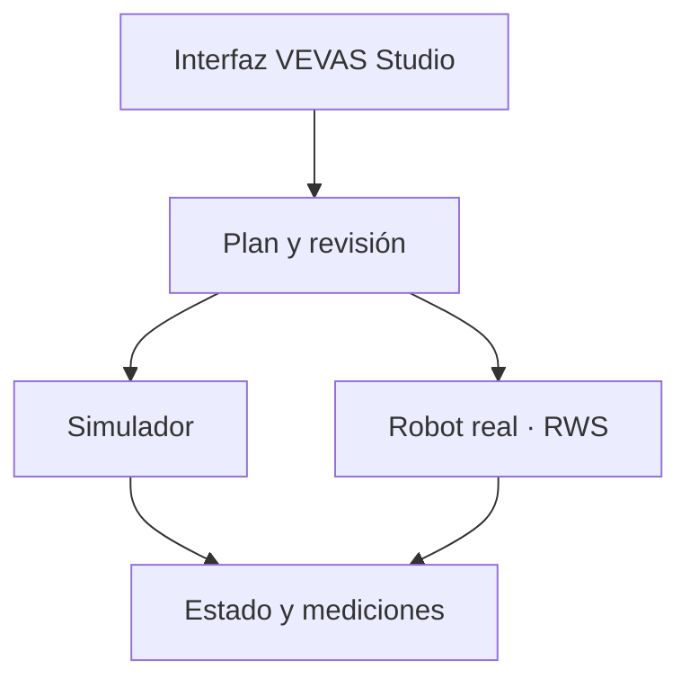

# Hitos 3 y 4 · Control del robot

**Consulta la defensa, ejecuta la simulación y revisa las evidencias del 24/11.**

[Abrir defensa](01_docs/02_presentacion/02_Defensa_Grupo_VEVAS.pdf) · [VEVAS Studio](vevas_studio/) · [Documentación](01_docs/)

## Material del hito

VEVAS Studio integra la simulación, la cinemática y la supervisión del ABB IRB 120 mediante RWS.

[1. Cómo ejecutar](COMO_EJECUTAR.md) · [2. Informe](01_docs/01_informe/01_Informe_Hito3_4.pdf) · [3. Índice de documentos](01_docs/INDICE.md)

La bitácora del 24 de noviembre registra la ejecución y los cambios de VEVAS Studio.

[Bitácora del 24/11](01_docs/05_bitacora/CAMBIOS_24NOV.md) · [Figura C02](01_docs/01_informe/informe_ieee/img/fig_c02.pdf)

Evidencia y documentación del 24/11

| Cambio | Documento |
| --- | --- |
| C02, streaming y comprobaciones registradas | [Bitácora del 24/11](01_docs/05_bitacora/CAMBIOS_24NOV.md) |
| Poses guardadas, figuras y medición de velocidad | [Guía completa](01_docs/03_guias/01_GUIA_COMPLETA_HITO3_4.md) |
| Diapositivas de defensa | [Presentación oficial](01_docs/02_presentacion/02_Defensa_Grupo_VEVAS.pdf) |
| Guía aportada del 24/11 | [Guía en Markdown](01_docs/03_guias/02_Guia_aportada_24NOV.md) |
| Arquitectura y figuras de validación | [Informe IEEE](01_docs/01_informe/informe_ieee/informe_hito3_4_ieee.pdf) |
| Validación reproducible y gráficas offline | [Resultados](01_docs/04_resultados/README.md) |
| Problemas de conexión y ejecución | [Solución de problemas](01_docs/07_solucion_de_problemas/README.md) |

