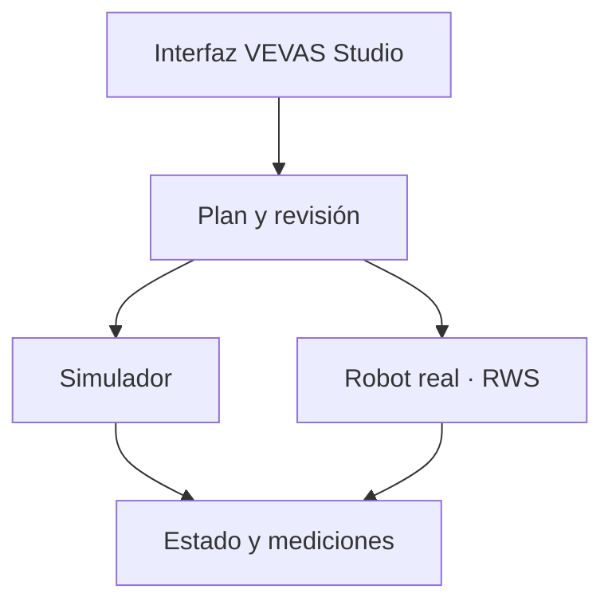

# Hitos 3 y 4 · Control del robot

VEVAS Studio integra la simulación, la cinemática y la supervisión del ABB IRB 120 mediante RWS.

[Cómo ejecutar](COMO_EJECUTAR.md) · [Informe](docs/informe/Informe_Hito3_4.pdf) · [Índice de documentos](docs/INDICE.md)

La bitácora del 24 de noviembre registra la ejecución y los cambios de VEVAS Studio.

[Bitácora del 24/11](docs/bitacora/CAMBIOS_24NOV.md) · [Figura C02](docs/informe/informe_ieee/img/fig_c02.pdf)

Evidencia y documentación del 24/11

| Cambio | Documento |
| --- | --- |
| C02, streaming y comprobaciones registradas | [Bitácora del 24/11](docs/bitacora/CAMBIOS_24NOV.md) |
| Poses guardadas, figuras y medición de velocidad | [Guía completa](docs/guias/GUIA_COMPLETA_HITO3_4.md) |
| Arquitectura y figuras de validación | [Informe IEEE](docs/informe/informe_ieee/informe_hito3_4_ieee.pdf) |
| Validación reproducible y gráficas offline | [Resultados](docs/resultados/README.md) |
| Problemas de conexión y ejecución | [Solución de problemas](docs/solucion_de_problemas/README.md) |

